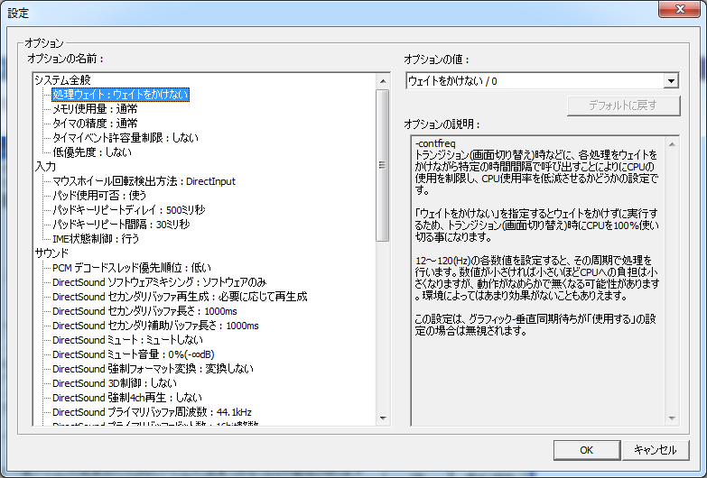

# 吉里吉里設定

## 吉里吉里設定について

「吉里吉里設定」は、吉里吉里のオプションを GUI で設定できるツールです。

エンドユーザ ( ２次ユーザ ) が自分自身である程度トラブルシューティングやパフォーマンスの調整をできるようにするためにあります。

エンジン設定は、吉里吉里実行可能ファイル本体に -userconf を加えて起動します。ゲームは起動せず、設定画面がブラウザ ( Edge / Chrome のアドレスバーの無いウィンドウ。使えなければ既定のブラウザ ) で開きます。Windows ネイティブ ( WINVER ) 版と SDL 版で同じ画面です。

- 左の一覧から項目を選び、右で値を選びます。項目の説明と初期値も右に出ます
- 「保存して閉じる」で設定ファイル ( .cfu ) に保存して終了します。「保存しないで閉じる」か、ウィンドウを閉じると保存せずに終了します
- 保存されるのは、画面で変えた項目と、前から .cfu にあった項目だけです。変えていない項目は書かないので、ゲームに付属の .cf の設定がそのまま効きます
- 設定画面は、ゲームの実行ファイル自身が手元 ( 127.0.0.1 ) で動かしているサーバが配っています。外部からは接続できず、インターネットへの接続も要りません

オプションの名前や設定可能な値やオプションの説明は、吉里吉里本体に内蔵されている情報を使います。説明の言語は OS の言語設定 ( ja / en / chs / cht ) に追従し、起動オプション [-language](CommandLine.md) で明示指定することもできます。

## 設定ファイルについて

吉里吉里の設定ファイルは２種類あります。吉里吉里の実行可能ファイルと同じ場所に配置され、実行可能ファイルの名前の拡張子を**cf**に変えた物と、

の -datapath で指定されたデータ保存場所に配置された、実行可能ファイルの名前の拡張子を**cfu**に変えた物の二つです。

cfuはエンドユーザ向けの「エンジン設定 (-userconf)」が生成します。

Releaserで設定を行った場合は .cf ファイルが作成されますが、このファイルは吉里吉里本体とともに配布しなければ、設定したオプションが反映されないので注意してください。

これらのファイルは、もし存在しなければ、エンジン設定を起動し、「保存して閉じる」を押した際に作成されます。

> **Note:**
> 設定ファイルの中は、一行ずつ、「名前="値"」の記述が並んでいます。"値"の部分は \xNN が連続している形になっており、それぞれが UNICODE におけるコードポイントの値となっています。たとえば opt="\x61\x62\x63\x3042\x3044\x3046" と記述してある場合は、これは「abcあいう」を表します。他のアプリケーションなどからこれらのファイルに書き込む際は注意してください。
>
> なお、opt="abcあいう" のように \xNN 形式を使わずに記述した場合、吉里吉里本体はこれを正しく認識することができますが、エンジン設定はこの形式を認識することができずに、想定した動作をしない可能性があります。値の両側のダブルクオーテーションも必須です。

## エンジン設定の画面

エンジン設定画面は以下のようになります。

- **「オプションの名前」**  
  設定できるオプションが一覧表示されています。
  
  も参照してください。
- **「オプションの値」**  
  「オプションの名前」で選んだオプションに対して設定できるオプションの値が一覧表示されます。
  
  選択してください。
- **「オプションの説明」**  
  「オプションの名前」で選んだオプションに対する説明が表示されます。
