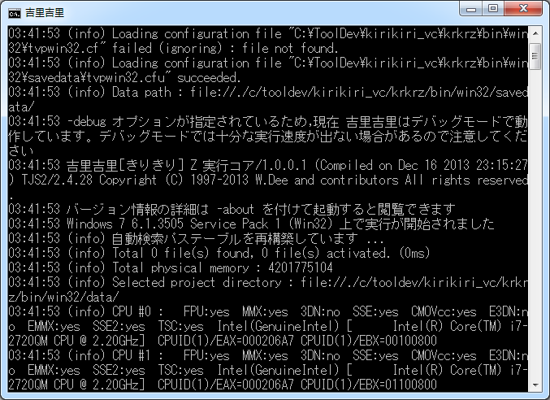

# Console

The current Kirikiri Z has no separate console window.
When launched from the command line, log messages are output **to that
terminal (command line)**, and you can start a REPL as needed to evaluate
TJS expressions interactively.

## Message Display

When launched from the command line, the debug messages output by the
Kirikiri system and by user scripts through [Debug.message](../reference/Debug.md#message)
and similar methods appear in the terminal you launched from. You can adjust
the display level with `-loglevel=` in the [command-line options](CommandLine.md).

The Win32 build is built as a windowed subsystem application, so when you
launch it from `cmd.exe`, PowerShell, etc., it uses the parent process's
console as is. The SDL build is a console subsystem application, so messages
are always visible in the terminal.



## Interactive Shell ( REPL ) { #repl }

If you launch a binary built with `KRKRZ_REPL=ON` with the command-line
argument `-repl` ( or `-repl=yes` ), an interactive TJS shell ( REPL ) is
available. Windows / macOS / Linux are supported.

```
krkrz -repl data/        # SDL 版
krkrz64 -repl data/      # Win32 版
```

Without `-repl`, the REPL does not start ( there is no automatic TTY detection ).
To disable it explicitly, specify `-repl=no` / `-repl=off` / `-repl=false` /
`-repl=0`.

When the REPL starts, the Win32 ( windowed subsystem ) build obtains the parent
process's console with `AttachConsole`, or allocates a new one with
`AllocConsole` if there is none.

#### Forcing a New Console ( `-repl=new` )

With `-repl=new` ( aliases `-repl=window` / `-repl=separate` ), the engine does
not attach to the parent's or an inherited console and always opens a
**new console window**. Use this when you launch the GUI from a terminal or
another application but do not want the REPL to take over the console you
launched from.

!!! note "It does not appear in Windows Terminal"
    This exe uses the GUI ( windowed ) subsystem, so the console it allocates
    at runtime is always the classic conhost, regardless of the "default
    terminal application" setting or launching via `wt.exe` ( GUI applications
    cannot join a terminal's pseudo console ).

## Browser REPL Viewer ( `-replweb` ) { #replweb }

With `-replweb=<port>` ( e.g. `-replweb=8899` ), a lightweight HTTP + SSE server
starts on `127.0.0.1:<port>`, and you can **operate the REPL and debug windows
from a browser** ( on by default in builds with `KRKRZ_REPL_WEB=ON` ).

```
krkrz64 data/ -replweb=8899      # → http://127.0.0.1:8899/ を開く
```

The advantage is that it is free of the console ( conhost ) limitations:
**text selection, copy, paste, scrolling, and search all work natively in the
browser**. Multiple browsers ( tabs ) can connect at the same time and see the
same log.

### Layout

Tabs and the controller are lined up at the top.

| Tab | Contents |
|---|---|
| **Console** | Log on top, input at the bottom. The log is color-coded by level and can be filtered and cleared. The input field evaluates expressions and statements, `↑↓` browses the history, and special commands such as `.help` are available |
| **Watch** | **Watch expressions**. Registered expressions are listed with their values and updated automatically at a set interval. You can add, remove, and edit them inline by double-clicking |
| **Pad** | **Script editor**. Write multi-line TJS and run it all with `Ctrl+Enter`. You can also load from and save to storage ( saving requires `-replwebpad` below ) |

The **controller** at the top right corresponds to the Kirikiri 2 controller window.

- **Events** … Shows and toggles [System.eventDisabled](../reference/System.md).
  The display follows changes made by the game
- **Exit** … Exits the application

These revive the debug windows built into the Kirikiri 2 engine ( console /
controller / watch expressions / script editor ) in a platform-independent form.

### Display Language

**By default, it follows the engine's language setting** ( `-language=` and the
OS language are reflected, so it uses the same language as engine messages ).
You can switch it on the spot with the language selector at the top, and the
choice is remembered in that browser. Japanese and English are supported; for
other language settings, it falls back to English the same way the engine does.

### Browser and Application Lifetime

**Closing the browser also exits the application** ( after 5 seconds by
default; disable with `-replwebidle=no` ). This prevents the engine from
lingering on its own in setups that use the browser as the UI.
**It does not exit until the first connection arrives**, so agent-driven
setups that never open a browser, or setups that use `-replweb` purely as an
API surface, are not affected.

Conversely, **when the application exits, the browser page closes
automatically** ( regular tabs that cannot be closed switch to an "exited"
display ).

### Options

| Option | Contents |
|---|---|
| `-replweb=[host:]port` | Listen address. The default bind is **127.0.0.1** ( local only ). `0.0.0.0:8899` listens on all interfaces ( browsers on other machines can connect; this exposes it to the network, so use only in trusted environments ). `no` / `0` / `off` / `false` disables it |
| `-replwebopen=app\|tab\|no` | Automatically open a browser. By default, it opens in app mode only when "loopback and no console ( launched as a GUI )". **It does not open when launched from a terminal**, so use `-replwebopen=app` if you want it to |
| `-replwebidle=<seconds>` | Seconds from when no browser is connected until exit ( default 5; `no` disables ) |
| `-replwebpad=<dir>` | Storage path prefix for which **[Save] is allowed** in the Pad tab. Writing is prohibited by default |
| `-replwatchfile=<path>` | Where the watch expression list is saved ( default `.krkrz_watch` in the current directory; `no` disables ) |

For details, see [Command-Line Options](CommandLine.md).

- The implementation supports both WIN32 ( Winsock ) and POSIX sockets ( the
  server mechanism is platform-independent; in environments that require
  initializing the OS socket library, do that first ).
- It is independent of `-repl` ( console ) / `-replfile` / `-replsocket` and can
  run at the same time.
- You can get the current URL from TJS with [`System.replWebURL`](../reference/System.md)
  ( an empty string if not running ).
- Scripts and plugins can add their own endpoints
  ( [WebServer](../reference/WebServer.md) class ). For the list of HTTP APIs
  and how to call them from outside a browser ( curl ), see
  [REPL ( interactive TJS shell )](../topics/core/repl.md).

## Input and Result Display ( Common )

The following is the same for all front ends: console, browser, and `-replfile`.

### Input

The prompt is `krkrz>`. It changes to `...` during continuation input.
Type a TJS expression or statement and press Enter to evaluate it and show the
result ( expressions without a trailing `;` are also evaluated ). If brackets or
quotes are not closed, it enters continuation mode, allowing multi-line input.
In the console REPL, the input history is saved to `.krkrz_history` in the
current directory ( the browser history exists only within the page and can be
browsed with `↑↓` ).

Lines starting with `.` are **special commands** ( `exit` / `quit` / `Ctrl+D`
leave the REPL and also exit the application; `.help` lists them ). There is a
full set, including memory inspection, screen capture, and watch expressions,
and **the same commands work in all three: console, `-replfile`, and
`-replweb`**. The list is in [REPL ( interactive TJS shell )](../topics/core/repl.md)
( it is not repeated here so that only one copy needs to be kept up to date ).

### Result Display

Evaluation results are formatted the same way as [Debug.prettyPrint](../reference/Debug.md#prettyprint).

- `void` → `(void)`, null object → `(null)`
- Numbers / strings / octet strings → shown as is in expression notation
- Arrays → `[ e1, e2, ... ]` ( `[e1, e2, ...]` in compact mode )
- Dictionaries → `%[ "key" => value, ... ]`
- Functions / classes / properties → `(function)` / `(class)` / `(property)`
- Other objects → `(object: 0x...)`
- When the expansion depth is reached → `[...]` / `%[...]`
- Circular references → `(recursion)`

While the REPL is running, the logs output by the engine are color-coded by
level ( `VERBOSE`=gray, `DEBUG`=cyan, `INFO`=default, `WARNING`=yellow,
`ERROR`=red, `CRITICAL`=bold red ) and shown above the prompt line as they arrive.
