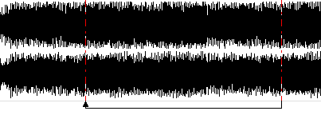
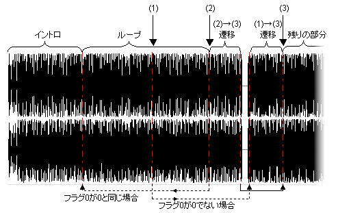

# Loop Tuner

## About the loop tuner

The loop tuner (`krkrloop`) is a tool for creating and previewing, while viewing the waveform, the following information for sound files (WAV / Ogg Vorbis / Ogg Opus):

- **Links**, which set up seamless loops or perform conditional jumps (changes of the playback position)
- **Labels**, which fire events in Kirikiri when playback reaches a specific position

It succeeds the Kirikiri 2 loop tuner (krkrlt.exe) and is one of the [standard tools](Tools.md).

The generated information is saved to a file named after the sound file with .sli appended (for example, bgm01.ogg.sli for bgm01.ogg), and it is loaded automatically when the sound file is opened with the [WaveSoundBuffer class](../reference/WaveSoundBuffer.md).

The loop tuner's preview uses a port of the Kirikiri engine's loop processing (WaveLoopManager). How links are followed, how conditions are evaluated, the crossfade of smooth links, and label expressions are all the same as in the engine, and links are followed at exactly the same positions as the engine, down to the sample.

## What is a seamless loop?

You can loop playback without the loop tuner by using the [WaveSoundBuffer.looping](../reference/WaveSoundBuffer.md#looping) property. However, this only allows a simple loop: play from the beginning of the sound to the end, then go back to the beginning, and so on.

With the loop tuner, you can set up a loop that plays up to any point in the sound and then returns to any other point, as in the figure below. This is useful for looping a piece that starts with an anacrusis (pickup), or when the sound cannot simply repeat from its beginning, such as an engine starting up followed by a looping engine sound.



In this case, unless the timing of the repeat is adjusted precisely, crackling noise such as clicks and pops occurs at the loop point. The loop tuner has features that help fine-tune this timing, such as zooming down to individual samples and snapping to zero crossings, so you can adjust it easily and achieve a seamless loop.

In rare cases the noise cannot be removed however much you adjust. Making the link **smooth** (スムーズ) applies a very short (50 ms) crossfade right around the link to reduce the noise. The crossfade mixes the sound from 25 ms before the link source up to the link source with the sound from 25 ms before to 25 ms after the link destination (it is shorter near the beginning or end of the sound).

## Conditional links

Conditional links are useful when, for example, "a piece is looping, but when a certain condition is met, playback should leave the loop and move on to the next melody."

The loop tuner calls the information that changes the playback position a "link", and you can attach a condition to a link.

Kirikiri manages 16 "flags" (numbered 0 to 15), each holding a value from 0 to 9999. For any link, you can set it to be followed when a "condition" such as "flag N equals X", "flag N does not equal X", or "flag N is X or less" is met.

There are six kinds of condition (the notation in .sli files is shown in parentheses).

| Condition | Meaning |
|---|---|
| = (`eq`) | When the flag equals the value |
| ≠ (`ne`) | When the flag does not equal the value |
| > (`gt`) | When the flag is greater than the value |
| ≥ (`ge`) | When the flag is greater than or equal to the value |
| < (`lt`) | When the flag is less than the value |
| ≤ (`le`) | When the flag is less than or equal to the value |

The comparison value can be 0 to 9999, but unless you have a special purpose, it is best to use 0 or 1.

You can change flag values in the loop tuner for testing, and you can also manipulate them from scripts with the [WaveSoundBuffer.flags property](../reference/WaveSoundBuffer.md#flags).

> **Note:**
> When an unconditional link and one or more conditional links have their sources at the same position, the conditions of the conditional links are tested first, and if none of them is met, the unconditional link is followed.
>
> If there are multiple unconditional links, which one is used is undefined.
>
> If there are multiple conditional links, they are not tested in the order they were added. Avoid combinations in which multiple conditions can be true at the same time.
>
> "The same position" here means exactly the same position. Positions that differ by even one sample are not considered the same.

## Labels

You can set "labels" for purposes such as "firing an event when the playback position reaches a specific point."

When playback passes a label, the [WaveSoundBuffer.onLabel](../reference/WaveSoundBuffer.md#onlabel) event fires. The label name is passed as the event parameter, so you can tell which label was passed. The list of labels and their positions is also available through the [WaveSoundBuffer.labels](../reference/WaveSoundBuffer.md#labels) property.

In addition, by giving a label a special "**expression**", you can increment, decrement, or set flag values when the label is passed (see "Label expressions" below).

Combined with the conditional links above, this lets you, for example, play a specific section only four times.

> **Note:**
> Label names cannot contain ' (single quote).

## Label expressions

By giving a label a specially formatted "expression", you can have it perform special processing on flags when the label is passed.

To write an expression in a label, the label name must start with ':' (colon).

An expression consists of the target flag, an "**operator**" indicating what to do to the target, and an "**operand**" serving as the operator's parameter, in that order (some operators have no operand).

The target flag is specified by enclosing the flag number (0 to 15) in '[' ']' (square brackets). For the operand, write a number as is; to specify another flag, enclose its flag number (0 to 15) in '[' ']'.

The following operators are available.

- **=**  
  Assigns the operand's value to the flag
- **+=**  
  Adds the operand's value to the flag
- **-=**  
  Subtracts the operand's value from the flag
- **++**  
  Increments the flag by one (no operand)
- **--**  
  Decrements the flag by one (no operand)

In every case, flag values are kept within 0 to 9999. Values below 0 are corrected to 0, and values above 9999 to 9999.

Examples:

| Expression | Meaning |
|---|---|
| `:[0]=1` | Assigns 1 to flag 0 |
| `:[1]=[0]` | Assigns the value of flag 0 to flag 1 |
| `:[1]+=3` | Adds 3 to flag 1 |
| `:[0]++` | Increments flag 0 by one |

Spaces may be placed between symbols. A malformed expression (a flag number of 16 or more, `=` and the like without an operand, and so on) does nothing in the engine (the onLabel event still fires). The loop tuner's label editing dialog indicates whether the name being entered is a valid expression.

> **Note:**
> When multiple labels are at the same position, the order in which they are executed is undefined.

## Links, labels, and buffering

Kirikiri's WaveSoundBuffer always buffers sound. After decoding (reading from the file and decompressing compressed audio files), it does not play the result immediately but first stores it in memory called a buffer, then plays it.

In other words, decoding always runs ahead of the actual playback position.

Link conditions are tested at decode time, so when you change a flag, the effect actually takes hold only after the length of the buffer. This means that changing a condition during playback just before a link may not affect that link, so be careful. Change conditions well ahead of the link.

As for labels, a label's event fires when the actual "playback position" reaches it, whereas the label's "expression" is executed when the "decode position" reaches it. Keep this in mind.

> **Note:**
> The loop tuner's preview decodes almost exactly at the playback position, so this delay hardly exists there. If the timing of flag changes is tight, verify it in Kirikiri itself.

## Supported formats

The loop tuner can handle sound files in the following formats.

- WAV (integer PCM 8 / 16 / 24 / 32-bit, floating point 32 / 64-bit; WAVE_FORMAT_EXTENSIBLE is also supported)
- Ogg Vorbis
- Ogg Opus

All positions are handled **in samples** (the number of samples per channel).

> **Note:**
> Ogg Opus is always played at 48 kHz, so .sli positions are also in 48 kHz samples. When converting WAV or Ogg Vorbis to Opus, the [audio format converter](AudioConverter.md) converts the .sli positions and writes the .sli along with the sound.
>
> The engine always applies the Opus header gain, so the loop tuner also displays and previews the waveform at the volume with the header gain applied.

MS-ADPCM WAV files, which the Kirikiri 2 loop tuner could handle, are not supported.

## Launching

```
krkrloop                    画面を開く
krkrloop <音声ファイル>      画面を開き、そのファイルを開く
```

The GUI opens in a browser window (see [Standard Tools](Tools.md) for launching and other common points). When you choose a sound file with «開く…» (Open...) (Ctrl+O), a «soundfile.sli» in the same folder, if present, is loaded along with it.

If the .sli is in a format the engine cannot read, a message saying so appears at the bottom of the screen, and the file opens with no links or labels (saving in this state overwrites that .sli).

## Screen

The screen consists of a toolbar at the top, the waveform view on the left, lists of links, labels, and flags on the right, and a status bar at the bottom.

- **Overview**  
  The thin strip above the waveform view shows a reduced waveform of the whole sound. Link sources and label positions are shown as vertical lines, and the range currently shown in the waveform view is shown as a frame. Click or drag to show that area in the waveform view.
- **Waveform view**  
  From top to bottom, it shows the time scale, labels, the waveform (per channel), and links.
  
  - Labels are shown as an inverted triangle mark with their name. Labels starting with ':' (those with expressions) are shown in a different color
  - Links are shown as arrows at the bottom. An arrow means that when the playback position reaches the arrow's tail (the link source, From), it moves to the arrow's head (the link destination, To). On the waveform, link sources are shown as solid vertical lines and link destinations as dotted vertical lines
  - Conditional links are shown in a different color, with the condition attached, such as `[0]=1`. Smooth links are marked with `~`
  - Clicking the waveform shows a vertical bar (the caret) at that position. Dragging on the waveform selects a range
  - During playback, the playback position is shown as a red vertical line
- **Link and label lists**  
  The right side shows the lists of links and labels, each in order of position. Click an item to select it and show its position. Double-click to open its editing dialog.
- **Flags**  
  The lower right shows the values of the 16 flags (described below).
- **Status bar**  
  Shows the caret position, the selection, the playback position, the zoom level, and messages such as the results of operations. Positions are shown as "minutes:seconds (sample position)".

### Zooming and scrolling

- The mouse wheel scrolls left and right
- Ctrl+wheel zooms in and out around the mouse position
- The toolbar's «＋» «－» (keys + / -) zoom in and out, and «全体» (Whole) (key 0) shows the whole sound. When zooming with the keys, the caret position is the center
- You can zoom in until one sample is 64 pixels wide. When zoomed in far enough, the waveform is drawn as individual sample points

### Adding and editing links and labels

- **Add a link** (toolbar «リンク追加» (Add link), «＋» on the list, key L)  
  Opens the link editing dialog. If a range is selected, it is prefilled with the end of the selection as the link source and the start as the link destination (a setting that loops the selected range).
- **Add a label** (toolbar «ラベル追加» (Add label), «＋» on the list, key B)  
  Adds a label at the caret position. The label editing dialog opens; enter a name.
- **Edit** (double-click a link or label in a list or on the waveform, or select it and press Enter)  
  In the link editing dialog, you can edit the link source (From) and destination (To) positions (in samples), whether the link is smooth, and the condition ("no condition" or one of the six conditions, the flag number, and the value). In the label editing dialog, you can edit the position and name.
- **Move**  
  In the waveform view, label marks and both ends of link arrows can be dragged with the mouse to adjust their positions.
- **Snap to zero crossings**  
  When the toolbar's «ゼロクロス» (Zero crossing) is checked (the default), a dragged position snaps to a nearby «point where the waveform crosses 0» (a zero-crossing point). For stereo and other multichannel sound, the sum of all channels is used. This helps reduce noise at the seam. Uncheck it when you want to adjust precisely, sample by sample.
- **Delete** (toolbar «削除» (Delete), key Delete)  
  Deletes the selected link or label.
- **Undo / Redo** (toolbar «↶» «↷», Ctrl+Z / Ctrl+Y)  
  Undoes or redoes changes to links and labels.

The link editing dialog does not accept the following.

- Positions outside the range of the sound (0 to the total number of samples)
- Flag numbers other than 0 to 15, or values other than 0 to 9999
- A link with no condition whose source and destination are the same (playback could never proceed past it)

### Flags

The flags section on the right has 16 fields, representing flags [0] to [15]. Changing a value (0 to 9999) takes effect in the preview immediately. Flags with values other than 0 have a differently colored frame.

When playback passes a label starting with ':', the flags change according to its expression and the display is updated. «0 に戻す» (Reset to 0) sets all flags to 0.

> **Note:**
> In the engine, all flags are reset to 0 by WaveSoundBuffer.open, but in the loop tuner, starting playback does not reset the flags. To test from the start, press «0 に戻す» (Reset to 0).

### Preview

- **▶ 再生 (Play) / ■ 停止 (Stop)** (Space)  
  Plays from the caret position. Press it during playback to stop.
- **先頭から (From start)** (Home)  
  Plays from the beginning of the sound.
- **Double-click the waveform**  
  Plays from that position. During playback, clicking the time scale moves the playback position there.
- **リンク試聴 (Preview link)** (P)  
  Plays 4 seconds starting 2 seconds before the source of the selected link. Use it to check the seam.
- **追従 (Follow)**  
  When checked (the default), the view scrolls to follow the playback position during playback.
- **末尾で先頭へ (Wrap at end)**  
  When checked, playback returns to the beginning after reaching the end and continues (the behavior when [WaveSoundBuffer.looping](../reference/WaveSoundBuffer.md#looping) is true). When unchecked, playback ends at the end.
- **リンク無視 (Ignore links)**  
  When checked, all links are ignored during playback. Links are not followed even when the playback position reaches a link source.

During playback, when a link is followed or a label is passed, the status bar shows what happened.

Playback reflects changes to links and flags immediately. Links are followed the same way as in the engine, and conditions, the priority among links with the same source, the crossfade of smooth links, and label expressions are all reproduced as is.

### Saving

«保存» (Save) (Ctrl+S) saves the links and labels to «soundfile.sli». When there are unsaved changes, the button reads «保存 *». If you try to open another file or close the screen with unsaved changes, a confirmation appears.

When saving, the tool first confirms that the written content can be read back under the same rules as the engine, then writes it. If link or label positions lie outside the range of the sound, or similar, the file is saved and the problem is shown as a warning in the status bar.

### WAV export

«WAV 書き出し…» (Export WAV...) (Ctrl+E) exports the sound to a WAV file. Choose one of the following as the content.

- **選択範囲をそのまま / 全体をそのまま (Selection as is / Whole as is)**  
  Exports the selected range as is if a range is selected, or the whole sound otherwise.
- **リンクをたどって再生した音 (ループを展開) (Sound as played following links (unrolled loop))**  
  From the start position (the caret or the beginning), exports the sound obtained by following links under the same rules as playback with the current flag values (conditions, smooth links, label expressions), for the specified number of seconds (up to 3600 seconds). You can also specify «末尾で先頭へ戻る» (Wrap at end). This is useful, for example, for checking the seam in another waveform editor. If playback gets stuck in a chain of links and can no longer proceed, the export stops there.

Choose the bit depth from 16-bit / 24-bit / 32-bit float. The default output is «name_range.wav», «name_out.wav», or «name_loop.wav» in the same folder as the sound file. Existing files are not overwritten unless «上書きする» (Overwrite) is checked.

### Keyboard shortcuts

| Key | Action |
|---|---|
| Ctrl+O | Open a sound file |
| Ctrl+S | Save the .sli |
| Ctrl+E | Export WAV |
| Ctrl+Z | Undo |
| Ctrl+Y / Ctrl+Shift+Z | Redo |
| Space | Play from caret / stop |
| Home | Play from the beginning |
| P | Preview the selected link |
| L | Add a link |
| B | Add a label at the caret position |
| Enter | Edit the selected link / label |
| Delete / Backspace | Delete the selected link / label |
| + / - | Zoom in / out around the caret |
| 0 | Show the whole sound |
| ← / → | Move the caret by one pixel (at least one sample). With Shift, one sample at a time |
| Ctrl+wheel | Zoom in / out around the mouse position |
| Wheel | Scroll |

## Using the command line

With `--cli`, you can display and check the contents of .sli files without opening the GUI.

```
krkrloop --cli info  <音声ファイル>...     長さと .sli の内容を表示
krkrloop --cli check <音声ファイル>...     .sli を本体が読めて、位置が音声の範囲内か調べる
```

`info` shows the length and the .sli contents; `check` checks that the engine can read the .sli and that the positions are within the range of the sound. With `--json`, the results are output as JSON.

Example `info` output:

```
> krkrloop --cli info bgm.wav
bgm.wav: 44100 Hz 132300 サンプル (3.000 秒)
    Link  110250 → 44100 Smooth
    Link  88200 → 132300 [0] eq 1
    Label 44100 «loopstart»
    Label 100000 «:[0]++»
```

`check` reports the following problems.

- The engine cannot read the .sli (format error)
- A link source, link destination, or label position lies outside the range of the sound (0 to the total number of samples)
- A conditional link's flag number is outside 0 to 15
- There is a link with no condition whose source and destination are the same

```
> krkrloop --cli check bgm/bgm01.ogg bgm/bgm02.opus
bgm/bgm01.ogg: 44100 Hz 132300 サンプル (3.000 秒)
    問題なし
bgm/bgm02.opus: 48000 Hz 144000 サンプル (3.000 秒)  .sli なし
    問題なし
```

Sound files without a .sli are shown as «.sli なし» (no .sli) and treated as having no problems.

Exit codes:

| Code | Meaning |
|---|---|
| 0 | Success (for `check`, no problems) |
| 1 | `check` found problems |
| 2 | Failure (a sound file could not be read, and so on) |

It is also useful for confirming that .sli positions have not shifted after re-converting a sound to another format.

## .sli file format

A .sli file is a text file (UTF-8). The loop tuner writes the following format.

```
#2.00
# Sound Loop Information (utf-8)
# Generated by krkrz_tools
Link { From=110250;           To=44100;            Smooth=True;  Condition=no; RefValue=0;          CondVar=0;  }
Link { From=88200;            To=132300;           Smooth=False; Condition=eq; RefValue=1;          CondVar=0;  }
Label { Position=44100;            Name='loopstart';                                 }
Label { Position=100000;           Name=':[0]++';                                    }
```

- The first line is `#2.00`; lines starting with `#` are comments
- In `Link`, `From` / `To` are the link source and destination positions (in samples), `Smooth` is whether the link is smooth (`True` / `False`), `Condition` is the condition (`no` / `eq` / `ne` / `gt` / `ge` / `lt` / `le`), `CondVar` is the number of the flag to compare, and `RefValue` is the value to compare against
- In `Label`, `Position` is the label position (in samples) and `Name` is the label name
- Key names are case-insensitive

A file that does not start with `#` is treated as the old format, and a single link from «LoopStart + LoopLength» to «LoopStart» is created from `LoopStart=n` and `LoopLength=n`.

## Hints and tips

- **Adjusting links**  
  At a PCM seam created by a link, poor adjustment causes crackling noise. Smooth links can reduce this noise, but we recommend adjusting without smoothing first.
  
  For music produced electronically, such as with a sound module and a sequencer, you can usually find a point where the waveform before and after the link nearly matches. Adjust by zooming in on the link source and destination alternately to compare them, and by repeating «リンク試聴» (Preview link). Exporting WAV with «ループを展開» (unrolled loop) also lets you check the seam in another waveform editor.
  
  Even if some noise is unavoidable, the following points help make it less noticeable.
  
  - Noise is less noticeable if the seam is placed just before a snare or cymbal hit. Just before high-pitched sounds or plosive sounds also works well
  - Noise is less noticeable if the seam is placed at a zero-crossing point
- **Lossy compression and loop positions**  
  Converting to Ogg Vorbis or Ogg Opus slightly alters the waveform. We recommend checking loop positions by opening the file in the format you will actually use.
- **Controlling song progression with conditional links**  
  By combining conditional links with flag manipulation, you can control song progression to reflect the progress and scene of a game: for example, start with an intro, loop, and then, under some condition as the game progresses, leave the loop and enter a different one.
  
  Of course, links only take effect at the positions specified in advance in the loop tuner. Changing a link's condition does not change the playback position until playback reaches the link's position.
  
  If being unable to leave the loop until its end is reached is a problem, for example because the loop is long, you need to structure the piece so that the loop can be left partway through.
  
  For example, do it as in the figure below.
  
  
  
  When playback starts, flag 0 is 0. The "intro" plays, and then the "loop" section plays repeatedly.
  
  Now, when the game progresses and flag 0 becomes 1, playback leaves this "loop" at point (1) or (2).
  
  If it leaves the loop at (1), it plays through the "(1)→(3) transition" up to (3), and then the "remaining part" plays.
  
  If it leaves the loop at (2), it plays the "(2)→(3) transition", jumps to (3) via a link, and then the "remaining part" plays.
  
  Many other applications are possible.
