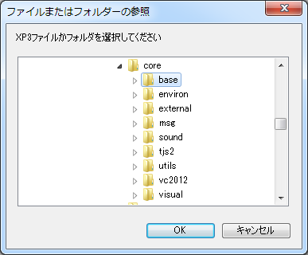

# Starting Kirikiri

## About Starting Kirikiri

To start Kirikiri and specify the scripts to run, a **project folder** normally has to be determined ( see "Project Folder" in [Storage System](StorageSystem.md) ).

There are several ways to determine the project folder; they take precedence in the order listed below (the first one that applies is used).

For the options passed to Kirikiri at startup, see [Command-Line Options](CommandLine.md).

## Order in Which the Project Folder Is Determined

- **A folder or archive specified on the command line**  
  If a folder is given as a command-line argument, it is treated as the project folder and executed.
  
  If an XP3 archive is given as a command-line argument, it is assumed to contain the project folder and is executed.
  
  You can pass files and folders as command-line arguments from the command prompt, but the easiest way is to drop the project folder or file onto the icon of the Kirikiri executable in Explorer or an "Open" dialog.
  
  It is also handy to put a shortcut on the desktop or elsewhere that passes a specific project folder as an argument to the Kirikiri executable.
- **A content-data folder in the same location as the executable**  
  If there is a folder named "content-data" in the same location as the executable, it is treated as the project folder and executed.
- **A "data.xp3" file in the same location as the executable**  
  If there is an archive file named data.xp3 in the same location as the executable, it is treated as an XP3 archive containing the project folder and executed.
- **A "data.exe" file in the same location as the executable** (Windows version only)  
  If there is an executable named data.exe with an XP3 archive appended to it in the same location as the executable, the XP3 archive inside it is used.
- **An XP3 archive appended to the executable itself**  
  If an XP3 archive is appended to the end of the executable, it is used (for releases that combine the exe and the data into a single file). The archive is placed immediately after the executable image (on a 16-byte boundary). Kirikiri finds the end of the image from the header and examines only what follows it. This works on the Windows version and on the SDL version for Windows / Linux. macOS and mobile platforms are not supported (code signing and packaging prevent appending data to the executable).
- **A data folder in the same location as the executable**  
  If there is a folder named "data" in the same location as the executable, it is treated as the project folder and executed.

If none of these methods determines the project folder, a folder/archive selection screen appears.

The SDL version checks, in order: the command-line argument, data.xp3, an XP3 archive appended to the executable itself, and the data folder (if data/startup.tjs exists). It does not check the content-data folder or data.exe.

However, if the release option "Run only from XP3 archives" is set, only data.xp3, data.exe, and an XP3 archive appended to the executable itself are used ( see `forcedataxp3` in [Releaser](Releaser.md) ).

## Folder/Archive Selection

The folder/archive selection screen looks like this.

- **"OK" button**  
  Starts running the currently selected folder or file.
- **"Cancel" button**  
  Exits Kirikiri without doing anything.

## The First File Executed

After the project folder is determined, the first file executed is startup.tjs in the project folder. If it does not exist, an error occurs.

You can also specify the first file to execute with -startup. See [Command-Line Options](CommandLine.md).

## Message Map File

Right after starting, Kirikiri checks whether msgmap.tjs exists in the same folder as Kirikiri, and executes it if it does, unless a release option specifies not to load it ( see `disablemsgmap` in [Releaser](Releaser.md) ). In msgmap.tjs you can use [System.assignMessage](../reference/System.md#assignmessage) to change message assignments.

## Configuration Files

Kirikiri reads the configuration files (.cf and .cfu files) created with [Kirikiri Configuration](Configure.md) and behaves according to the settings written in them.

For the file names and where the files are created, see "Configuration File Names and Locations" in [Command-Line Options](CommandLine.md).
