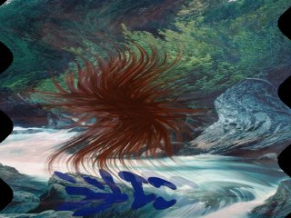
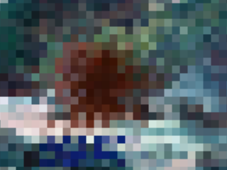
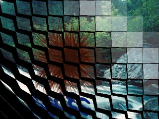
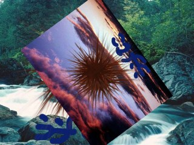
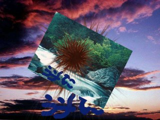
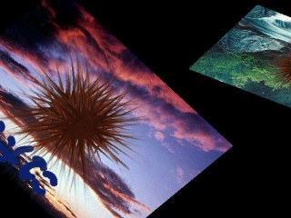
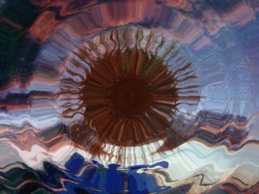

# About Transitions

## What Are Transitions

A transition switches the screen over a period of time. In Kirikiri Z, a transition can be applied to a single layer or to a layer tree.

When a source layer is specified for the switch, the two layers are swapped.

In the former case the layer itself is swapped, and in the latter case the entire layer tree structure is swapped as is.

See the [Layer.beginTransition](../reference/Layer.md#begintransition) method.

Kirikiri Z manages transitions with objects called "**transition handlers**". They are specified by the name argument of the Layer.beginTransition method, and the current version has three built into the Kirikiri engine. They can also be extended with plugins.

Below, the transition handlers built into the Kirikiri engine and the transition handlers made available by the extended transition plugins ( extrans.dll / extNagano.dll ) are described.

In this page, "source" means the image being switched to, and "destination" means the image currently shown, which is replaced.

## Specifying Options

- **When using from TJS2**  
  Specify them as a dictionary in the options argument of the Layer.beginTransition method. For example, to specify the "universal" transition with vague=100 time=2000 rule=rule1.png, pass the following as the options argument.
  
  
  
  `%[vague:100, time:2000, rule:"rule1.png"]`

## Built-in Transition Handlers

Kirikiri has the following three transition handlers built into the engine.

- ****crossfade****  
  The "crossfade" transition is the simplest transition; it performs a plain crossfade.
  
  The options are as follows.
  
  - **time (required)**  
    Specifies the duration of the transition in milliseconds.
- ****universal****  
  The "universal" transition switches according to a grayscale image called a rule image. The rule image is specified with the rule option, and darker areas of the image switch to the source earlier.
  
  If the rule image is smaller than the screen being transitioned, it is tiled; if it is larger, only its upper-left part is used.
  
  The options are as follows.
  
  - **time (required)**  
    Specifies the duration of the transition in milliseconds.
  - **rule (required)**  
    Specifies the rule image file name. The rule image must be a 256-level grayscale image. Any other image is forcibly converted to grayscale.
  - **vague**  
    Specifies the "vague region value". A small value ( such as 0 ) makes the boundary between the parts before and after the switch sharp. A large value ( such as 128 ) makes the boundary blurred and smooth. The optimal value depends on the rule image. If omitted, 64 is assumed.
- ****scroll****  
  The "scroll" transition slides the source, the destination, or both to create a scrolling effect.
  
  The options are as follows.
  
  - **time (required)**  
    Specifies the duration of the transition in milliseconds.
  - **from**  
    Specifies from which direction the source layer appears.
    
    sttLeft makes it appear from the left (default), sttTop from the top, sttRight from the right, and sttBottom from the bottom.
  - **stay**  
    Specifies how the source and destination images move.
    
    ststNoStay makes the destination image move out as if pushed by the source image (default). This gives the effect of two screens joined together and scrolling. ststStaySrc makes the destination image move out, revealing the source image behind it. ststStayDest keeps the destination image still while the source image slides in over it.

## Extended Transition Plugin

The extended transition plugin ( extrans.dll ) is a plugin for Kirikiri Z that makes several transitions available that are not built into the engine.

To use it, connect it with the [Plugins.link](../reference/Plugins.md#link) method, as with other plugins. Simply connecting it makes the following transition handlers available.

- **wave**  
  The "wave" transition switches while rendering waves with raster scrolling.
  
  
  
  
  
  
  
  It has the following options.
  
  - **time (required)**  
    Specifies the duration of the transition in milliseconds.
  - **wavetype**  
    Specifies the motion of the waves. 0 makes the waves fine at the beginning and end of the transition and broad in the middle. 1 makes them fine at first and gradually broader. 2 makes them broad at first and gradually finer. The default is 0.
  - **maxh**  
    Specifies the maximum horizontal width of the waves in pixels. Larger values make the waves deeper. The default is 50.
  - **maxomega**  
    Specifies the maximum angular velocity ( rad/pixel ) of the waves. Larger values make the waves finer; smaller values make them broader. The default is 0.2.
  - **bgcolor1**  
    Specifies the initial background color in 0xRRGGBB format.
  - **bgcolor2**  
    Specifies the final background color in 0xRRGGBB format. The background color starts at the initial background color and gradually changes to the final background color.
- **mosaic**  
  The "mosaic" transition gives the appearance of a rectangular mosaic effect.
  
  
  
  
  
  
  
  It has the following options.
  
  - **time (required)**  
    Specifies the duration of the transition in milliseconds.
  - **maxsize**  
    Specifies the maximum size of the mosaic rectangles. The default is 30. Larger values make the mosaic coarser.
- **turn**  
  The "turn" transition looks like many small cards flipping over.
  
  
  
  
  
  
  
  It has the following options.
  
  - **time (required)**  
    Specifies the duration of the transition in milliseconds.
  - **bgcolor**  
    Specifies the background color in 0xRRGGBB format.
- **rotatezoom**  
  The "rotatezoom" transition zooms the transition source in or out while rotating it.
  
  
  
  
  
  
  
  It has the following options.
  
  - **time (required)**  
    Specifies the duration of the transition in milliseconds.
  - **factor**  
    Specifies the initial zoom factor. With 0, it is invisible at first and zooms in from the center while rotating. With 2, it zooms out while rotating from 2x down to 1x. Values of 3 or more and real numbers can also be specified. The default is 1 (1x).
  - **accel**  
    Specifies whether the zooming accelerates. A negative number of -2 or less makes it fast at first and gradually slower. A positive number of 2 or more makes it slow at first and gradually faster. 0 gives linear motion, although it may not look linear due to visual effects. The default is 0.
  - **twist**  
    Specifies the direction and amount of rotation. A positive number rotates counterclockwise; a negative number rotates clockwise. The value is the number of turns. The default is 2.
  - **twistaccel**  
    Specifies whether the rotation accelerates. A negative number of -2 or less makes it fast at first and gradually slower. A positive number of 2 or more makes it slow at first and gradually faster. 0 gives linear motion. The default is -2.
- **rotatevanish**  
  The "rotatevanish" transition zooms out the transition destination while rotating it.
  
  
  
  
  
  
  
  It has the following options.
  
  - **time (required)**  
    Specifies the duration of the transition in milliseconds.
  - **accel**  
    Specifies whether the zooming accelerates. A negative number of -2 or less makes it fast at first and gradually slower. A positive number of 2 or more makes it slow at first and gradually faster. 0 gives linear motion, although it may not look linear due to visual effects. The default is 2.
  - **twist**  
    Specifies the direction and amount of rotation. A positive number rotates counterclockwise; a negative number rotates clockwise. The value is the number of turns. The default is 2.
  - **twistaccel**  
    Specifies whether the rotation accelerates. A negative number of -2 or less makes it fast at first and gradually slower. A positive number of 2 or more makes it slow at first and gradually faster. 0 gives linear motion. The default is 2.
- **rotateswap**  
  The "rotateswap" transition swaps the transition destination and source while rotating them. The destination recedes into the distance while rotating, and the source comes forward while rotating.
  
  
  
  
  
  
  
  It has the following options.
  
  - **time (required)**  
    Specifies the duration of the transition in milliseconds.
  - **twist**  
    Specifies the direction and amount of rotation. A positive number rotates counterclockwise; a negative number rotates clockwise. The value is the number of turns. The default is 1.
  - **bgcolor**  
    Specifies the background color in 0xRRGGBB format.
- **ripple**  
  The "ripple" transition switches while rendering spreading ripples.
  
  
  
  
  
  
  
  It has the following options.
  
  - **time (required)**  
    Specifies the duration of the transition in milliseconds.
  - **centerx**  
    Specifies the X coordinate of the ripple center. If omitted, the center of the image is used.
  - **centery**  
    Specifies the Y coordinate of the ripple center. If omitted, the center of the image is used.
  - **rwidth**  
    Specifies the fineness of the ripples. One of 16, 32, 64, or 128 can be specified; the smaller the value, the finer the ripples. If omitted, 128 is assumed.
  - **roundness**  
    Specifies whether the ripples are vertically elongated ellipses, perfect circles, or horizontally elongated ellipses. A value in the range 0.0 to 1.0 (excluding 0.0) ( such as 0.5 ) gives vertically elongated ellipses. 1.0 gives perfect circles. A value greater than 1.0 (such as 2 ) gives horizontally elongated ellipses. If omitted, 1.0 is assumed.
  - **speed**  
    Specifies how fast the waves spread. If omitted, 6.0 is assumed.
  - **maxdrift**  
    Specifies the intensity of the waves. If omitted, 24 is assumed.
  
  > **Note:**
  > The first time the ripple transition runs, it allocates a fairly large amount of memory ( about 0.5 to 4 MB, depending on the options ),
  > completes in advance the numerical computation needed to run the transition smoothly, and stores the results in that memory.
  > This can take a little time ( about 0.01 to 0.5 seconds ).
  >
  > If the size of the transitioned image and the centerx, centery, rwidth, roundness, and maxdrift conditions are all the same, the previous
  > computation results are reused. Results for up to the last four sets of conditions are kept ( cached ).
  > If computation for a new set of conditions beyond that is requested, the oldest results are discarded first.
  >
  > With this in mind, if you use this transition often, running it once as a dummy beforehand avoids
  > the computation afterward.

## Additional Transition Plugin ( extNagano.dll )

The additional transition plugin ( extNagano.dll ) is a reconstruction of the DLL of the same name that was published for Kirikiri 2, and it adds 12 transition handlers. Like extrans.dll, it becomes available when connected with the [Plugins.link](../reference/Plugins.md#link) method.

All of these transitions require the **time** option, which specifies the duration of the transition in milliseconds. The options other than time are described below.

- **3duniversal**  
  A general-purpose transition that switches while moving pixels according to the color components of each pixel in the rule image. In the rule image, R(H) is interpreted as the movement start time ( 0 to 255 ), G(S) as the movement speed, and B(B) as the movement direction ( 0: up / 63: right / 127: down / 191: left ).
  
  - **rule**  
    Specifies the rule image used for the switch. You can specify an image file path or a layer object.
  - **type**  
    Specifies how the rule components are interpreted: "RGB" or "HSB". The default is "RGB".
  - **speed1, accel1, bound1**  
    Specify the base speed, base acceleration, and bounce time ( 0 to 127 ) for the image before the change. speed1 / accel1 also have the aliases s1 / a1.
  - **speed2, accel2, bound2**  
    The same settings for the image after the change. speed2 / accel2 also have the aliases s2 / a2.
- **blurfade**  
  A crossfade with blurring.
  
  - **exponent**  
    Specifies the pace of the switch. Greater than 1 makes the first half gentle; less than 1 makes the first half abrupt. The default is 1.
  - **blur1, blur1x, blur1y**  
    Specify the amount of blur for the original image. blur1 sets the same value for both x and y.
  - **blur2, blur2x, blur2y**  
    Specify the amount of blur for the new image. blur2 sets the same value for both x and y.
  - **prerender**  
    Specifies when the blurred images are generated. 0 generates them every frame, 1 generates them before starting ( smooth ), and 2 is a lighter version of 1.
  - **type**  
    Specifies the type of blur. 0 is box (average) blur, and 1 is bilinear blur.
- **scanline**  
  Switches by sliding scanlines alternately left and right. The only option is time.
- **zoomfade**  
  Switches to the next image while zooming in on the original image.
  
  - **zoom1**  
    Specifies the target zoom value for the original image.
  - **zoom2**  
    Specifies the starting zoom value for the new image.
- **rgbfade**  
  A crossfade with the timing offset for each RGB component.
  
  - **delayR, delayG, delayB, delayA**  
    Specify the delay of each component from 0 to 255.
- **spin**  
  Switches by rotating two sets of lines.
  
  - **type1, type2**  
    Specify the rotation type from -1 to 11. -1 is none, 0 and 1 are cuboid rotation, 4 to 7 are door rotation, and so on.
- **flutter**  
  A transition that looks like paper being flipped up.
  
  - **back**  
    Specifies the color of the back of the flipped paper in 0xAARRGGBB format. AA=00 uses the inverted color of the front, and AA=ff uses the color 0xRRGGBB.
  - **alpha**  
    Specifies the opacity of the back of the flipped paper.
  - **slip**  
    Specifies how much the paper shifts.
- **book**  
  A transition that looks like turning the pages of a book.
  
  - **dir**  
    Specifies the turning direction. -1 is random, 0 turns the left page to the right, and 1 turns the right page to the left.
- **imagewipe**  
  A wipe using an arbitrary rule image.
  
  - **rule**  
    Specifies the rule image used for the switch. You can specify an image file path or a layer object.
  - **dir**  
    Specifies the direction of the wipe. 0 switches in order from white to black, and 1 from black to white.
- **honeyturn**  
  A flipping effect that extends extrans's turn to hexagons ( the effect was unfinished in the original DLL as well ).
  
  - **size**  
    Specifies the length of one side of a hexagon in pixels.
  - **dir**  
    Specifies the rotation direction of each hexagon from 1 to 9 ( the same directions as the numeric keypad ).
  - **order**  
    Specifies the order in which the hexagons rotate from 1 to 9 ( the same directions as the numeric keypad ).
  - **twist**  
    Specifies the amount of twist.
- **morphing**  
  Fades while deforming triangle patches. Specify the triangle patches so that they tile without gaps.
  
  - **before**  
    Specifies the triangles before deformation. Each triangle takes 6 numbers ( ax1, ay1, ax2, ay2, ax3, ay3 ), so n triangles make an array of 6n numbers.
  - **after**  
    Specifies the triangles after deformation, likewise as an array of 6n numbers.
- **multiripple**  
  A transition that switches while multiple ripples spread.
  
  - **count**  
    Specifies the number of wave sources from 1 to 20.
  - **wavecount**  
    Specifies the number of waves for each wave source.
  - **rwidth**  
    Specifies the wavelength of the waves for each wave source.
  - **maxdrift**  
    Specifies the amplitude scale of the waves for each wave source. 0 means no waves.
  - **roundness**  
    Specifies the roundness. Less than 1.0 gives vertically elongated ellipses, 1.0 gives perfect circles, and greater than 1.0 gives horizontally elongated ellipses.
  - **delaylast**  
    Specifies the delay of the last wave source. 1.0 means no delay; larger values make it later.
