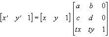

# Layer

The Layer class manages **layers**.

A layer is a "displayed image": in addition to its image buffers (the main image and the province image), it has a parent-child tree, a display position, an opacity, and input events. Off-screen working images are handled by the [Bitmap](Bitmap.md) class, and processed with the
[ImageFunction](ImageFunction.md) class.

For how the three relate and when to use which, see [Layer, Bitmap and ImageFunction](../guide/LayerAndBitmap.md).

### Members for screen readers

When [ElementsDialog.a11yLayers](ElementsDialog.md#a11ylayers) is true, Layers in the focus chain
appear in the screen reader's accessibility tree (their name is [hint](#hint)).
Adding the following members to a Layer changes how it is announced. All of them are optional; this is a convention in which the engine only reads the values (the Layer class itself does not define them).

| Member | Meaning |
|---|---|
| `a11yName` / `a11yRole` | Name / role (same names as in [ElementsDialog.setGameA11y](ElementsDialog.md#setgamea11y)). If either is present, the Layer appears even when it cannot take focus (headings, descriptive text) |
| `a11yValue` / `a11yDescription` | Value / additional description |
| `a11yStates` | An array or a string like `"checked,selected"`. `disabled` is also added based on [enabled](#enabled) |
| `a11yHidden` | If true, removes the Layer together with its children (set this on Layers you expose yourself with `setGameA11y`) |
| `onA11yAction(action, arg)` | Receives actions from the screen reader. Return false to also run the default handling |

The default handling is: `"focus"` calls [focus](#focus), and `"click"` focuses the layer and then sends the Enter key. Value changes (`"increment"`, `"set_value"`, etc.) are delivered only to `onA11yAction`. If you implement these members as property getters, keep them cheap
(they are re-read at most once every 150 ms). For the full specification, see
[Accessibility (screen reader) support](../specification/accessibility.md).

## Members

### Constructors

- [Layer](#layer)

### Properties

- [parent](#parent)
- [children](#children)
- [order](#order)
- [absolute](#absolute)
- [absoluteOrderMode](#absoluteordermode)
- [visible](#visible)
- [cached](#cached)
- [nodeVisible](#nodevisible)
- [neutralColor](#neutralcolor)
- [hasImage](#hasimage)
- [opacity](#opacity)
- [window](#window)
- [isPrimary](#isprimary)
- [left](#left)
- [top](#top)
- [width](#width)
- [height](#height)
- [imageLeft](#imageleft)
- [imageTop](#imagetop)
- [imageWidth](#imagewidth)
- [imageHeight](#imageheight)
- [clipLeft](#clipleft)
- [clipTop](#cliptop)
- [clipWidth](#clipwidth)
- [clipHeight](#clipheight)
- [type](#type)
- [face](#face)
- [holdAlpha](#holdalpha)
- [imageModified](#imagemodified)
- [hitType](#hittype)
- [hitThreshold](#hitthreshold)
- [cursor](#cursor)
- [cursorX](#cursorx)
- [cursorY](#cursory)
- [hint](#hint)
- [showParentHint](#showparenthint)
- [focusable](#focusable)
- [prevFocusable](#prevfocusable)
- [nextFocusable](#nextfocusable)
- [joinFocusChain](#joinfocuschain)
- [focused](#focused)
- [enabled](#enabled)
- [nodeEnabled](#nodeenabled)
- [attentionLeft](#attentionleft)
- [attentionTop](#attentiontop)
- [useAttention](#useattention)
- [imeMode](#imemode)
- [callOnPaint](#callonpaint)
- [font](#font)
- [name](#name)
- [mainImageBuffer](#mainimagebuffer)
- [mainImageBufferForWrite](#mainimagebufferforwrite)
- [mainImageBufferPitch](#mainimagebufferpitch)
- [provinceImageBuffer](#provinceimagebuffer)
- [provinceImageBufferForWrite](#provinceimagebufferforwrite)
- [provinceImageBufferPitch](#provinceimagebufferpitch)
- [ignoreHintSensing](#ignorehintsensing)
- [nodeFocusable](#nodefocusable)

### Methods

- [moveBefore](#movebefore)
- [moveBehind](#movebehind)
- [bringToBack](#bringtoback)
- [bringToFront](#bringtofront)
- [loadImages](#loadimages)
- [loadProvinceImage](#loadprovinceimage)
- [getMainPixel](#getmainpixel)
- [setMainPixel](#setmainpixel)
- [getMaskPixel](#getmaskpixel)
- [setMaskPixel](#setmaskpixel)
- [getProvincePixel](#getprovincepixel)
- [setProvincePixel](#setprovincepixel)
- [getLayerAt](#getlayerat)
- [releaseCapture](#releasecapture)
- [setPos](#setpos)
- [setClip](#setclip)
- [setSize](#setsize)
- [setSizeToImageSize](#setsizetoimagesize)
- [setImagePos](#setimagepos)
- [setImageSize](#setimagesize)
- [independMainImage](#independmainimage)
- [independProvinceImage](#independprovinceimage)
- [fillRect](#fillrect)
- [colorRect](#colorrect)
- [drawText](#drawtext)
- [drawGlyph](#drawglyph)
- [drawShapedText](#drawshapedtext)
- [drawShapedTextArea](#drawshapedtextarea)
- [measureShapedText](#measureshapedtext)
- [shapedTextCount](#shapedtextcount)
- [drawVerticalTextArea](#drawverticaltextarea)
- [measureVerticalTextArea](#measureverticaltextarea)
- [copyRect](#copyrect)
- [copy9Patch](#copy9patch)
- [piledCopy](#piledcopy)
- [operateRect](#operaterect)
- [stretchCopy](#stretchcopy)
- [operateStretch](#operatestretch)
- [affineCopy](#affinecopy)
- [operateAffine](#operateaffine)
- [doBoxBlur](#doboxblur)
- [adjustGamma](#adjustgamma)
- [doGrayScale](#dograyscale)
- [flipLR](#fliplr)
- [flipUD](#flipud)
- [convertType](#converttype)
- [update](#update)
- [setCursorPos](#setcursorpos)
- [focus](#focus)
- [focusPrev](#focusprev)
- [focusNext](#focusnext)
- [setMode](#setmode)
- [removeMode](#removemode)
- [setAttentionPos](#setattentionpos)
- [beginTransition](#begintransition)
- [stopTransition](#stoptransition)
- [assignImages](#assignimages)
- [saveLayerImage](#savelayerimage)
- [copyToBitmapFromMainImage](#copytobitmapfrommainimage)
- [copyFromBitmapToMainImage](#copyfrombitmaptomainimage)
- [dump](#dump)
- [releaseTouchCapture](#releasetouchcapture)

### Events

- [onClick](#onclick)
- [onDoubleClick](#ondoubleclick)
- [onMouseDown](#onmousedown)
- [onMouseUp](#onmouseup)
- [onMouseMove](#onmousemove)
- [onMouseEnter](#onmouseenter)
- [onMouseLeave](#onmouseleave)
- [onMouseWheel](#onmousewheel)
- [onKeyDown](#onkeydown)
- [onKeyUp](#onkeyup)
- [onKeyPress](#onkeypress)
- [onHitTest](#onhittest)
- [onBlur](#onblur)
- [onFocus](#onfocus)
- [onNodeDisabled](#onnodedisabled)
- [onNodeEnabled](#onnodeenabled)
- [onSearchPrevFocusable](#onsearchprevfocusable)
- [onSearchNextFocusable](#onsearchnextfocusable)
- [onBeforeFocus](#onbeforefocus)
- [onPaint](#onpaint)
- [onTransitionCompleted](#ontransitioncompleted)
- [onTouchDown](#ontouchdown)
- [onTouchUp](#ontouchup)
- [onTouchMove](#ontouchmove)
- [onTouchScaling](#ontouchscaling)
- [onTouchRotate](#ontouchrotate)
- [onMultiTouch](#onmultitouch)

---

### Layer

Constructor

**Arguments**

| Arguments | Default | Description |
| --- | --- | --- |
| `window` | `&nbsp;` | The window (an object of the [Window](Window.md) class) that will own this layer.<br>Once set, the window cannot be changed. |
| `parent` | `&nbsp;` | The layer to become the parent of this layer.<br>Specify null to create a primary layer.<br>A window can have only one primary layer, and when layers are used there must always be exactly one; it is the layer that is the parent of all other layers.<br>However, some draw devices (configurable with [Window.drawDevice](Window.md#drawdevice)) allow a window to have<br>multiple primary layers.<br>The parent of a layer can be changed with the [Layer.parent](Layer.md#parent) property. |

**Description**

Constructs a Layer object

Constructs an object of the Layer class.

A Layer is constructed in the hidden state.

---

### parent

Property \ Access: `r/w`

**Description**

Parent layer

The parent layer object.

This property can also be set. Setting it makes the layer a child of the given layer.

A layer cannot become a child of a layer belonging to a different window or a different primary layer, nor a child of itself or of one of its own
descendants.

When a layer is invalidated with invalidate, its child layers are not invalidated automatically;
they remain as valid layers detached from the parent (with no parent). Detached
layers are not shown on screen, but drawing methods and the like still work without throwing exceptions,
so note that drawing to a stale reference can easily go unnoticed. To dispose of a whole subtree,
invalidate the child layers individually (recursively).

---

### children

Property \ Access: `r`

**Description**

Array of child layers

An array object containing the child layers.

Writing values to this array, or removing or adding items, is not reflected in the actual layer state. Treat it as read-only.

---

### order

Property \ Access: `r/w`

**Description**

Relative order

The rank among sibling layers with the same parent. Smaller values are displayed further back.

Setting the value changes the rank among the siblings. Setting it sets the
parent layer's [Layer.absoluteOrderMode](Layer.md#absoluteordermode) property to false.

**See also:** [Layer.absolute](Layer.md#absolute) / [Layer.absoluteOrderMode](Layer.md#absoluteordermode) / [Layer.bringToBack](Layer.md#bringtoback) / [Layer.bringToFront](Layer.md#bringtofront)

---

### absolute

Property \ Access: `r/w`

**Description**

Absolute order

The stacking order among sibling layers with the same parent. Smaller values are displayed further back.

Unlike the [Layer.order](Layer.md#order) property, the values need not be consecutive among siblings.

Setting the value changes the rank among the siblings. Setting it sets the
parent layer's [Layer.absoluteOrderMode](Layer.md#absoluteordermode) property to true.

**See also:** [Layer.order](Layer.md#order) / [Layer.absoluteOrderMode](Layer.md#absoluteordermode) / [Layer.bringToBack](Layer.md#bringtoback) / [Layer.bringToFront](Layer.md#bringtofront)

---

### absoluteOrderMode

Property \ Access: `r/w`

**Description**

Whether absolute order mode is used

The stacking order mode of the immediate child layers. This property can also be set.

If false, relative ordering is used and the [Layer.order](Layer.md#order) property
represents the rank.

If true, absolute ordering is used and the [Layer.absolute](Layer.md#absolute) property
represents the rank.

**See also:** [Layer.order](Layer.md#order) / [Layer.absolute](Layer.md#absolute) / [Layer.bringToBack](Layer.md#bringtoback) / [Layer.bringToFront](Layer.md#bringtofront)

---

### visible

Property \ Access: `r/w`

**Description**

Whether visible

Whether the layer is visible. This property can also be set.

false makes it invisible; true makes it visible.

---

### cached

Property \ Access: `r/w`

**Description**

Whether caching is used

Whether caching is used. This property can also be set.

With caching on, the layer keeps a pre-composited image of itself and all its child layers, and thereafter performs no compositing for itself and its children unless they change (when they change, the cache is rebuilt automatically).

With caching off, compositing is performed on every screen update.

Caching is off by default, but it is enabled automatically during transitions (this property does not, however, reflect caching that is enabled automatically, e.g. during transitions).

If you know that a layer's image and its children's images and states will not change, and the screen is redrawn frequently, enabling caching on that layer improves overall performance.

---

### nodeVisible

Property \ Access: `r`

**Description**

Whether the node is visible

Whether the node is visible.

false if any of the ancestor layers is invisible.

true if all ancestor layers are visible.

---

### neutralColor

Property \ Access: `r/w`

**Description**

Neutral color

The layer's neutral color, in 0xAARRGGBB format. This property can also be set.

When the [Layer.type](Layer.md#type) property is changed, the neutral color is set to the neutral color of that type.

The neutral color is the initial value used to fill the extended area when the layer image is enlarged.

Setting this value specifies the initial color used when the layer image is enlarged.

---

### hasImage

Property \ Access: `r/w`

**Description**

Whether the layer has an image

Whether the layer has an image. This property can also be set.

If true, the layer has an image. This is the default.

If false, the layer's image is freed and the layer no longer has an image.

Setting the [Layer.type](Layer.md#type) property resets hasImage to true.

When the layer has no image and [Layer.type](Layer.md#type) is **ltOpaque**, the layer is displayed as if it were entirely filled with
[Layer.neutralColor](Layer.md#neutralcolor).

For other types it is treated as fully transparent.

A layer with this property false is regarded as having opacity 0 (fully transparent) everywhere when [Layer.hitType](Layer.md#hittype) is htMask. Also, drawing and font operations are not possible on it.

Layers with this property false are normally used to group several child layers while being merely transparent themselves.

---

### opacity

Property \ Access: `r/w`

**Description**

Opacity

The opacity of the layer. This property can be set.

The value is an integer from 0 to 255; larger values are more opaque.

---

### window

Property \ Access: `r`

**Description**

Window object

The window object that owns this layer.

---

### isPrimary

Property \ Access: `r`

**Description**

Whether this is the primary layer

Whether this layer is a primary layer.

The primary layer has no parent and is displayed at the very back.

---

### left

Property \ Access: `r/w`

**Description**

Left edge

The left edge of the layer, in pixels in the parent layer's display coordinates.

This property can also be set.

**See also:** [Layer.setPos](Layer.md#setpos)

---

### top

Property \ Access: `r/w`

**Description**

Top edge

The top edge of the layer, in pixels in the parent layer's display coordinates.

This property can also be set.

**See also:** [Layer.setPos](Layer.md#setpos)

---

### width

Property \ Access: `r/w`

**Description**

Width

The display width of the layer, in pixels.

This property can also be set.

**See also:** [Layer.setSize](Layer.md#setsize)

---

### height

Property \ Access: `r/w`

**Description**

Height

The display height of the layer, in pixels.

This property can also be set.

**See also:** [Layer.setSize](Layer.md#setsize)

---

### imageLeft

Property \ Access: `r/w`

**Description**

Layer image left offset

The left edge of the layer's display offset, in pixels.

This property can also be set.

**See also:** [Layer.setImagePos](Layer.md#setimagepos)

---

### imageTop

Property \ Access: `r/w`

**Description**

Layer image top offset

The top edge of the layer's display offset, in pixels.

This property can also be set.

**See also:** [Layer.setImagePos](Layer.md#setimagepos)

---

### imageWidth

Property \ Access: `r/w`

**Description**

Image width

The width of the layer's image, in pixels.

This property can also be set.

**See also:** [Layer.setImageSize](Layer.md#setimagesize)

---

### imageHeight

Property \ Access: `r/w`

**Description**

Image height

The height of the layer's image, in pixels.

This property can also be set.

**See also:** [Layer.setSize](Layer.md#setsize)

---

### clipLeft

Property \ Access: `r/w`

**Description**

Clip rectangle left edge

The left edge of the drawing clip rectangle, in pixels.

This property can also be set.

**See also:** [Layer.setClip](Layer.md#setclip)

---

### clipTop

Property \ Access: `r/w`

**Description**

Clip rectangle top edge

The top edge of the drawing clip rectangle, in pixels.

This property can also be set.

**See also:** [Layer.setClip](Layer.md#setclip)

---

### clipWidth

Property \ Access: `r/w`

**Description**

Clip rectangle width

The width of the drawing clip rectangle, in pixels.

This property can also be set.

**See also:** [Layer.setClip](Layer.md#setclip)

---

### clipHeight

Property \ Access: `r/w`

**Description**

Clip rectangle height

The height of the drawing clip rectangle, in pixels.

This property can also be set.

**See also:** [Layer.setClip](Layer.md#setclip)

---

### type

Property \ Access: `r/w`

**Description**

Layer display type

The display type of the layer. This property can also be set.

- `**ltOpaque**` or `**ltCoverRect**` disables per-pixel alpha blending. `ltCoverRect` and `ltOpaque` mean the same thing.
If the [Layer.opacity](Layer.md#opacity) property is 255, the layer is displayed as a fully opaque rectangle.
The mask image is ignored. The suitable drawing mode (specified with [Layer.face](Layer.md#face)) for this type is `**dfOpaque**`.
- `**ltAlpha**` or `**ltTransparent**` enables per-pixel alpha blending. `ltTransparent` and `ltAlpha` mean the same thing.
The mask image is used for transparency. The suitable drawing mode for this type is `**dfAlpha**`.
- `**ltAddAlpha**` enables per-pixel additive alpha blending. The suitable drawing mode for this type is `**dfAddAlpha**`.
- `**ltAdditive**` performs additive blending. The mask image is ignored. The suitable drawing mode for this type is `**dfOpaque**`.
- `**ltSubtractive**` performs subtractive blending. The mask image is ignored. The suitable drawing mode for this type is `**dfOpaque**`.
- `**ltMultiplicative**` performs multiplicative blending. The mask image is ignored. The suitable drawing mode for this type is `**dfOpaque**`.
- `**ltDodge**` performs dodge blending. The mask image is ignored. The suitable drawing mode for this type is `**dfOpaque**`.
- `**ltDarken**` performs darken blending. The mask image is ignored. The suitable drawing mode for this type is `**dfOpaque**`.
- `**ltLighten**` performs lighten blending. The mask image is ignored. The suitable drawing mode for this type is `**dfOpaque**`.
- `**ltScreen**` performs screen blending. The mask image is ignored. The suitable drawing mode for this type is `**dfOpaque**`.

For other layer display types, see [Graphic System](../guide/GraphicSystem.md).

**See also:** [Layer.face](Layer.md#face)

---

### face

Property \ Access: `r/w`

**Description**

Drawing mode

The drawing mode used for drawing to the layer. This property can also be set.

In Kirikiri 2.23 beta 1 and earlier, this was called the "drawing face".

- `**dfAlpha**` or `**dfBoth**`: the image is treated as an image with an alpha channel when drawing. `dfBoth` and `dfAlpha` are equivalent. The corresponding layer types are `ltTransparent` or `ltAlpha`.
- `**dfAddAlpha**`: the image is treated as an image with an additive alpha channel when drawing. The corresponding layer type is `ltAddAlpha`.
-  `**dfOpaque**` or `**dfMain**`: the layer image is treated as fully opaque when drawing. The corresponding layer types are `ltOpaque` or `ltCoverRect`, or layer types that perform arithmetic/logical operations such as `ltAdditive`.
- `**dfMask**`: drawing targets the mask image (alpha channel).
- `**dfProvince**`: drawing targets the province image.
- `**dfAuto**`: the drawing mode is determined automatically from the current [Layer.type](Layer.md#type) property. A newly created layer's drawing mode is dfAuto.

Some methods cannot be used depending on the value of this property.

**See also:** [Layer.type](Layer.md#type)

---

### holdAlpha

Property \ Access: `r/w`

**Description**

Whether to preserve the alpha channel

Whether to preserve the alpha channel when drawing. This property can also be set.

The default is false.

In Kirikiri 2.23 beta 1 and earlier, each drawing method had a parameter called hda that behaved like this property; since 2.23 beta 2 it has been separated out as a property.

For some drawing operations, when the [Layer.face](Layer.md#face) property is **dfOpaque**, this property specifies whether the image's alpha channel (mask image) is kept. For many methods, drawing is faster with this property set to false. If [Layer.type](Layer.md#type) is neither **ltAlpha** nor **ltAddAlpha**, the image's alpha channel is not used, so setting this property to false causes no problems. Note, however, that the alpha channel is destroyed when this property is false.

The following methods are not affected by this property.

[Layer.loadImages](Layer.md#loadimages)

[Layer.loadProvinceImage](Layer.md#loadprovinceimage)

[Layer.setMainPixel](Layer.md#setmainpixel)

[Layer.setMaskPixel](Layer.md#setmaskpixel)

[Layer.setProvincePixel](Layer.md#setprovincepixel)

[Layer.piledCopy](Layer.md#piledcopy)

[Layer.adjustGamma](Layer.md#adjustgamma) (the alpha channel is always preserved)

[Layer.doGrayScale](Layer.md#dograyscale) (the alpha channel is always preserved)

[Layer.flipLR](Layer.md#fliplr)

[Layer.flipUD](Layer.md#flipud)

[Layer.assignImages](Layer.md#assignimages)

The following methods are affected by this property.

[Layer.copyRect](Layer.md#copyrect)

[Layer.stretchCopy](Layer.md#stretchcopy)

[Layer.affineCopy](Layer.md#affinecopy)

[Layer.fillRect](Layer.md#fillrect)

[Layer.colorRect](Layer.md#colorrect)

[Layer.drawText](Layer.md#drawtext)

[Layer.operateRect](Layer.md#operaterect)

[Layer.operateStretch](Layer.md#operatestretch)

[Layer.operateAffine](Layer.md#operateaffine)

---

### imageModified

Property \ Access: `r/w`

**Description**

Whether the image was modified

Whether the layer's image has been modified. This property can also be set.

It is set to true automatically when you draw on the layer's image or change its size.

If you set this property to false, it becomes true when the layer's image is modified,
so you can tell whether the image has been modified.

This property itself does not affect the layer's behavior.

---

### hitType

Property \ Access: `r/w`

**Description**

Hit test type

The type of hit test for mouse events. This property can also be set.

`**htProvince**`: mouse events are received only in areas where the province image is nonzero.

`**htMask**`: mouse events are received only where the mask (opacity) image value is greater than or equal to the value
specified by the [Layer.hitThreshold](Layer.md#hitthreshold) property.

Mouse events that are not received are handled by layers further back.

The initial value is `htMask`.

---

### hitThreshold

Property \ Access: `r/w`

**Description**

Hit test threshold

The threshold for the mouse event hit test. This property can also be set.

This property is effective only when the [Layer.hitType](Layer.md#hittype) property is htMask;
mouse messages are received where the mask (opacity) image value is greater than or equal to this value.

0 makes all mouse messages received. 256 makes no mouse messages
received.

The initial value is 16.

---

### cursor

Property \ Access: `r/w`

**Description**

Mouse cursor

The layer's mouse cursor. This property can also be set.

You can specify a **mouse cursor constant** starting with cr, or the storage name of a
mouse cursor with the .cur extension or an animated mouse cursor with the .ani extension.

---

### cursorX

Property \ Access: `r/w`

**Description**

Mouse cursor x position

The x coordinate of the layer's mouse cursor, in pixels in display coordinates. This property can also be set.

When setting, setting the cursorX property alone does not move the mouse cursor.
The cursor moves when the cursorY property is set afterward.

**See also:** [Layer.setCursorPos](Layer.md#setcursorpos)

---

### cursorY

Property \ Access: `r/w`

**Description**

Mouse cursor y position

The y coordinate of the layer's mouse cursor, in pixels in display coordinates. This property can also be set.

When setting, setting the cursorX property alone does not move the mouse cursor.
The cursor moves when the cursorY property is set afterward.

**See also:** [Layer.setCursorPos](Layer.md#setcursorpos)

---

### hint

Property \ Access: `r/w`

**Description**

Hint

The layer's hint string. This property can also be set.

The hint string is shown near the mouse cursor when the cursor rests on the layer
for a moment.

Specify an empty string to show no hint.

**See also:** [Layer.showParentHint](Layer.md#showparenthint)

---

### showParentHint

Property \ Access: `r/w`

**Description**

Whether to inherit the parent's hint

Whether to inherit the parent layer's hint. This property can also be set.

If true and the [Layer.hint](Layer.md#hint) property is an empty string, the ancestors are searched
and the hint of the first layer that has one is shown as is.
If Layer.hint is not empty, it is shown.

If false, Layer.hint is shown if it is not empty; if it is empty,
no hint is shown.

---

### focusable

Property \ Access: `r/w`

**Description**

Whether the layer can receive the focus

Whether the layer can receive the focus. This property can also be set.

If true, the layer can receive the focus.

If false, the layer cannot receive the focus.

---

### prevFocusable

Property \ Access: `r`

**Description**

Previous focusable layer

Searches backward for a layer that can receive the focus.

null if there is no such layer.

---

### nextFocusable

Property \ Access: `r`

**Description**

Next focusable layer

Searches forward for a layer that can receive the focus.

null if there is no such layer.

---

### joinFocusChain

Property \ Access: `r/w`

**Description**

Whether to join the focus chain

Whether the layer joins the focus chain.

If true, the layer joins the focus chain: it appears in [Layer.prevFocusable](Layer.md#prevfocusable) and the like,
and the focus can be moved to it with the TAB key and so on.

If false, the layer does not join the focus chain, but it can still receive the focus through the [Layer.focus](Layer.md#focus)
method and the like.

---

### focused

Property \ Access: `r`

**Description**

Whether the layer has the focus

Whether the layer has the focus.

true if it has the focus, false otherwise.

---

### enabled

Property \ Access: `r/w`

**Description**

Whether enabled

Whether the layer is enabled (can be operated). This property can also be set.

If true, the layer is enabled and can receive the focus and so on.

If false, the layer is disabled and cannot receive the focus and so on.

---

### nodeEnabled

Property \ Access: `r`

**Description**

Whether the layer node is enabled

Whether the layer node is enabled.

false if the layer itself is disabled or any of its ancestor layers is disabled.

Otherwise true.

---

### attentionLeft

Property \ Access: `r/w`

**Description**

Attention position left edge

The left edge of the attention position, in pixels in display coordinates. This property can also be set.

**See also:** [Layer.setAttentionPos](Layer.md#setattentionpos) / [Layer.useAttention](Layer.md#useattention)

---

### attentionTop

Property \ Access: `r/w`

**Description**

Attention position top edge

The top edge of the attention position, in pixels in display coordinates. This property can also be set.

**See also:** [Layer.setAttentionPos](Layer.md#setattentionpos) / [Layer.useAttention](Layer.md#useattention)

---

### useAttention

Property \ Access: `r/w`

**Description**

Whether to use the attention information

Whether to use the attention information. This property can also be set.

If true, this layer's attention information is used.

If false, the attention information of the layer's parent (if any) is used.

**See also:** [Layer.setAttentionPos](Layer.md#setattentionpos) / [Layer.attentionLeft](Layer.md#attentionleft) / [Layer.attentionTop](Layer.md#attentiontop)

---

### imeMode

Property \ Access: `r/w`

**Description**

IME mode

The IME mode. This property can also be set.

When the layer receives the focus, the IME switches to the mode specified here.

The possible values are:

- `**imDisable**`: the IME is disabled. Input through the IME is not possible, and the user cannot enable the IME either.

- `**imClose**`: the IME is disabled. Unlike imDisable, the user can enable the IME.

- `**imOpen**`: the IME is enabled.

- `**imDontCare**`: the IME's enabled/disabled state is carried over from the previous state. The user can enable or disable the IME. For Japanese input, this is the usual mode for letting the user freely enter half-width / full-width characters.

- `**imSAlpha**`: the IME is enabled in half-width alphabet input mode.

- `**imAlpha**`: the IME is enabled in full-width alphabet input mode.

- `**imHira**`: the IME is enabled in hiragana input mode.

- `**imSKata**`: the IME is enabled in half-width katakana input mode.

- `**imKata**`: the IME is enabled in full-width katakana input mode.

- `**imChinese**`: the IME is enabled in a mode that accepts double-byte Chinese input. Not available in a Japanese environment.

- `**imSHanguel**`: the IME is enabled in a mode that accepts single-byte Korean input. Not available in a Japanese environment.

- `**imHanguel**`: the IME is enabled in a mode that accepts double-byte Korean input. Not available in a Japanese environment.

If not specified, imDisable is used.

On Windows, `imDisable` is implemented by **detaching the input context**
(`ImmAssociateContext(hwnd, NULL)`). Therefore, while a layer with
`imDisable` has the focus, pressing the half-width/full-width key does not
open the IME. This is the difference from `imClose`. When the focus moves to a layer other than
`imDisable`, the context is reattached automatically.

To turn off IME control altogether, use the command-line option `-controlime=no`
(layers' `imeMode` is then never applied).

In SDL-based builds, the same meaning is achieved by enabling the OS text input only while
a layer other than `imDisable` has the focus.

**See also:** [Window.imeMode](Window.md#imemode)

---

### callOnPaint

Property \ Access: `r/w`

**Description**

Whether to call the onPaint event

Whether to call the [Layer.onPaint](Layer.md#onpaint) event. This property can also be set.

If true, the onPaint event is called just before the next drawing to the screen. After the onPaint event
finishes, this property is automatically set back to false.

While it is false, the onPaint event does not occur.

The [Layer.update](Layer.md#update) method sets this property to true.

---

### font

Property \ Access: `r`

**Description**

Font

An object of the [Font](Font.md) class representing the font used for drawing with the [Layer.drawText](Layer.md#drawtext) method.

---

### name

Property \ Access: `r/w`

**Description**

Layer name

The layer name. This property can also be set.

The value set here does not affect the behavior of the Layer class.

---

### mainImageBuffer

Property \ Access: `r`

**Description**

Main image buffer pointer

A pointer to the top-left corner of the image buffer of the main image (a 32bpp bitmap containing color and mask (opacity) information).

This property exists to give plugins and the like direct access to the image buffer.

It is returned as an integer; in plugins, cast it to an appropriate type (const unsigned long *, etc.) before use.

Do not write to the pointer obtained from this property.
You can write to the pointer obtained from [Layer.mainImageBufferForWrite](Layer.md#mainimagebufferforwrite).

NULL (0) is returned if no image is assigned to the layer.

The image size is given by the [Layer.imageWidth](Layer.md#imagewidth) and [Layer.imageHeight](Layer.md#imageheight) properties.

For how to compute pointers, see [Layer.mainImageBufferPitch](Layer.md#mainimagebufferpitch).

**See also:** [Layer.mainImageBufferForWrite](Layer.md#mainimagebufferforwrite) / [Layer.mainImageBufferPitch](Layer.md#mainimagebufferpitch)

---

### mainImageBufferForWrite

Property \ Access: `r`

**Description**

Main image buffer pointer (for writing)

A pointer to the top-left corner of the image buffer of the main image (a 32bpp bitmap containing color and mask (opacity) information).

This property exists to give plugins and the like direct access to the image buffer.

It is returned as an integer; in plugins, cast it to an appropriate type (unsigned long *, etc.) before use.

Unlike [Layer.mainImageBuffer](Layer.md#mainimagebuffer), you can write to the pointer obtained from this property.
Internally, Kirikiri shares identical images among multiple layers and so on;
reading this property ends that sharing.

NULL (0) is returned if no image is assigned to the layer.

The image size is given by the [Layer.imageWidth](Layer.md#imagewidth) and [Layer.imageHeight](Layer.md#imageheight) properties.

For how to compute pointers, see [Layer.mainImageBufferPitch](Layer.md#mainimagebufferpitch).

**See also:** [Layer.mainImageBuffer](Layer.md#mainimagebuffer) / [Layer.mainImageBufferPitch](Layer.md#mainimagebufferpitch)

---

### mainImageBufferPitch

Property \ Access: `r`

**Description**

Main image buffer pitch

The pitch of the image buffer of the main image (a 32bpp bitmap containing color and mask (opacity) information)
(the number of bytes to the next scan line down).

This property exists to give plugins and the like direct access to the image buffer.

With tjs_uint32 as a 32-bit integer type and tjs_uint8 as an 8-bit (1-byte) integer type, a pointer to image position (x, y)
can be computed in C as follows.

`( (tjs_uint32*)( (tjs_uint8*)mainImageBuffer + y*mainImageBufferPitch )) + x`

Note that this property returns the number of bytes to the next scan line, not the number of pixels.
This value may be slightly larger than the number of bytes needed for exactly the image width.

Note that this property can be negative.

**See also:** [Layer.mainImageBuffer](Layer.md#mainimagebuffer) / [Layer.mainImageBufferForWrite](Layer.md#mainimagebufferforwrite)

---

### provinceImageBuffer

Property \ Access: `r`

**Description**

Province image buffer pointer

A pointer to the top-left corner of the image buffer of the province image (an 8bpp bitmap containing province information).

This property exists to give plugins and the like direct access to the image buffer.

It is returned as an integer; in plugins, cast it to an appropriate type (const unsigned char *, etc.) before use.

Do not write to the pointer obtained from this property.
You can write to the pointer obtained from [Layer.provinceImageBufferForWrite](Layer.md#provinceimagebufferforwrite).

NULL (0) is returned if no image is assigned. In that case, the whole area must be treated as
province number 0.

The image size is given by the [Layer.imageWidth](Layer.md#imagewidth) and [Layer.imageHeight](Layer.md#imageheight) properties.

For how to compute pointers, see [Layer.provinceImageBufferPitch](Layer.md#provinceimagebufferpitch).

**See also:** [Layer.provinceImageBufferForWrite](Layer.md#provinceimagebufferforwrite) / [Layer.provinceImageBufferPitch](Layer.md#provinceimagebufferpitch)

---

### provinceImageBufferForWrite

Property \ Access: `r`

**Description**

Province image buffer pointer (for writing)

A pointer to the top-left corner of the image buffer of the province image (an 8bpp bitmap containing province information).

This property exists to give plugins and the like direct access to the image buffer.

It is returned as an integer; in plugins, cast it to an appropriate type (unsigned char *, etc.) before use.

Unlike [Layer.provinceImageBuffer](Layer.md#provinceimagebuffer), you can write to the pointer obtained from this property.
Internally, Kirikiri shares identical images among multiple layers and so on;
reading this property ends that sharing.

If no image is assigned to the layer, one is assigned automatically when this property is read,
with the whole area initialized to province number 0.

The image size is given by the [Layer.imageWidth](Layer.md#imagewidth) and [Layer.imageHeight](Layer.md#imageheight) properties.

For how to compute pointers, see [Layer.provinceImageBufferPitch](Layer.md#provinceimagebufferpitch).

**See also:** [Layer.provinceImageBuffer](Layer.md#provinceimagebuffer) / [Layer.provinceImageBufferPitch](Layer.md#provinceimagebufferpitch)

---

### provinceImageBufferPitch

Property \ Access: `r`

**Description**

Province image buffer pitch

The pitch of the image buffer of the province image (an 8bpp bitmap containing province information)
(the number of bytes to the next scan line down).

This property exists to give plugins and the like direct access to the image buffer.

With tjs_uint8 as an 8-bit (1-byte) integer type, a pointer to image position (x, y)
can be computed in C as follows.

`(tjs_uint8*)provinceImageBuffer + y*provinceImageBufferPitch + x`

This value may be slightly larger than the number of bytes needed for exactly the image width.

Note that this property can be negative.

**See also:** [Layer.provinceImageBuffer](Layer.md#provinceimagebuffer) / [Layer.provinceImageBufferForWrite](Layer.md#provinceimagebufferforwrite)

---

### ignoreHintSensing

Property \ Access: `r/w`

**Description**

Whether to skip hint detection

Whether hint detection is skipped.

If set to true, no hint detection is performed for this layer.

If set to false, detection is performed.

**See also:** [Window.onHintChanged](Window.md#onhintchanged)

---

### nodeFocusable

Property \ Access: `r/w`

**Description**

Whether the node can take the focus

Returns whether this layer node can have the focus.
The result takes into account `focusable` in the ancestor hierarchy. Read-only.

**See also:** [Layer.focusable](Layer.md#focusable)

---

### moveBefore

Method

**Arguments**

| Arguments | Default | Description |
| --- | --- | --- |
| `layer` | `&nbsp;` | The layer to move in front of.<br>Only sibling layers (layers with the same parent) can be specified. |

**Description**

Moves in front of the specified layer

Moves the layer in front of the specified layer in the stacking order.

This method sets the [Layer.absoluteOrderMode](Layer.md#absoluteordermode) property to false.

---

### moveBehind

Method

**Arguments**

| Arguments | Default | Description |
| --- | --- | --- |
| `layer` | `&nbsp;` | The layer to move behind.<br>Only sibling layers (layers with the same parent) can be specified. |

**Description**

Moves behind the specified layer

Moves the layer behind the specified layer in the stacking order.

This method sets the [Layer.absoluteOrderMode](Layer.md#absoluteordermode) property to false.

---

### bringToBack

Method

**Description**

Moves to the very back

Moves the layer to the very back among its siblings (layers with the same parent) in the stacking order.

Calling this method sets the parent layer's [Layer.absoluteOrderMode](Layer.md#absoluteordermode) property to false.

**See also:** [Layer.order](Layer.md#order) / [Layer.absolute](Layer.md#absolute) / [Layer.absoluteOrderMode](Layer.md#absoluteordermode) / [Layer.bringToFront](Layer.md#bringtofront)

---

### bringToFront

Method

**Description**

Moves to the very front

Moves the layer to the very front among its siblings (layers with the same parent) in the stacking order.

Calling this method sets the parent layer's [Layer.absoluteOrderMode](Layer.md#absoluteordermode) property to false.

**See also:** [Layer.order](Layer.md#order) / [Layer.absolute](Layer.md#absolute) / [Layer.absoluteOrderMode](Layer.md#absoluteordermode) / [Layer.bringToBack](Layer.md#bringtoback)

---

### loadImages

Method

**Arguments**

| Arguments | Default | Description |
| --- | --- | --- |
| `image` | `&nbsp;` | The image storage to load.<br>If an image storage exists whose name is this storage name (without the extension) followed by _m,<br>it is loaded as the mask (opacity) image.<br>If an image storage exists whose name is this storage name (without the extension) followed by _p,<br>it is loaded as the province image. |
| `colorkey` | `clNone` | The color key (transparent color) of the image to load.<br>Specifying a color in 0xRRGGBB format makes that color the color key.<br>Specifying `**clPalIdx**` plus a palette index makes<br>that palette index transparent (for images with 256 colors or fewer).<br>Specifying `**clAdapt**` automatically makes the color used most often<br>in the top line of the image transparent.<br>Specifying `**clAlphaMat**` plus a color value in 0xRRGGBB<br>format composites the image onto that color using<br>alpha blending (the ltAlpha method).<br>For example, specifying (clAlphaMat + 0xffffff)<br>composites the loaded image onto white.<br>The result is a fully opaque image<br>(note that although the image becomes fully opaque,<br>the tag information is not changed at all in this mode). |

**Return value**

Dictionary of tag information

**Description**

Loads an image

Loads an image into the layer.

This method changes the layer's image size, but does not change the layer's display size unless
the image is smaller than the current display size.

The return value is a dictionary of tag information (information about the image itself, such as its layer type and display position).

If the image has no tag information, null is returned.

In the current version, only the PNG and TLG5/6 formats can carry tag information. For the available information, see [Image Format Converter](../guide/TPC.md).

---

### loadProvinceImage

Method

**Arguments**

| Arguments | Default | Description |
| --- | --- | --- |
| `image` | `&nbsp;` | The image storage to load as the province image. |

**Description**

Loads a province image

Loads the layer's province image. The other images are left unchanged.

An exception is thrown if the image to load differs in size from the layer's image size.

---

### getMainPixel

Method

**Arguments**

| Arguments | Default | Description |
| --- | --- | --- |
| `x` | `&nbsp;` | The x coordinate (in the layer's image coordinates) to get the color from. |
| `y` | `&nbsp;` | The y coordinate (in the layer's image coordinates) to get the color from. |

**Return value**

Color value in 0xRRGGBB format

**Description**

Gets a color from the main image

Gets the color at any position in the layer's main image (the image that holds the colors).

An exception is thrown if the position is invalid (out of range) in image coordinates.

---

### setMainPixel

Method

**Arguments**

| Arguments | Default | Description |
| --- | --- | --- |
| `x` | `&nbsp;` | The x coordinate (in the layer's image coordinates) to set the color at. |
| `y` | `&nbsp;` | The y coordinate (in the layer's image coordinates) to set the color at. |
| `color` | `&nbsp;` | The color to set, in 0xRRGGBB format. |

**Description**

Sets a color in the main image

Sets the color at any position in the layer's main image (the image that holds the colors).

An exception is thrown if the position is invalid (out of range) in image coordinates.

---

### getMaskPixel

Method

**Arguments**

| Arguments | Default | Description |
| --- | --- | --- |
| `x` | `&nbsp;` | The x coordinate (in the layer's image coordinates) to get the value from. |
| `y` | `&nbsp;` | The y coordinate (in the layer's image coordinates) to get the value from. |

**Return value**

Mask image value (0 to 255)

**Description**

Gets a value from the mask image

Gets the value (0 to 255) at any position in the layer's mask image (the image that holds the opacity).

An exception is thrown if the position is invalid (out of range) in image coordinates.

---

### setMaskPixel

Method

**Arguments**

| Arguments | Default | Description |
| --- | --- | --- |
| `x` | `&nbsp;` | The x coordinate (in the layer's image coordinates) to set the value at. |
| `y` | `&nbsp;` | The y coordinate (in the layer's image coordinates) to set the value at. |
| `value` | `&nbsp;` | The value to set (0 to 255). |

**Description**

Sets a value in the mask image

Sets the value (0 to 255) at any position in the layer's mask image (the image that holds the opacity).

An exception is thrown if the position is invalid (out of range) in image coordinates.

---

### getProvincePixel

Method

**Arguments**

| Arguments | Default | Description |
| --- | --- | --- |
| `x` | `&nbsp;` | The x coordinate (in the layer's image coordinates) to get the value from. |
| `y` | `&nbsp;` | The y coordinate (in the layer's image coordinates) to get the value from. |

**Return value**

Province image value (0 to 255)

**Description**

Gets a value from the province image

Gets the value (0 to 255) at any position in the layer's province image.

An exception is thrown if the position is invalid (out of range) in image coordinates.

---

### setProvincePixel

Method

**Arguments**

| Arguments | Default | Description |
| --- | --- | --- |
| `x` | `&nbsp;` | The x coordinate (in the layer's image coordinates) to set the value at. |
| `y` | `&nbsp;` | The y coordinate (in the layer's image coordinates) to set the value at. |
| `value` | `&nbsp;` | The value to set (0 to 255). |

**Description**

Sets a value in the province image

Sets the value (0 to 255) at any position in the layer's province image.

An exception is thrown if the position is invalid (out of range) in image coordinates.

---

### getLayerAt

Method

**Arguments**

| Arguments | Default | Description |
| --- | --- | --- |
| `x` | `&nbsp;` | The x coordinate, in pixels in display coordinates, of the position to look up.<br>The display coordinates of the layer calling this method are used (not the display<br>coordinates of the primary layer). |
| `y` | `&nbsp;` | The y coordinate, in pixels in display coordinates, of the position to look up.<br>The display coordinates of the layer calling this method are used (not the display<br>coordinates of the primary layer). |
| `exclude_self` | `false` | Whether to exclude this layer itself from the search.<br>If false, this layer is included in the search.<br>If true, this layer is excluded from the search and treated as if it did not exist.<br>If omitted, false is assumed. |
| `get_disabled` | `false` | Whether to return disabled layer objects.<br>If false and the layer at the position is disabled (e.g. its [Layer.enabled](Layer.md#enabled) property is false), null is returned.<br>If true and the layer at the position is disabled, that layer object is returned.<br>If omitted, false is assumed. |

**Return value**

The layer object at the position. Returns null if there is no layer there, etc.

**Description**

Gets the layer at a position

Returns the layer object at the position given by x, y.

The hit test uses the same mechanism as for ordinary mouse events: the position is examined from the frontmost layer in the stacking order, and the first layer that is hit is returned.

Specifying true for the exclude_self argument excludes the layer that calls this method from the search.

**See also:** [Layer.hitType](Layer.md#hittype) / [Layer.hitThreshold](Layer.md#hitthreshold) / [Layer.onHitTest](Layer.md#onhittest)

---

### releaseCapture

Method

**Description**

Releases the mouse capture

Releases the mouse event capture.

Mouse event capture is a feature whereby mouse events are sent exclusively to the layer that was under the mouse when a button was first pressed, until the button is released.

This method cancels that capture and returns to normal mouse event handling.

Calling this method releases the mouse capture for layers belonging to the same window, even if the layer calling the method differs from the layer being captured.

This method does nothing when no capture is active.

---

### setPos

Method

**Arguments**

| Arguments | Default | Description |
| --- | --- | --- |
| `left` | `&nbsp;` | The left edge of the layer (in the parent layer's display coordinates), in pixels.<br>This value can also be read and set with the [Layer.left](Layer.md#left) property. |
| `top` | `&nbsp;` | The top edge of the layer (in the parent layer's display coordinates), in pixels.<br>This value can also be read and set with the [Layer.top](Layer.md#top) property. |
| `width` | `void` | The width of the layer, in pixels.<br>This value can also be read and set with the [Layer.width](Layer.md#width) property.<br>If this argument and the height argument are omitted, only the position is changed using the left and top arguments. |
| `height` | `void` | The height of the layer, in pixels.<br>This value can also be read and set with the [Layer.height](Layer.md#height) property.<br>If this argument and the width argument are omitted, only the position is changed using the left and top<br>arguments. |

**Description**

Sets the layer's display position

Sets the display position of the layer.

---

### setClip

Method

**Arguments**

| Arguments | Default | Description |
| --- | --- | --- |
| `left` | `&nbsp;` | The left edge of the clip rectangle (in the layer's image coordinates), in pixels.<br>This value can also be read and set with the [Layer.clipLeft](Layer.md#clipleft) property. |
| `top` | `&nbsp;` | The top edge of the clip rectangle (in the layer's image coordinates), in pixels.<br>This value can also be read and set with the [Layer.clipTop](Layer.md#cliptop) property. |
| `width` | `void` | The width of the clip rectangle, in pixels.<br>This value can also be read and set with the [Layer.clipWidth](Layer.md#clipwidth) property. |
| `height` | `void` | The height of the clip rectangle, in pixels.<br>This value can also be read and set with the [Layer.clipHeight](Layer.md#clipheight) property. |

**Description**

Sets the drawing clip rectangle

Sets the layer's **drawing clip rectangle**.

Drawing to the layer is restricted to this clip rectangle (anything outside the rectangle
is not drawn). Some methods, however, such as [Layer.flipLR](Layer.md#fliplr) and [Layer.flipUD](Layer.md#flipud),
are not affected by the clip rectangle.

Initially, the clip rectangle covers the whole layer image (you can draw over the entire
layer).

The clip rectangle is reset to its initial value when an image is loaded, the image size changes, or the layer's display type
changes.

Calling this method with no arguments also resets the clip rectangle to its initial value.

---

### setSize

Method

**Arguments**

| Arguments | Default | Description |
| --- | --- | --- |
| `width` | `&nbsp;` | The display width of the layer, in pixels.<br>This value can also be read and set with the [Layer.width](Layer.md#width) property. |
| `height` | `&nbsp;` | The display height of the layer, in pixels.<br>This value can also be read and set with the [Layer.height](Layer.md#height) property. |

**Description**

Sets the layer's display size

Sets the display size of the layer.

---

### setSizeToImageSize

Method

**Description**

Matches the display size to the image size

Makes the layer's display size the same as its image size.

Most operations that change the image size do not change the display size;
this method makes the display size match the image size.

---

### setImagePos

Method

**Arguments**

| Arguments | Default | Description |
| --- | --- | --- |
| `left` | `&nbsp;` | The left edge (x offset) of the image shown in the layer, in pixels.<br>This value can also be read and set with the [Layer.imageLeft](Layer.md#imageleft) property. |
| `top` | `&nbsp;` | The top edge (y offset) of the image shown in the layer, in pixels.<br>This value can also be read and set with the [Layer.imageTop](Layer.md#imagetop) property. |

**Description**

Sets the layer image offset

Sets the layer image offset.

The layer image can be larger than the layer's display size, but then not all of it can be
shown, so you specify the display offset with this method or the [Layer.imageLeft](Layer.md#imageleft) and [Layer.imageTop](Layer.md#imagetop)
properties.

The offset is 0 or negative.

---

### setImageSize

Method

**Arguments**

| Arguments | Default | Description |
| --- | --- | --- |
| `width` | `&nbsp;` | The width of the layer image, in pixels.<br>This value can also be read and set with the [Layer.imageWidth](Layer.md#imagewidth) property. |
| `height` | `&nbsp;` | The height of the layer image, in pixels.<br>This value can also be read and set with the [Layer.imageHeight](Layer.md#imageheight) property. |

**Description**

Sets the layer image size

Sets the size of the layer image.

When the size is enlarged, the layer's display size is not changed; when it is reduced,
the display size is reduced as well.

---

### independMainImage

Method

**Arguments**

| Arguments | Default | Description |
| --- | --- | --- |
| `copy` | `true` | Whether to copy the original image when ending the sharing.<br>If true, the original image is copied. If false, it is not copied and the image<br>contents are undefined. |

**Description**

Stops sharing the main image

Forcibly ends the sharing of the layer image.

When an image is copied wholesale to another layer, e.g. with assignImages, Kirikiri does not actually
copy the image buffer; the layers share the same image instead.

Normally this sharing ends automatically just before the image is modified,
but this method ends it forcibly.

If false is passed for the copy argument, sharing ends but the original image is not
guaranteed to be carried over (the image contents become undefined); in exchange, ending the sharing
is faster. When you are going to overwrite the entire layer image, you do not need the original
image, so calling this method with false before drawing
can be more efficient.

This method does nothing if the image is not shared.

---

### independProvinceImage

Method

**Arguments**

| Arguments | Default | Description |
| --- | --- | --- |
| `copy` | `true` | Whether to copy the original image when ending the sharing.<br>If true, the original image is copied. If false, it is not copied and the image<br>contents are undefined. |

**Description**

Stops sharing the province image

Forcibly ends the sharing of the province image.

When an image is copied wholesale to another layer, e.g. with assignImages, Kirikiri does not actually
copy the image buffer; the layers share the same image instead.

Normally this sharing ends automatically just before the image is modified,
but this method ends it forcibly.

If false is passed for the copy argument, sharing ends but the original image is not
guaranteed to be carried over (the image contents become undefined); in exchange, ending the sharing
is faster. When you are going to overwrite the entire layer image, you do not need the original
image, so calling this method with false before drawing
can be more efficient.

This method does nothing if the image is not shared.

---

### fillRect

Method

**Arguments**

| Arguments | Default | Description |
| --- | --- | --- |
| `left` | `&nbsp;` | The left edge of the rectangle to fill (in image coordinates), in pixels. |
| `top` | `&nbsp;` | The top edge of the rectangle to fill (in image coordinates), in pixels. |
| `width` | `&nbsp;` | The width of the rectangle to fill (in image coordinates), in pixels. |
| `height` | `&nbsp;` | The height of the rectangle to fill (in image coordinates), in pixels. |
| `value` | `&nbsp;` | The color or value to fill with.<br>Its meaning depends on the value of the [Layer.face](Layer.md#face) property.<br>`**dfAlpha** (or **dfBoth**)  ` : Specify the opacity and color in 0xAARRGGBB format. Both the main image and the mask are filled.<br>`**dfAddAlpha**              ` : Specify the opacity and color in 0xAARRGGBB format. Both the main image and the mask are filled.<br>`**dfOpaque** (or **dfMain**) ` : Specify the color in 0xRRGGBB format. When the [Layer.holdAlpha](Layer.md#holdalpha) property is true, only the main image is filled and the mask is left unchanged. When it is false, as with dfAlpha and dfAddAlpha, opacity and color are accepted in 0xAARRGGBB format and both the main image and the mask are filled.<br>`**dfMask**                  ` : Specify the mask (opacity) value (0 to 255). Only the mask is filled; the main image is left unchanged.<br>`**dfProvince**              ` : Specify the province value (0 to 255). Only the province image is filled. |

**Description**

Fills a rectangle

Fills the specified rectangle of the layer image in the specified way.

---

### colorRect

Method

**Arguments**

| Arguments | Default | Description |
| --- | --- | --- |
| `left` | `&nbsp;` | The left edge of the rectangle to fill (in image coordinates), in pixels. |
| `top` | `&nbsp;` | The top edge of the rectangle to fill (in image coordinates), in pixels. |
| `width` | `&nbsp;` | The width of the rectangle to fill (in image coordinates), in pixels. |
| `height` | `&nbsp;` | The height of the rectangle to fill (in image coordinates), in pixels. |
| `value` | `&nbsp;` | The color or value to fill with.<br>Its meaning depends on the value of the [Layer.face](Layer.md#face) property.<br>`**dfAlpha** (or **dfBoth**)   ` : Specify the color in 0xRRGGBB format<br>`**dfAddAlpha**                   ` : Specify the color in 0xRRGGBB format<br>`**dfOpaque** (or **dfMain**)  ` : Specify the color in 0xRRGGBB format<br>`**dfMask**                       ` : Specify the mask (opacity) value (0 to 255)<br>`**dfProvince**                   ` : Specify the province value (0 to 255)<br>With dfOpaque, the mask information is ignored (whether it is preserved or destroyed depends on the [Layer.holdAlpha](Layer.md#holdalpha) property). With dfMask, the color information is left unchanged.<br>With dfAlpha and a negative opa, this argument is ignored. |
| `opa` | `255` | The fill opacity (-255 to 0 to 255).<br>This argument is ignored when the [Layer.face](Layer.md#face) property is dfMask or<br>dfProvince (always fully opaque).<br>Negative values are valid only when [Layer.face](Layer.md#face) is dfAlpha;<br>in that case the value argument is ignored and opacity is removed from the image<br>(-255 makes the rectangle fully transparent). |

**Description**

Fills a rectangle semi-transparently

Fills the specified rectangle of the layer image in the specified way.

Unlike [Layer.fillRect](Layer.md#fillrect), you can specify an opacity to fill semi-transparently.

---

### drawText

Method

**Arguments**

| Arguments | Default | Description |
| --- | --- | --- |
| `x` | `&nbsp;` | The x coordinate (in image coordinates), in pixels, of the origin where text drawing starts. |
| `y` | `&nbsp;` | The y coordinate (in image coordinates), in pixels, of the origin where text drawing starts. |
| `text` | `&nbsp;` | The text to draw. |
| `color` | `&nbsp;` | The text color in 0xRRGGBB format (24-bit).<br>**Note:** Keep the upper 8 bits (alpha) at 0. If the upper 8 bits are nonzero<br>(e.g. 0xFFFFFFFF intended as white), the value is interpreted as a "system color<br>number" (internally via `TVPToActualColor`), resulting in an unintended color<br>(usually nearly black). Specify opacity with the opa argument, not with color.<br>(Colors for [Layer.fillRect](Layer.md#fillrect) / [Layer.colorRect](Layer.md#colorrect) /<br>[Layer.operateRect](Layer.md#operaterect) and so on are in 0xAARRGGBB format and<br>include alpha, whereas the color for font drawing such as drawText / drawGlyph is<br>24-bit RGB.) |
| `opa` | `255` | The opacity of the text (-255 to 0 to 255).<br>Negative values are valid only when [Layer.face](Layer.md#face) is dfAlpha;<br>in that case opacity is removed in the shape of the text (the smaller the value, the<br>stronger the effect). |
| `aa` | `true` | Whether to apply antialiasing.<br>If true, antialiasing is applied. If false, it is not. |
| `shadowlevel` | `0` | The opacity of the shadow. The appropriate value depends on the shadowwidth argument.<br>Specifying 0 draws no shadow. |
| `shadowcolor` | `0x000000` | The shadow color in 0xRRGGBB format. |
| `shadowwidth` | `0` | The width (blur) of the shadow. 0 is the sharpest (no blur); larger values<br>blur the shadow more. |
| `shadowofsx` | `0` | The x offset of the shadow, in pixels. Specifying 0 draws the shadow directly beneath the text. |
| `shadowofsy` | `0` | The y offset of the shadow, in pixels. Specifying 0 draws the shadow directly beneath the text. |

**Description**

Draws text

Draws text on the layer. Drawing is possible only when [Layer.face](Layer.md#face) is dfAlpha (or dfBoth), dfAddAlpha, or dfOpaque (or dfMain).

With dfOpaque (or dfMain), whether the destination mask is destroyed or preserved depends on the [Layer.holdAlpha](Layer.md#holdalpha) property.

The font specified by [Layer.font](Layer.md#font) is used.

---

### drawGlyph

Method

**Arguments**

| Arguments | Default | Description |
| --- | --- | --- |
| `x` | `&nbsp;` | The x coordinate (in image coordinates), in pixels, of the origin where drawing starts. |
| `y` | `&nbsp;` | The y coordinate (in image coordinates), in pixels, of the origin where drawing starts. |
| `glyph` | `&nbsp;` | The glyph to draw. |
| `color` | `&nbsp;` | The text color in 0xRRGGBB format (24-bit).<br>**Note:** As with the color of [Layer.drawText](Layer.md#drawtext), keep the upper 8 bits<br>at 0 (passing 0xFFFFFFFF or similar is treated as a system color and gives an unintended<br>color). Specify opacity with the opa argument. |
| `opa` | `255` | The opacity of the text (-255 to 0 to 255).<br>Negative values are valid only when face is dfAlpha;<br>in that case opacity is removed in the shape of the glyph (the smaller the value, the<br>stronger the effect). |
| `aa` | `true` | Whether to apply antialiasing.<br>If true, antialiasing is applied. If false, it is not. |
| `shadowlevel` | `0` | The opacity of the shadow. The appropriate value depends on the shadowwidth argument.<br>Specifying 0 draws no shadow. |
| `shadowcolor` | `0x000000` | The shadow color in 0xRRGGBB format. |
| `shadowwidth` | `0` | The width (blur) of the shadow. 0 is the sharpest (no blur); larger values<br>blur the shadow more. |
| `shadowofsx` | `0` | The x offset of the shadow, in pixels. Specifying 0 draws the shadow directly beneath the text. |
| `shadowofsy` | `0` | The y offset of the shadow, in pixels. Specifying 0 draws the shadow directly beneath the text. |

**Description**

Draws a glyph

Draws a glyph on the layer.

The glyph is an array of the form glyph : Array[9] = [ width, height, originx, originy, incx, incy, inc, bitmap(Octet), colors ].

If the glyph's colors is omitted, 256 levels of gray are assumed.

---

### drawShapedText

Method

**Arguments**

| Arguments | Default | Description |
| --- | --- | --- |
| `x` | `&nbsp;` | The x coordinate, in pixels, of the baseline origin to draw at. |
| `y` | `&nbsp;` | The y coordinate, in pixels, of the baseline origin to draw at. |
| `text` | `&nbsp;` | The string to draw. |
| `color` | `&nbsp;` | The text color in 0xAARRGGBB format (if the upper 8 alpha bits are omitted, the text is opaque). |
| `font` | `void` | The drawing attributes, given as one of the following.<br>+ A [Font](Font.md) object … uses face (font specification), height (size in px),<br>bold, italic, underline, strikeout, and angle (in tenths of a degree, counterclockwise; color emoji<br>cannot be transformed and stay upright)<br>+ A string … uses this layer's font with only the face replaced<br>+ void (omitted) … uses this layer's [Layer.font](Layer.md#font) as is<br>The face (font specification) is a font name declared in data/fonts.json, a storage path, or<br>(on WINVER) the name of an installed system font. Specifying several separated by commas forms<br>a fallback chain (for each code point, the first face that contains it is used; e.g.<br>"メイリオ,Segoe UI Emoji"). |
| `base` | `0` | The base direction. 0 = auto-detect / 1 = left-to-right horizontal (LTR) / 2 = right-to-left horizontal (RTL). |
| `count` | `-1` | If 0 or greater, draws only the first count "characters" in logical (reading) order<br>(for typewriter-style display). A "character" here is a cluster that is treated as one unit when drawn,<br>counted the same way as [Layer.shapedTextCount](Layer.md#shapedtextcount) (a ligature, a combining sequence, or an<br>emoji ZWJ sequence counts as 1). Because the whole text is shaped before only the leading part is drawn,<br>contextual glyph forms such as those in Arabic do not change midway through the display. If omitted (-1), the whole text is drawn. |

**Return value**

Returns the advance width (in pixels) of the drawn portion, or -1 on failure.

**Description**

Draws text (shaping / unified font engine)

Draws text at the baseline origin (x, y) of the main image using the unified font engine glyphware (FreeType + HarfBuzz). This is a drawing path independent of [Layer.drawText](Layer.md#drawtext)
and supports **BiDi (bidirectional text), complex-script shaping, and
font fallback** (Arabic, Hebrew, etc.). The return value is the
advance width (in pixels) of the drawn portion.

**Note:** This is a new path that coexists with the existing drawText for a gradual migration. To switch the behavior of the existing drawText
(cell-stepping one code point at a time) to glyphware, use
[Font.rasterizer](Font.md#rasterizer) (that path does not perform shaping).

---

### drawShapedTextArea

Method

**Arguments**

| Arguments | Default | Description |
| --- | --- | --- |
| `x` | `&nbsp;` | The left edge of the rectangle, in pixels. |
| `y` | `&nbsp;` | The top edge of the rectangle, in pixels. |
| `width` | `&nbsp;` | The width of the rectangle, in pixels. |
| `height` | `&nbsp;` | The height of the rectangle, in pixels. |
| `text` | `&nbsp;` | The string to draw. |
| `color` | `&nbsp;` | The text color in 0xAARRGGBB format (if the upper 8 alpha bits are omitted, the text is opaque). |
| `font` | `void` | The drawing attributes (same as [Layer.drawShapedText](Layer.md#drawshapedtext)). |
| `base` | `0` | The base direction (0 = auto / 1 = LTR / 2 = RTL). |
| `count` | `-1` | If 0 or greater, draws only the first count "characters" (clusters) of the whole text<br>(for typewriter-style display). Because the line breaks are determined for the whole text before drawing,<br>lines are not rearranged (reflowed) midway through the display. If omitted (-1), the whole text is drawn. |
| `lineSpacing` | `0` | Extra pixels added between lines (may be negative). |
| `align` | `0` | The line alignment. 0 = left / 1 = center / 2 = right. |

**Return value**

Returns a Dictionary describing the result (void on failure):
%[ "height" => height used (px), "lines" => number of lines drawn,
"count" => number of clusters actually drawn ]

**Description**

Draws text in a rectangle (shaping / simple line wrapping)

Draws text inside the rectangle (x, y, width, height) with simple line wrapping, using the unified font engine glyphware. \n (\r\n / \r) is treated as an explicit line break.
Languages that separate words with spaces (English, etc.) wrap at word boundaries, and CJK languages such as Japanese wrap
at character boundaries (with simple line-start / line-end prohibition rules). Lines extending past the bottom of the rectangle are not drawn, and
drawing is clipped to the rectangle. The font's angle is ignored.

---

### measureShapedText

Method

**Arguments**

| Arguments | Default | Description |
| --- | --- | --- |
| `text` | `&nbsp;` | The string to measure. |
| `font` | `void` | The drawing attributes (same as [Layer.drawShapedText](Layer.md#drawshapedtext)). |
| `base` | `0` | The base direction (0 = auto / 1 = LTR / 2 = RTL). |

**Return value**

Returns a Dictionary with the measurement (void on failure). All values are in pixels relative to the baseline origin (0,0):
%[ "width" => advance width, "left" => ink left, "top" => ink top (negative = above the baseline),
"right" => ink right, "bottom" => ink bottom, "ascent" => ascent, "descent" => descent,
"count" => number of drawn clusters (same as [Layer.shapedTextCount](Layer.md#shapedtextcount)) ]

**Description**

Measures text (shaping / unified font engine)

Measures text with the unified font engine glyphware and returns the result as a Dictionary.
Nothing is drawn. Measurement uses the same font specification and shaping as [Layer.drawShapedText](Layer.md#drawshapedtext).

---

### shapedTextCount

Method

**Arguments**

| Arguments | Default | Description |
| --- | --- | --- |
| `text` | `&nbsp;` | The string to count. |
| `font` | `void` | The drawing attributes (same as [Layer.drawShapedText](Layer.md#drawshapedtext);<br>the cluster count can vary by font, e.g. depending on whether it has ligatures). |
| `base` | `0` | The base direction (0 = auto / 1 = LTR / 2 = RTL). |

**Return value**

Returns the number of clusters, or -1 on failure.

**Description**

Gets the number of drawn characters (clusters)

Returns the number of "characters treated as one unit when drawn" (clusters) in the text.
This is the same unit that the count argument of [Layer.drawShapedText](Layer.md#drawshapedtext) /
[Layer.drawShapedTextArea](Layer.md#drawshapedtextarea) limits.
A ligature, a base character plus combining characters, and an emoji ZWJ sequence each count as
1, so the result may differ from the number of code points (the string's length).
Line-break characters split lines and are not counted themselves.

---

### drawVerticalTextArea

Method

**Arguments**

| Arguments | Default | Description |
| --- | --- | --- |
| `x` | `&nbsp;` | The left edge of the rectangle, in pixels. |
| `y` | `&nbsp;` | The top edge of the rectangle, in pixels. |
| `width` | `&nbsp;` | The width of the rectangle, in pixels (the length in the direction columns are laid out). |
| `height` | `&nbsp;` | The height of the rectangle, in pixels (the length of one column). |
| `text` | `&nbsp;` | The string to draw. |
| `color` | `&nbsp;` | The text color in 0xAARRGGBB format (if the upper 8 alpha bits are omitted, the text is opaque). |
| `font` | `void` | The drawing attributes (same as [Layer.drawShapedText](Layer.md#drawshapedtext)). |
| `count` | `-1` | If 0 or greater, draws only the first count "characters" (clusters) of the whole text<br>(for typewriter-style display). Because the line breaks are determined for the whole text before the limit is applied,<br>columns are not rearranged (reflowed) midway through the display. Spaces between Latin words are<br>not counted here (the unit counted is the drawn characters themselves). If omitted (-1), the whole text is drawn. |
| `lineSpacing` | `0` | Extra pixels added between columns (lines) (may be negative). |
| `options` | `void` | Layout options as a Dictionary (optional). Keys not specified<br>keep their defaults:<br>+ "orientation" => upright / sideways. 0 = Japanese upright, Latin sideways (default) /<br>1 = all upright / 2 = all sideways<br>+ "verticalLr" => if true, columns proceed left to right (default false = right to left)<br>+ "punctuation" => applies punctuation spacing compression (JLReq spacing table) (default true; false = solid setting)<br>+ "latinGap" => inserts space between Japanese and Latin text (default true)<br>+ "hanging" => lets punctuation at the end of a line hang outside the text area (hanging punctuation; default false)<br>+ "justify" => justifies line ends (default true). Even when false, compression for overflowing lines is still applied<br>+ "letterSpacing" => letter spacing as a real number in em units (default 0) |

**Return value**

Returns a Dictionary describing the result (void on failure):
%[ "width" => width used (px; the extent in the direction columns are laid out), "lines" => number of columns drawn,
"count" => number of clusters actually drawn,
"totalCount" => total number of clusters without the count limit ]

**Description**

Draws vertical text in a rectangle (shaping / Japanese vertical writing)

Draws text inside the rectangle (x, y, width, height) in **vertical text (Japanese vertical writing)**,
using the unified font engine glyphware. This path is separate from the horizontal
[Layer.drawShapedTextArea](Layer.md#drawshapedtextarea):
Japanese characters are set upright and Latin text is rotated sideways, and punctuation (commas, periods, brackets) spacing, line-start / line-end prohibition rules,
and pushing in / pushing out are handled according to the spacing amounts of the Japanese layout rules (JLReq).

The column length is height, and the column advance (line pitch) is "font size + lineSpacing".
By default (vertical, right to left), the first column is at the right edge of the rectangle and columns proceed leftward. Columns that do not
fit in the rectangle are not drawn, and drawing is clipped to the rectangle. \n (\r\n / \r) is treated as an explicit line break (paragraph
separator).

**Only body text is supported.** Ruby, tate-chu-yoko (horizontal-in-vertical), emphasis dots, warichu (inline notes), fixed-width character fitting, and multi-column layout are not supported.
The font's angle, underline, and strikeout are ignored.

---

### measureVerticalTextArea

Method

**Arguments**

| Arguments | Default | Description |
| --- | --- | --- |
| `width` | `&nbsp;` | The width of the rectangle, in pixels. |
| `height` | `&nbsp;` | The height of the rectangle, in pixels. |
| `text` | `&nbsp;` | The string to measure. |
| `font` | `void` | The drawing attributes (same as [Layer.drawShapedText](Layer.md#drawshapedtext)). |
| `count` | `-1` | If 0 or greater, only the first count clusters are measured<br>(if omitted (-1), the whole text). |
| `lineSpacing` | `0` | Extra pixels added between columns (lines) (may be negative). |
| `options` | `void` | Layout options as a Dictionary<br>(same as [Layer.drawVerticalTextArea](Layer.md#drawverticaltextarea)). |

**Return value**

Returns a Dictionary with the measurement (void on failure). Its contents are the same as the return value of
[Layer.drawVerticalTextArea](Layer.md#drawverticaltextarea).

**Description**

Measures vertical text in a rectangle

Performs the same layout as [Layer.drawVerticalTextArea](Layer.md#drawverticaltextarea) without drawing,
and returns the result as a Dictionary. Use it to find out, before drawing, how many columns are needed and how many characters there are in total.

---

### copyRect

Method

**Arguments**

| Arguments | Default | Description |
| --- | --- | --- |
| `dleft` | `&nbsp;` | The left edge of the destination rectangle (in the destination layer's image coordinates), in pixels. |
| `dtop` | `&nbsp;` | The top edge of the destination rectangle (in the destination layer's image coordinates), in pixels. |
| `src` | `&nbsp;` | The source layer object.<br>An object of the Bitmap class can also be specified (1.1.0 and later). |
| `sleft` | `&nbsp;` | The left edge of the rectangle to copy (in the source layer's image coordinates), in pixels. |
| `stop` | `&nbsp;` | The top edge of the rectangle to copy (in the source layer's image coordinates), in pixels. |
| `swidth` | `&nbsp;` | The width of the rectangle to copy (in the source layer's image coordinates), in pixels. |
| `sheight` | `&nbsp;` | The height of the rectangle to copy (in the source layer's image coordinates), in pixels. |

**Description**

Copies a rectangle

Copies a rectangular area of the specified source layer to the specified position in this layer.

Which images are copied depends on the [Layer.face](Layer.md#face) property of the destination layer (the layer calling the method).

`**dfAlpha** (or dfBoth)    ` : The main image and the mask image are copied

`**dfAddAlpha**             ` : The main image and the mask image are copied

`**dfOpaque** (or dfMain)   ` : If the [Layer.holdAlpha](Layer.md#holdalpha) property is true, only the main image is copied (the mask image is not). If false, the main image and the mask image are copied

`**dfMask**                 ` : Only the mask image is copied (the main image is not)

`**dfProvince**             ` : Only the province image is copied (the mask and main images are not)

The Layer.face property of the source layer is ignored.

This method is not affected by [Layer.holdAlpha](Layer.md#holdalpha) (with dfAlpha or dfAddAlpha, the mask image is also copied regardless of holdAlpha)

---

### copy9Patch

Method

**Arguments**

| Arguments | Default | Description |
| --- | --- | --- |
| `src` | `&nbsp;` | The source layer object.<br>An object of the Bitmap class can also be specified. |

**Return value**

Margin information

**Description**

Copies an image using 9-patch (1.3.0 and later)

Copies an image using 9-patch (slicing).

The returned margin information is an object of the Rect class.

---

### piledCopy

Method

**Arguments**

| Arguments | Default | Description |
| --- | --- | --- |
| `dleft` | `&nbsp;` | The left edge of the destination rectangle (in the destination layer's image coordinates), in pixels. |
| `dtop` | `&nbsp;` | The top edge of the destination rectangle (in the destination layer's image coordinates), in pixels. |
| `src` | `&nbsp;` | The source layer object. |
| `sleft` | `&nbsp;` | The left edge of the rectangle to copy (in the source layer's display coordinates), in pixels. |
| `stop` | `&nbsp;` | The top edge of the rectangle to copy (in the source layer's display coordinates), in pixels. |
| `swidth` | `&nbsp;` | The width of the rectangle to copy (in the source layer's display coordinates), in pixels. |
| `sheight` | `&nbsp;` | The height of the rectangle to copy (in the source layer's display coordinates), in pixels. |

**Description**

Copies the composited image of layers

Composites the specified rectangular area of the source layer together with its child layers, and copies the
resulting image to the specified position in this layer.

This method is not affected by the [Layer.face](Layer.md#face) property of either the source or the destination layer.

---

### operateRect

Method

**Arguments**

| Arguments | Default | Description |
| --- | --- | --- |
| `dleft` | `&nbsp;` | The left edge of the destination rectangle (in the destination layer's image coordinates), in pixels. |
| `dtop` | `&nbsp;` | The top edge of the destination rectangle (in the destination layer's image coordinates), in pixels. |
| `src` | `&nbsp;` | The source layer object.<br>An object of the Bitmap class can also be specified (1.1.0 and later). |
| `sleft` | `&nbsp;` | The left edge of the rectangle to blend (in the source layer's image coordinates), in pixels. |
| `stop` | `&nbsp;` | The top edge of the rectangle to blend (in the source layer's image coordinates), in pixels. |
| `swidth` | `&nbsp;` | The width of the rectangle to blend (in the source layer's image coordinates), in pixels. |
| `sheight` | `&nbsp;` | The height of the rectangle to blend (in the source layer's image coordinates), in pixels. |
| `mode` | `omAuto` | The blend mode.<br>`**omAuto**`: the kind of blend is determined automatically from the source layer's [Layer.type](Layer.md#type) property.<br>`**omPsNormal**`: Photoshop-compatible alpha blending.<br>`**omPsAdditive**`: Photoshop-compatible Linear Dodge blending.<br>`**omPsSubtractive**`: Photoshop-compatible Linear Burn blending.<br>`**omPsMultiplicative**`: Photoshop-compatible Multiply blending.<br>`**omPsScreen**`: Photoshop-compatible Screen blending.<br>`**omPsOverlay**`: Photoshop-compatible Overlay blending.<br>`**omPsHardLight**`: Photoshop-compatible Hard Light blending.<br>`**omPsSoftLight**`: Photoshop-compatible Soft Light blending.<br>`**omPsColorDodge**`: Photoshop-compatible Color Dodge blending.<br>`**omPsColorDodge5**`: Color Dodge blending compatible with Photoshop 5.x and earlier.<br>`**omPsColorBurn**`: Photoshop-compatible Color Burn blending.<br>`**omPsLighten**`: Photoshop-compatible Lighten blending.<br>`**omPsDarken**`: Photoshop-compatible Darken blending.<br>`**omPsDifference**`: Photoshop-compatible Difference blending.<br>`**omPsDifference5**`: Difference blending compatible with Photoshop 5.x and earlier.<br>`**omPsExclusion**`: Photoshop-compatible Exclusion blending.<br>`**omAdditive**`: additive blending.<br>`**omSubtractive**`: subtractive blending.<br>`**omMultiplicative**`: multiplicative blending.<br>`**omDodge**`: dodge blending.<br>`**omDarken**`: darken blending.<br>`**omLighten**`: lighten blending.<br>`**omScreen**`: screen blending.<br>`**omAlpha**`: alpha blending.<br>`**omAddAlpha**`: additive alpha blending.<br>`**omOpaque**`: the alpha information of src is ignored and src is always treated as fully opaque. |
| `opa` | `255` | The strength of the blend (0 to 255). |

**Description**

Blends a rectangle

Blends a rectangular area of the specified source layer onto the specified position in this layer using the specified mode.

The [Layer.face](Layer.md#face) property of both the destination layer (the one calling the method) and the source layer
is ignored.

If the destination layer's [Layer.holdAlpha](Layer.md#holdalpha) property is false,
arithmetic blends (omAdditive / omSubtractive / omMultiplicative / omDodge /
omDarken / omLighten / omScreen and the omPs modes) do not preserve the destination's mask (alpha)
information, and the resulting mask is an undefined value that differs by mode
(e.g. 0 for multiply, dodge, and lighten/darken; 255 for screen). If you want to keep the mask, for example when blending onto an ltAlpha
layer, set holdAlpha to true.

If omAuto is specified for mode, the kind of blend is determined automatically from the source layer's [Layer.type](Layer.md#type) property.

---

### stretchCopy

Method

**Arguments**

| Arguments | Default | Description |
| --- | --- | --- |
| `dleft` | `&nbsp;` | The left edge of the destination rectangle (in the destination layer's image coordinates), in pixels. |
| `dtop` | `&nbsp;` | The top edge of the destination rectangle (in the destination layer's image coordinates), in pixels. |
| `dwidth` | `&nbsp;` | The width of the destination rectangle (in the destination layer's image coordinates), in pixels. |
| `dheight` | `&nbsp;` | The height of the destination rectangle (in the destination layer's image coordinates), in pixels. |
| `src` | `&nbsp;` | The source layer object.<br>An object of the Bitmap class can also be specified (1.1.0 and later). |
| `sleft` | `&nbsp;` | The left edge of the rectangle to copy (in the source layer's image coordinates), in pixels. |
| `stop` | `&nbsp;` | The top edge of the rectangle to copy (in the source layer's image coordinates), in pixels. |
| `swidth` | `&nbsp;` | The width of the rectangle to copy (in the source layer's image coordinates), in pixels. |
| `sheight` | `&nbsp;` | The height of the rectangle to copy (in the source layer's image coordinates), in pixels. |
| `type` | `stNearest` | The scaling type.<br>`**stNearest**          ` : Nearest neighbor<br>`**stFastLinear**       ` : Low-precision linear interpolation (partially implemented)<br>`**stSemiFastLinear**   ` : Fixed-point linear interpolation (1.3 and later)<br>`**stLinear**           ` : Linear interpolation (implementation changed in 1.3)<br>`**stFastCubic**        ` : Fixed-point cubic interpolation (1.3 and later)<br>`**stCubic**            ` : Cubic interpolation (implementation changed in 1.3)<br>`**stFastLanczos2**     ` : Fixed-point Lanczos interpolation over a 4x4 window (1.3 and later)<br>`**stLanczos2**         ` : Lanczos interpolation over a 4x4 window (1.3 and later)<br>`**stFastLanczos3**     ` : Fixed-point Lanczos interpolation over a 6x6 window (1.3 and later)<br>`**stLanczos3**         ` : Lanczos interpolation over a 6x6 window (1.3 and later)<br>`**stFastSpline16**     ` : Fixed-point 4x4 spline interpolation (1.3 and later)<br>`**stSpline16**         ` : 4x4 spline interpolation (1.3 and later)<br>`**stFastSpline36**     ` : Fixed-point 6x6 spline interpolation (1.3 and later)<br>`**stSpline36**         ` : 6x6 spline interpolation (1.3 and later)<br>`**stFastAreaAvg**      ` : Fixed-point area-average reduction. Cannot enlarge (1.3 and later)<br>`**stAreaAvg**          ` : Area-average reduction. Cannot enlarge (1.3 and later)<br>`**stFastGaussian**     ` : Fixed-point 4x4 Gaussian interpolation (1.3 and later)<br>`**stGaussian**         ` : 4x4 Gaussian interpolation (1.3 and later)<br>`**stFastBlackmanSinc** ` : Fixed-point 8x8 Blackman-Sinc interpolation (1.3 and later)<br>`**stBlackmanSinc**     ` : 8x8 Blackman-Sinc interpolation (1.3 and later)<br>In terms of speed, stNearest > stFastLinear > stLinear > stCubic, but the faster the type,<br>the lower the image quality.<br>The methods from stCubic onward all give sufficiently high quality; choosing among them is largely a matter of taste.<br>Gaussian interpolation, however, gives a somewhat blurry result.<br>The difference between stFastLinear and the other linear interpolations (stSemiFastLinear and stLinear) is most noticeable when reducing.<br>stFastLinear always samples the surrounding 4 pixels, whereas stSemiFastLinear and stLinear, when reducing,<br>sample a range scaled so that it corresponds to 4 pixels at 1:1, i.e. a wider range of pixels, which gives higher quality<br>(algorithmically, this is proper linear interpolation).<br>For stFastLinear, you can additionally specify stRefNoClip with a bitwise OR, which<br>allows colors to be sampled from outside the area of the bitmap being copied. Without it,<br>pixels outside the source bitmap's range are never sampled, even if the source bitmap has<br>room around it (colors outside the range are taken to be those of the nearest pixel inside the range). |
| `option` | `-1.0` | Added in 1.3.<br>The sharpness for cubic interpolation. Currently meaningless for other interpolation methods.<br>Increasing the sharpness value in the positive direction makes the result blurrier; increasing it in the negative direction makes it sharper. |

**Description**

Copies with scaling

Copies a rectangle of the specified source layer to a rectangle of the destination (the layer calling the method).
If the source and destination rectangles differ in size, the image is enlarged or
reduced.

In the current version, linear interpolation with stFastLinear takes effect only when the [Layer.face](Layer.md#face) property of the destination layer (the one calling the method) is dfAlpha (or dfBoth) or dfAddAlpha. Linear interpolation is also possible when Layer.face is dfOpaque and the [Layer.holdAlpha](Layer.md#holdalpha) property is false.

Also, in the current version, stLinear and stCubic are effective only when no horizontal / vertical flipping
is involved and the destination rectangle does not extend beyond the layer.

If the [Layer.face](Layer.md#face) property of the destination layer (the one calling the method) is
dfAlpha (or dfBoth) or dfAddAlpha, both the main image and the mask image are copied.

With dfOpaque (or dfMain), only the main image is copied when the [Layer.holdAlpha](Layer.md#holdalpha) property is true, and both the main image and the mask image are copied when it is false.

---

### operateStretch

Method

**Arguments**

| Arguments | Default | Description |
| --- | --- | --- |
| `dleft` | `&nbsp;` | The left edge of the destination rectangle (in the destination layer's image coordinates), in pixels. |
| `dtop` | `&nbsp;` | The top edge of the destination rectangle (in the destination layer's image coordinates), in pixels. |
| `dwidth` | `&nbsp;` | The width of the destination rectangle (in the destination layer's image coordinates), in pixels. |
| `dheight` | `&nbsp;` | The height of the destination rectangle (in the destination layer's image coordinates), in pixels. |
| `src` | `&nbsp;` | The source layer object.<br>An object of the Bitmap class can also be specified (1.1.0 and later). |
| `sleft` | `&nbsp;` | The left edge of the rectangle to blend (in the source layer's image coordinates), in pixels. |
| `stop` | `&nbsp;` | The top edge of the rectangle to blend (in the source layer's image coordinates), in pixels. |
| `swidth` | `&nbsp;` | The width of the rectangle to blend (in the source layer's image coordinates), in pixels. |
| `sheight` | `&nbsp;` | The height of the rectangle to blend (in the source layer's image coordinates), in pixels. |
| `mode` | `omAuto` | The blend mode.<br>`**omAuto**`: the kind of blend is determined automatically from the source layer's [Layer.type](Layer.md#type) property.<br>`**omPsNormal**`: Photoshop-compatible alpha blending (since 1.3, implemented for types other than stNearest and stFastLinear).<br>`**omPsAdditive**`: Photoshop-compatible Linear Dodge blending (since 1.3, implemented for types other than stNearest and stFastLinear).<br>`**omPsSubtractive**`: Photoshop-compatible Linear Burn blending (since 1.3, implemented for types other than stNearest and stFastLinear).<br>`**omPsMultiplicative**`: Photoshop-compatible Multiply blending (since 1.3, implemented for types other than stNearest and stFastLinear).<br>`**omPsScreen**`: Photoshop-compatible Screen blending (since 1.3, implemented for types other than stNearest and stFastLinear).<br>`**omPsOverlay**`: Photoshop-compatible Overlay blending (since 1.3, implemented for types other than stNearest and stFastLinear).<br>`**omPsHardLight**`: Photoshop-compatible Hard Light blending (since 1.3, implemented for types other than stNearest and stFastLinear).<br>`**omPsSoftLight**`: Photoshop-compatible Soft Light blending (since 1.3, implemented for types other than stNearest and stFastLinear).<br>`**omPsColorDodge**`: Photoshop-compatible Color Dodge blending (since 1.3, implemented for types other than stNearest and stFastLinear).<br>`**omPsColorDodge5**`: Color Dodge blending compatible with Photoshop 5.x and earlier (since 1.3, implemented for types other than stNearest and stFastLinear).<br>`**omPsColorBurn**`: Photoshop-compatible Color Burn blending (since 1.3, implemented for types other than stNearest and stFastLinear).<br>`**omPsLighten**`: Photoshop-compatible Lighten blending (since 1.3, implemented for types other than stNearest and stFastLinear).<br>`**omPsDarken**`: Photoshop-compatible Darken blending (since 1.3, implemented for types other than stNearest and stFastLinear).<br>`**omPsDifference**`: Photoshop-compatible Difference blending (since 1.3, implemented for types other than stNearest and stFastLinear).<br>`**omPsDifference5**`: Difference blending compatible with Photoshop 5.x and earlier (since 1.3, implemented for types other than stNearest and stFastLinear).<br>`**omPsExclusion**`: Photoshop-compatible Exclusion blending (since 1.3, implemented for types other than stNearest and stFastLinear).<br>`**omAdditive**`: additive blending (since 1.3, implemented for types other than stNearest and stFastLinear).<br>`**omSubtractive**`: subtractive blending (since 1.3, implemented for types other than stNearest and stFastLinear).<br>`**omMultiplicative**`: multiplicative blending (since 1.3, implemented for types other than stNearest and stFastLinear).<br>`**omDodge**`: dodge blending (since 1.3, implemented for types other than stNearest and stFastLinear).<br>`**omDarken**`: darken blending (since 1.3, implemented for types other than stNearest and stFastLinear).<br>`**omLighten**`: lighten blending (since 1.3, implemented for types other than stNearest and stFastLinear).<br>`**omScreen**`: screen blending (since 1.3, implemented for types other than stNearest and stFastLinear).<br>`**omAlpha**`: alpha blending.<br>`**omAddAlpha**`: additive alpha blending. In this case, when the destination's [Layer.face](Layer.md#face) property is dfOpaque and the [Layer.holdAlpha](Layer.md#holdalpha) property is false, linear interpolation is available by specifying stFastLinear for the type argument.<br>`**omOpaque**`: the alpha information of src is ignored and src is always treated as fully opaque. In this case, when the destination's [Layer.face](Layer.md#face) property is dfOpaque and the [Layer.holdAlpha](Layer.md#holdalpha) property is false, linear interpolation is available by specifying stFastLinear for the type argument. |
| `opa` | `255` | The strength of the blend (0 to 255). |
| `type` | `stNearest` | The scaling type.<br>`**stNearest**          ` : Nearest neighbor<br>`**stFastLinear**       ` : Low-precision linear interpolation (partially implemented)<br>`**stSemiFastLinear**   ` : Fixed-point linear interpolation (1.3 and later)<br>`**stLinear**           ` : Linear interpolation (implementation changed in 1.3)<br>`**stFastCubic**        ` : Fixed-point cubic interpolation (1.3 and later)<br>`**stCubic**            ` : Cubic interpolation (implementation changed in 1.3)<br>`**stFastLanczos2**     ` : Fixed-point Lanczos interpolation over a 4x4 window (1.3 and later)<br>`**stLanczos2**         ` : Lanczos interpolation over a 4x4 window (1.3 and later)<br>`**stFastLanczos3**     ` : Fixed-point Lanczos interpolation over a 6x6 window (1.3 and later)<br>`**stLanczos3**         ` : Lanczos interpolation over a 6x6 window (1.3 and later)<br>`**stFastSpline16**     ` : Fixed-point 4x4 spline interpolation (1.3 and later)<br>`**stSpline16**         ` : 4x4 spline interpolation (1.3 and later)<br>`**stFastSpline36**     ` : Fixed-point 6x6 spline interpolation (1.3 and later)<br>`**stSpline36**         ` : 6x6 spline interpolation (1.3 and later)<br>`**stFastAreaAvg**      ` : Fixed-point area-average reduction. Cannot enlarge (1.3 and later)<br>`**stAreaAvg**          ` : Area-average reduction. Cannot enlarge (1.3 and later)<br>`**stFastGaussian**     ` : Fixed-point 4x4 Gaussian interpolation (1.3 and later)<br>`**stGaussian**         ` : 4x4 Gaussian interpolation (1.3 and later)<br>`**stFastBlackmanSinc** ` : Fixed-point 8x8 Blackman-Sinc interpolation (1.3 and later)<br>`**stBlackmanSinc**     ` : 8x8 Blackman-Sinc interpolation (1.3 and later)<br>In terms of speed, stNearest > stFastLinear > stLinear > stCubic, but the faster the type,<br>the lower the image quality.<br>The methods from stCubic onward all give sufficiently high quality; choosing among them is largely a matter of taste.<br>Gaussian interpolation, however, gives a somewhat blurry result.<br>The difference between stFastLinear and the other linear interpolations (stSemiFastLinear and stLinear) is most noticeable when reducing.<br>stFastLinear always samples the surrounding 4 pixels, whereas stSemiFastLinear and stLinear, when reducing,<br>sample a range scaled so that it corresponds to 4 pixels at 1:1, i.e. a wider range of pixels, which gives higher quality<br>(algorithmically, this is proper linear interpolation).<br>For stFastLinear, you can additionally specify stRefNoClip with a bitwise OR, which<br>allows colors to be sampled from outside the area of the bitmap being copied. Without it,<br>pixels outside the source bitmap's range are never sampled, even if the source bitmap has<br>room around it (colors outside the range are taken to be those of the nearest pixel inside the range). |
| `option` | `-1.0` | Added in 1.3.<br>The sharpness for cubic interpolation. Currently meaningless for other interpolation methods.<br>Increasing the sharpness value in the positive direction makes the result blurrier; increasing it in the negative direction makes it sharper. |

**Description**

Blends with scaling

Blends a rectangle of the specified source layer onto a rectangle of the destination (the layer calling the method).
If the source and destination rectangles differ in size, the image is enlarged or reduced.

For the fact that arithmetic blends do not preserve the destination's mask (alpha) information when the [Layer.holdAlpha](Layer.md#holdalpha) property is false, see [Layer.operateRect](Layer.md#operaterect).

If omAuto is specified for mode, the kind of blend is determined automatically from the source layer's [Layer.type](Layer.md#type) property.

---

### affineCopy

Method

**Arguments**

| Arguments | Default | Description |
| --- | --- | --- |
| `src` | `&nbsp;` | The source layer object.<br>An object of the Bitmap class can also be specified (1.1.0 and later). |
| `sleft` | `&nbsp;` | The left edge of the rectangle to copy (in the source layer's image coordinates), in pixels. |
| `stop` | `&nbsp;` | The top edge of the rectangle to copy (in the source layer's image coordinates), in pixels. |
| `swidth` | `&nbsp;` | The width of the rectangle to copy (in the source layer's image coordinates), in pixels. |
| `sheight` | `&nbsp;` | The height of the rectangle to copy (in the source layer's image coordinates), in pixels. |
| `affine` | `&nbsp;` | How the following six arguments (parameters A to F) are interpreted.<br>If true, the six parameters are interpreted as follows.<br>`A   : a of the 2D affine transformation matrix`<br>`B   : b of the 2D affine transformation matrix`<br>`C   : c of the 2D affine transformation matrix`<br>`D   : d of the 2D affine transformation matrix`<br>`E   : tx of the 2D affine transformation matrix`<br>`F   : ty of the 2D affine transformation matrix`<br>The affine transformation maps a source image position (x, y) (with the top-left corner of the source rectangle at (0, 0)) to the destination image position (x', y') by the following formulas.<br>x' =  a*x + c*y + tx<br>y' =  b*x + d*y + ty<br>If false, the six parameters are interpreted as follows. These parameters also accept real numbers.<br>`A   : X coordinate (x0), in destination image coordinates, of the top-left corner of the source rectangle`<br>`B   : Y coordinate (y0), in destination image coordinates, of the top-left corner of the source rectangle`<br>`C   : X coordinate (x1), in destination image coordinates, of the top-right corner of the source rectangle`<br>`D   : Y coordinate (y1), in destination image coordinates, of the top-right corner of the source rectangle`<br>`E   : X coordinate (x2), in destination image coordinates, of the bottom-left corner of the source rectangle`<br>`F   : Y coordinate (y2), in destination image coordinates, of the bottom-left corner of the source rectangle`<br>If false, the destination position (x3, y3) corresponding to the bottom-right corner of the source is computed automatically by the following formulas.<br>x3 = x1 - x0 + x2<br>y3 = y1 - y0 + y2 |
| `A` | `&nbsp;` | Parameter A. Its interpretation depends on the affine argument. |
| `B` | `&nbsp;` | Parameter B. Its interpretation depends on the affine argument. |
| `C` | `&nbsp;` | Parameter C. Its interpretation depends on the affine argument. |
| `D` | `&nbsp;` | Parameter D. Its interpretation depends on the affine argument. |
| `E` | `&nbsp;` | Parameter E. Its interpretation depends on the affine argument. |
| `F` | `&nbsp;` | Parameter F. Its interpretation depends on the affine argument. |
| `type` | `stNearest` | The affine transformation type.<br>`**stNearest**    ` : Nearest neighbor<br>`**stFastLinear** ` : Low-precision linear interpolation (partially implemented)<br>`**stLinear**     ` : Linear interpolation (not implemented)<br>`**stCubic**      ` : Cubic interpolation (not implemented)<br>For stFastLinear, stLinear, and stCubic, you can additionally specify stRefNoClip with a bitwise OR,<br>which allows colors to be sampled from outside the area of the bitmap being copied.<br>Without it, pixels outside the source bitmap's range are never sampled, even if the source bitmap has<br>room around it (colors outside the range are taken to be those of the nearest pixel<br>inside the range). |
| `clear` | `false` | Whether to clear the area of the destination layer surrounding the transformed image with the color and opacity given by the [Layer.neutralColor](Layer.md#neutralcolor) property. If true, it is cleared; if omitted or false, it is not.<br>The cleared area can also be restricted with the [Layer.setClip](Layer.md#setclip) method.<br>This clearing feature avoids the waste of first clearing the destination layer and then overwriting it with the affine-transformed image (clearing the parts that are about to be overwritten anyway). |

**Description**

Copies with an affine transformation

Copies a rectangle of the specified source layer to the destination (the layer calling the method)
while applying an affine transformation.

With the affine argument, you can choose whether to give the transformation as a 2D affine transformation matrix
or to specify the transformed points directly.

In the current version, linear interpolation with stFastLinear takes effect only when the [Layer.face](Layer.md#face) property of the destination layer (the one calling the method) is dfAlpha (or dfBoth) or dfAddAlpha. Linear interpolation is also possible when Layer.face is dfOpaque and the [Layer.holdAlpha](Layer.md#holdalpha) property is false.

If the [Layer.face](Layer.md#face) property of the destination layer (the one calling the method) is
dfAlpha (or dfBoth) or dfAddAlpha, both the main image and the mask image are copied.

If the Layer.face property of the destination layer (the one calling the method) is
dfOpaque (or dfMain), only the main image is copied when the [Layer.holdAlpha](Layer.md#holdalpha) property is true, and both the main image and the mask image are copied when it is false.

The transformation by a 2D affine transformation matrix takes the top-left corner of the source rectangle as the origin (0, 0)
and is defined as follows.



A 2D affine transformation can perform scaling, rotation, shearing (skewing), translation, flipping, or any combination of these.

Methods that perform 2D affine transformations also let you specify the transformation by giving the transformed vertices directly instead of a 2D affine matrix, but even then, transformations that cannot be expressed as a 2D affine transformation are not possible.

In affine transformations, a pixel is regarded as having a size of 1.0 × 1.0. That is, the pixel at (0, 0) is regarded as occupying the range (-0.5, -0.5) - (0.5, 0.5).

---

### operateAffine

Method

**Arguments**

| Arguments | Default | Description |
| --- | --- | --- |
| `src` | `&nbsp;` | The source layer object.<br>An object of the Bitmap class can also be specified (1.1.0 and later). |
| `sleft` | `&nbsp;` | The left edge of the rectangle to blend (in the source layer's image coordinates), in pixels. |
| `stop` | `&nbsp;` | The top edge of the rectangle to blend (in the source layer's image coordinates), in pixels. |
| `swidth` | `&nbsp;` | The width of the rectangle to blend (in the source layer's image coordinates), in pixels. |
| `sheight` | `&nbsp;` | The height of the rectangle to blend (in the source layer's image coordinates), in pixels. |
| `affine` | `&nbsp;` | How the following six arguments (parameters A to F) are interpreted.<br>If true, the six parameters are interpreted as follows.<br>`A   : a of the 2D affine transformation matrix`<br>`B   : b of the 2D affine transformation matrix`<br>`C   : c of the 2D affine transformation matrix`<br>`D   : d of the 2D affine transformation matrix`<br>`E   : tx of the 2D affine transformation matrix`<br>`F   : ty of the 2D affine transformation matrix`<br>The affine transformation maps a source image position (x, y) (with the top-left corner of the source rectangle at (0, 0)) to the destination image position (x', y') by the following formulas.<br>x' =  a*x + c*y + tx<br>y' =  b*x + d*y + ty<br>If false, the six parameters are interpreted as follows.<br>`A   : X coordinate (x0), in destination image coordinates, of the top-left corner of the source rectangle`<br>`B   : Y coordinate (y0), in destination image coordinates, of the top-left corner of the source rectangle`<br>`C   : X coordinate (x1), in destination image coordinates, of the top-right corner of the source rectangle`<br>`D   : Y coordinate (y1), in destination image coordinates, of the top-right corner of the source rectangle`<br>`E   : X coordinate (x2), in destination image coordinates, of the bottom-left corner of the source rectangle`<br>`F   : Y coordinate (y2), in destination image coordinates, of the bottom-left corner of the source rectangle`<br>If false, the destination position (x3, y3) corresponding to the bottom-right corner of the source is computed automatically by the following formulas.<br>x3 = x1 - x0 + x2<br>y3 = y1 - y0 + y2 |
| `A` | `&nbsp;` | Parameter A. Its interpretation depends on the affine argument. |
| `B` | `&nbsp;` | Parameter B. Its interpretation depends on the affine argument. |
| `C` | `&nbsp;` | Parameter C. Its interpretation depends on the affine argument. |
| `D` | `&nbsp;` | Parameter D. Its interpretation depends on the affine argument. |
| `E` | `&nbsp;` | Parameter E. Its interpretation depends on the affine argument. |
| `F` | `&nbsp;` | Parameter F. Its interpretation depends on the affine argument. |
| `mode` | `omAuto` | The blend mode.<br>`**omAuto**`: the kind of blend is determined automatically from the source layer's [Layer.type](Layer.md#type) property.<br>`**omPsNormal**`: Photoshop-compatible alpha blending (not implemented in the current version).<br>`**omPsAdditive**`: Photoshop-compatible Linear Dodge blending (not implemented in the current version).<br>`**omPsSubtractive**`: Photoshop-compatible Linear Burn blending (not implemented in the current version).<br>`**omPsMultiplicative**`: Photoshop-compatible Multiply blending (not implemented in the current version).<br>`**omPsScreen**`: Photoshop-compatible Screen blending (not implemented in the current version).<br>`**omPsOverlay**`: Photoshop-compatible Overlay blending (not implemented in the current version).<br>`**omPsHardLight**`: Photoshop-compatible Hard Light blending (not implemented in the current version).<br>`**omPsSoftLight**`: Photoshop-compatible Soft Light blending (not implemented in the current version).<br>`**omPsColorDodge**`: Photoshop-compatible Color Dodge blending (not implemented in the current version).<br>`**omPsColorDodge5**`: Color Dodge blending compatible with Photoshop 5.x and earlier (not implemented in the current version).<br>`**omPsColorBurn**`: Photoshop-compatible Color Burn blending (not implemented in the current version).<br>`**omPsLighten**`: Photoshop-compatible Lighten blending (not implemented in the current version).<br>`**omPsDarken**`: Photoshop-compatible Darken blending (not implemented in the current version).<br>`**omPsDifference**`: Photoshop-compatible Difference blending (not implemented in the current version).<br>`**omPsDifference5**`: Difference blending compatible with Photoshop 5.x and earlier (not implemented in the current version).<br>`**omPsExclusion**`: Photoshop-compatible Exclusion blending (not implemented in the current version).<br>`**omAdditive**`: additive blending (not implemented in the current version).<br>`**omSubtractive**`: subtractive blending (not implemented in the current version).<br>`**omMultiplicative**`: multiplicative blending (not implemented in the current version).<br>`**omDodge**`: dodge blending (not implemented in the current version).<br>`**omDarken**`: darken blending (not implemented in the current version).<br>`**omLighten**`: lighten blending (not implemented in the current version).<br>`**omScreen**`: screen blending (not implemented in the current version).<br>`**omAlpha**`: alpha blending.<br>`**omAddAlpha**`: additive alpha blending. In this case, when the destination's [Layer.face](Layer.md#face) property is dfOpaque and the [Layer.holdAlpha](Layer.md#holdalpha) property is false, linear interpolation is available by specifying stFastLinear for the type argument.<br>`**omOpaque**`: the alpha information of src is ignored and src is always treated as fully opaque. In this case, when the destination's [Layer.face](Layer.md#face) property is dfOpaque and the [Layer.holdAlpha](Layer.md#holdalpha) property is false, linear interpolation is available by specifying stFastLinear for the type argument. |
| `opa` | `255` | The opacity of the blend (0 to 255). |
| `type` | `stNearest` | The affine transformation type.<br>`**stNearest**    ` : Nearest neighbor<br>`**stFastLinear** ` : Low-precision linear interpolation (partially implemented)<br>`**stLinear**     ` : Linear interpolation (not implemented)<br>`**stCubic**      ` : Cubic interpolation (not implemented)<br>In terms of speed, stNearest > stFastLinear > stLinear > stCubic, but the faster the mode,<br>the lower the image quality.<br>For stFastLinear, stLinear, and stCubic, you can additionally specify stRefNoClip with a bitwise OR,<br>which allows colors to be sampled from outside the area of the bitmap being copied.<br>Without it, pixels outside the source bitmap's range are never sampled, even if the source bitmap has<br>room around it (colors outside the range are taken to be those of the nearest pixel<br>inside the range). |

**Description**

Blends with an affine transformation

Blends a rectangle of the specified source layer onto the destination (the layer calling the method)
while applying an affine transformation.

For affine transformations, see also [Layer.affineCopy](Layer.md#affinecopy).

For the fact that arithmetic blends do not preserve the destination's mask (alpha) information when the [Layer.holdAlpha](Layer.md#holdalpha) property is false, see [Layer.operateRect](Layer.md#operaterect).

If omAuto is specified for mode, the kind of blend is determined automatically from the source layer's [Layer.type](Layer.md#type) property.

---

### doBoxBlur

Method

**Arguments**

| Arguments | Default | Description |
| --- | --- | --- |
| `xblur` | `1` | The horizontal blur range. |
| `yblur` | `1` | The vertical blur range. |

**Description**

Applies a box blur

Applies a blur. The algorithm is a box blur.

A box blur takes the average brightness of the pixels within a "range" defined by the two parameters xblur and yblur. For example, with xblur=10 and yblur=2, the brightness of the pixels in the rectangle from -10 to 10 horizontally and -2 to 2 vertically around the target pixel is averaged, and the result becomes the final brightness of that pixel.

The area of the range is (xblur×2+1) × (yblur×2+1). In the current version, when this area is less than 256, a faster algorithm is used than when it is 256 or more.

When the [Layer.face](Layer.md#face) property is dfAlpha, a special algorithm for alpha blending is used, which is somewhat slower. With dfAddAlpha and the other drawing modes, a faster algorithm is used.

---

### adjustGamma

Method

**Arguments**

| Arguments | Default | Description |
| --- | --- | --- |
| `rgamma` | `1.0` | The gamma value of the red component (0.0 to 1.0 to 9.0). |
| `rfloor` | `0` | The output floor of the red component (0 to 255). |
| `rceil` | `255` | The output ceiling of the red component (0 to 255). |
| `ggamma` | `1.0` | The gamma value of the green component (0.0 to 1.0 to 9.0). |
| `gfloor` | `0` | The output floor of the green component (0 to 255). |
| `gceil` | `255` | The output ceiling of the green component (0 to 255). |
| `bgamma` | `1.0` | The gamma value of the blue component (0.0 to 1.0 to 9.0). |
| `bfloor` | `0` | The output floor of the blue component (0 to 255). |
| `bceil` | `255` | The output ceiling of the blue component (0 to 255). |

**Description**

Gamma correction

Applies gamma correction to the image.

A gamma value of 1.0 makes the gamma curve a straight line.

The output floor and output ceiling specify the minimum and maximum brightness of each component.

Setting the ceiling lower than the floor inverts the image.

This method refers to the [Layer.face](Layer.md#face) property. If it is dfAddAlpha, this method uses
a special gamma correction routine for additive alpha. That routine applies gamma correction to the component of additive alpha that corresponds to alpha blending, but not to the component that corresponds to additive blending.

---

### doGrayScale

Method

**Arguments**

| Arguments | Default | Description |
| --- | --- | --- |
| `rweight` | `&nbsp;` | The weight of the red component. Either omit all three weights or specify all three. |
| `gweight` | `&nbsp;` | The weight of the green component. |
| `bweight` | `&nbsp;` | The weight of the blue component. |

**Description**

Converts to grayscale

Converts the image to grayscale.

If the arguments are omitted, BT.709 weights (0.2126 / 0.7152 / 0.0722) are used
(the traditional behavior). Passing three weights allows arbitrary weighting. For example,
BT.601 is `doGrayScale(0.299, 0.587, 0.114)`.

The weights are treated as relative values: they are normalized internally to sum to 1 and then quantized to 8-bit fixed point
(summing to 256). Therefore `0.299, 0.587, 0.114` and
`76, 149, 29` give the same result. Because of the quantization, the result may differ from the theoretical value
by up to about 1 (specifying the BT.709 weights explicitly gives exactly the same result as omitting the arguments).

An exception is thrown if a weight is negative or the weights sum to 0.

---

### flipLR

Method

**Description**

Flips horizontally

Flips the image horizontally.

This method is not affected by the drawing clip rectangle set by the [Layer.setClip](Layer.md#setclip) method and the like (the whole layer image is always flipped).

It is also not affected by the [Layer.face](Layer.md#face) or [Layer.holdAlpha](Layer.md#holdalpha) properties.

---

### flipUD

Method

**Description**

Flips vertically

Flips the image vertically.

This method is not affected by the drawing clip rectangle set by the [Layer.setClip](Layer.md#setclip) method and the like (the whole layer image is always flipped).

It is also not affected by the [Layer.face](Layer.md#face) or [Layer.holdAlpha](Layer.md#holdalpha) properties.

---

### convertType

Method

**Arguments**

| Arguments | Default | Description |
| --- | --- | --- |
| `from` | `&nbsp;` | The drawing mode type to convert from. |

**Description**

Converts the layer image representation

Converts the format of the layer image.

This method converts the image representation between types such as ltAlpha (dfAlpha) and ltAddAlpha (dfAddAlpha), "whose image representations differ but which can express the same things".

For example, simply changing the type of a layer displayed as ltAlpha to ltAddAlpha does not display correctly, because the alpha channel and color information are handled differently. You therefore need to use this method to convert from dfAlpha to dfAddAlpha.

The target image representation of this method is the one corresponding to the drawing mode specified by the [Layer.face](Layer.md#face) property (note that it is the drawing mode, not the layer type specified by [Layer.type](Layer.md#type)).

For the from argument, specify the drawing mode (a constant starting with df; see [Layer.face](Layer.md#face)) that corresponds to the source image representation. `dfAuto` cannot be specified for from.

The currently supported conversions are dfAlpha→dfAddAlpha and dfAddAlpha→dfAlpha. Converting dfAddAlpha→dfAlpha may lose color information.

This method is not affected by the drawing clip rectangle (the whole layer image is always affected).

---

### update

Method

**Arguments**

| Arguments | Default | Description |
| --- | --- | --- |
| `left` | `&nbsp;` | The left edge of the rectangle to update, in pixels in display coordinates. |
| `top` | `&nbsp;` | The top edge of the rectangle to update, in pixels in display coordinates. |
| `width` | `&nbsp;` | The width of the rectangle to update, in pixels in display coordinates. |
| `height` | `&nbsp;` | The height of the rectangle to update, in pixels in display coordinates. |

**Description**

Updates the image

Forces the layer to be drawn to the screen.

Screen updates happen automatically when drawing methods and the like are called, but
this method forces drawing to the screen.

If all arguments are omitted, the whole layer is redrawn.

This method sets the [Layer.callOnPaint](Layer.md#callonpaint) property to true.

No matter how many times this method is called before the screen is actually drawn,
the screen is drawn only once (requests are cached).

---

### setCursorPos

Method

**Arguments**

| Arguments | Default | Description |
| --- | --- | --- |
| `x` | `&nbsp;` | The x coordinate of the mouse cursor (in this layer's display coordinates), in pixels.<br>This value can also be set and read with the [Layer.cursorX](Layer.md#cursorx) property. |
| `y` | `&nbsp;` | The y coordinate of the mouse cursor (in this layer's display coordinates), in pixels.<br>This value can also be set and read with the [Layer.cursorY](Layer.md#cursory) property. |

**Description**

Sets the mouse cursor position (layer coordinates)

Sets the mouse cursor position in **this layer's display coordinates**.

⚠ It has the same name as [Window.setCursorPos](Window.md#setcursorpos), but that one uses
**drawing-area coordinates**, a different coordinate system.

---

### focus

Method

**Arguments**

| Arguments | Default | Description |
| --- | --- | --- |
| `direction` | `true` | The value passed as the direction argument of the [Layer.onBeforeFocus](Layer.md#onbeforefocus) and [Layer.onFocus](Layer.md#onfocus)<br>events. |

**Description**

Sets the focus

Gives the **focus** to the layer. When a layer receives the focus,
it can accept keyboard input.

---

### focusPrev

Method

**Return value**

The layer object that newly gained the focus

**Description**

Moves the focus to the previous layer

Searches backward for a focusable layer and, if one is found, gives it the focus.

---

### focusNext

Method

**Return value**

The layer object that newly gained the focus

**Description**

Moves the focus to the next layer

Searches forward for a focusable layer and, if one is found, gives it the focus.

---

### setMode

Method

**Description**

Makes the layer modal

Sets a **mode** on the layer. When a mode is set (the layer becomes **modal**), only the layer's child layers
can receive the focus and mouse messages.

---

### removeMode

Method

**Description**

Ends the modal state

Ends the modal state set by [Layer.setMode](Layer.md#setmode).

---

### setAttentionPos

Method

**Arguments**

| Arguments | Default | Description |
| --- | --- | --- |
| `left` | `&nbsp;` | The x coordinate to attend to (in this layer's display coordinates), in pixels.<br>This value can also be set and read with the [Layer.attentionLeft](Layer.md#attentionleft) property. |
| `top` | `&nbsp;` | The y coordinate to attend to (in this layer's display coordinates), in pixels.<br>This value can also be set and read with the [Layer.attentionTop](Layer.md#attentiontop) property. |

**Description**

Sets the attention position

Sets the **attention position**. The attention position is normally set to the position of the caret (the blinking bar that text editors and the like use to show
where keyboard input goes). IME composition text is displayed at this attention
position.

**See also:** [Layer.useAttention](Layer.md#useattention)

---

### beginTransition

Method

**Arguments**

| Arguments | Default | Description |
| --- | --- | --- |
| `name` | `&nbsp;` | The transition name.<br>By default, 'crossfade' (crossfade), 'universal' (universal<br>transition), and 'scroll' (scroll transition) are defined. |
| `withchildren` | `true` | Whether child layers transition together. If true, the layer transitions<br>together with its children. If false, only the layer calling the method<br>transitions. |
| `transsrc` | `null` | The layer to switch to. Some transitions may not need it<br>(e.g. those that transition on their own). |
| `options` | `%[ ]` | Transition options, as a dictionary.<br>The required options depend on the kind of transition.<br>Regardless of the kind of transition, the 'selfupdate' and 'callback' members can be specified as common options.<br>If the 'selfupdate' member is true, Kirikiri no longer updates the screen automatically.<br>In this case, the program must update the screen as needed, e.g. with the [Layer.update](Layer.md#update) method. This is useful when you want to synchronize drawing by the transition completely with drawing by the program.<br>If a TJS2 method is specified for the 'callback' member,<br>that method is called every time drawing actually takes place.<br>This method (the callback) must return a 'tick' value of 0 or greater.<br>Most transitions are driven by the 'tick' value, which is the actual time<br>in milliseconds, but by implementing the callback to return any tick you like,<br>you can rewind the transition effect to any point or fast-forward it midway,<br>controlling the transition independently of real time.<br>Most transitions treat the value specified by the 'time' option<br>member as the end of the transition.<br>So, for example, by specifying a suitable value such as 1000 for the 'time' option<br>and returning values below 1000 from the callback,<br>you can show the transition at any stage.<br>Also, for most transitions, the transition stops when the 'tick'<br>value reaches the value specified by the 'time' option,<br>so if you do not want the transition to stop, always return a value<br>below the one specified by 'time'. |

**Description**

Starts a transition

Starts a transition.

With children=true, when the transition finishes, the entire parent-child tree is swapped
with the transition source specified by transsrc.

With children=false, only the transition source layer and the layer that called the method
(the transition destination layer) are swapped.

In either case, note that the swap takes place in the tree structure.

This method only starts the transition and returns immediately.

---

### stopTransition

Method

**Description**

Stops a transition

Stops the transition in progress.

---

### assignImages

Method

**Arguments**

| Arguments | Default | Description |
| --- | --- | --- |
| `src` | `&nbsp;` | The source layer. |

**Description**

Copies images

Copies all of the main image, mask image, and province image of the layer specified by src.

The image size becomes the same as the source layer's image size. No other information is copied.

Although it is called a copy, in practice it just puts the layers into a state where "the same image is shared by two or more layers",
so this method takes almost no time.

---

### saveLayerImage

Method

**Arguments**

| Arguments | Default | Description |
| --- | --- | --- |
| `name` | `&nbsp;` | The name of the storage to save to. |
| `type` | `"bmp"` | The image format to save in, as a string. The current version supports the following formats.<br>"**bmp**" or "**bmp32**"<br>32bpp BMP. The alpha channel (mask) is also saved.<br>"**bmp24**"<br>24bpp BMP. The alpha channel (mask) is not saved.<br>"**bmp8**"<br>8bpp BMP. The alpha channel (mask) is not saved. The image is<br>color-reduced with 4×4 ordered dithering using a fixed 252-color palette.<br>"**jpg**"<br>JPEG. The alpha channel (mask) is not saved. The image is<br>saved at 90% quality.<br>"**jpg###**"<br>JPEG. The alpha channel (mask) is not saved. The image is<br>saved at the quality given by ###: "jpg010" is 10%, "jpg100" is 100%, "jpg080" is 80%.<br>"**png**"<br>32bpp PNG. The alpha channel (mask) is also saved.<br>"**png24**"<br>24bpp PNG. The alpha channel (mask) is not saved.<br>"**tlg5**"<br>32bpp TLG5. The alpha channel (mask) is also saved.<br>"**tlg524**"<br>24bpp TLG5. The alpha channel (mask) is not saved.<br>"**tlg6**"<br>32bpp TLG6. The alpha channel (mask) is also saved.<br>"**tlg624**"<br>24bpp TLG6. The alpha channel (mask) is not saved. |

**Description**

Saves the image

Saves the image to the storage (file) specified by name, in the image format specified by type.

The layer's image is saved; the province image cannot be saved.

---

### copyToBitmapFromMainImage

Method

**Arguments**

| Arguments | Default | Description |
| --- | --- | --- |
| `dest` | `&nbsp;` | The destination [Bitmap](Bitmap.md) object. |

**Description**

Copies the image to a Bitmap

Copies the layer's main image to the Bitmap object specified by dest.

The image size becomes the same as the source layer's image size.

Although it is called a copy, in practice it just puts them into a state where "the same image is shared by two or more layers",
so this method takes almost no time.

**See also:** [Layer.copyFromBitmapToMainImage](Layer.md#copyfrombitmaptomainimage)

---

### copyFromBitmapToMainImage

Method

**Arguments**

| Arguments | Default | Description |
| --- | --- | --- |
| `src` | `&nbsp;` | The source [Bitmap](Bitmap.md) object. |

**Description**

Copies an image from a Bitmap

Copies the image from the Bitmap object specified by src to the layer's main image.

The image size becomes the same as the source Bitmap object's image size.

Although it is called a copy, in practice it just puts them into a state where "the same image is shared by two or more layers",
so this method takes almost no time.

**See also:** [Layer.copyToBitmapFromMainImage](Layer.md#copytobitmapfrommainimage)

---

### dump

Method

**Arguments**

| Arguments | Default | Description |
| --- | --- | --- |
| `level` | `0` | The depth of the hierarchy to output. Specify 0 or omit it to output<br>all levels below. |

**Description**

Dumps the layer structure

Writes the structure of the layer tree rooted at this layer to the debug log.

---

### releaseTouchCapture

Method

**Arguments**

| Arguments | Default | Description |
| --- | --- | --- |
| `id` | `void` | The individual touch ID to release. If omitted, all touch captures held by<br>this layer are released. |

**Description**

Releases the touch capture

Releases the touch capture held by this layer.

---

### onClick

Event

**Arguments**

| Arguments | Default | Description |
| --- | --- | --- |
| `x` | `&nbsp;` | The x coordinate (in the layer's display coordinates) of the clicked position. |
| `y` | `&nbsp;` | The y coordinate (in the layer's display coordinates) of the clicked position. |

**Description**

The layer was clicked

Occurs when the layer is clicked.

**See also:** [Layer.onMouseDown](Layer.md#onmousedown) / [Layer.onDoubleClick](Layer.md#ondoubleclick)

---

### onDoubleClick

Event

**Arguments**

| Arguments | Default | Description |
| --- | --- | --- |
| `x` | `&nbsp;` | The x coordinate (in the layer's display coordinates) of the double-clicked position. |
| `y` | `&nbsp;` | The y coordinate (in the layer's display coordinates) of the double-clicked position. |

**Description**

The layer was double-clicked

Occurs when the layer is double-clicked.

**See also:** [Layer.onClick](Layer.md#onclick)

---

### onMouseDown

Event

**Arguments**

| Arguments | Default | Description |
| --- | --- | --- |
| `x` | `&nbsp;` | The x coordinate (in the layer's display coordinates) of the position where the mouse button was pressed. |
| `y` | `&nbsp;` | The y coordinate (in the layer's display coordinates) of the position where the mouse button was pressed. |
| `button` | `&nbsp;` | The mouse button that was pressed. One of the following values.<br>`**mbLeft**    : `The left mouse button was pressed<br>`**mbMiddle**  : `The middle mouse button was pressed<br>`**mbRight**   : `The right mouse button was pressed<br>`**mbX1**      : `The first side button of the mouse was pressed<br>`**mbX2**      : `The second side button of the mouse was pressed |
| `shift` | `&nbsp;` | The state of the modifier keys held down when the mouse button was pressed.<br>A bitwise OR combination of the following values.<br>`**ssAlt**     : `The ALT key was held down<br>`**ssShift**   : `The SHIFT key was held down<br>`**ssCtrl**    : `The CTRL key was held down |

**Description**

A mouse button was pressed

Occurs when a mouse button is pressed.

**See also:** [Layer.onClick](Layer.md#onclick)

---

### onMouseUp

Event

**Arguments**

| Arguments | Default | Description |
| --- | --- | --- |
| `x` | `&nbsp;` | The x coordinate (in the layer's display coordinates) of the position where the mouse button was released. |
| `y` | `&nbsp;` | The y coordinate (in the layer's display coordinates) of the position where the mouse button was released. |
| `button` | `&nbsp;` | The mouse button that was released. One of the following values.<br>`**mbLeft**    : `The left mouse button was released<br>`**mbMiddle**  : `The middle mouse button was released<br>`**mbRight**   : `The right mouse button was released<br>`**mbX1**      : `The first side button of the mouse was released<br>`**mbX2**      : `The second side button of the mouse was released |
| `shift` | `&nbsp;` | The state of the modifier keys held down when the mouse button was released.<br>A bitwise OR combination of the following values.<br>`**ssAlt**     : `The ALT key was held down<br>`**ssShift**   : `The SHIFT key was held down<br>`**ssCtrl**    : `The CTRL key was held down |

**Description**

A mouse button was released

Occurs when a mouse button is released.

---

### onMouseMove

Event

**Arguments**

| Arguments | Default | Description |
| --- | --- | --- |
| `x` | `&nbsp;` | The x coordinate (in the layer's display coordinates) of the position the mouse moved to. |
| `y` | `&nbsp;` | The y coordinate (in the layer's display coordinates) of the position the mouse moved to. |
| `shift` | `&nbsp;` | The state of the modifier keys and mouse buttons held down while the mouse was moving.<br>A bitwise OR combination of the following values.<br>`**ssAlt**     : `The ALT key was held down<br>`**ssShift**   : `The SHIFT key was held down<br>`**ssCtrl**    : `The CTRL key was held down<br>`**ssLeft**    : `The left mouse button was held down<br>`**ssMiddle**  : `The middle mouse button was held down<br>`**ssRight**   : `The right mouse button was held down |

**Description**

The mouse moved

Occurs when the mouse moves.

---

### onMouseEnter

Event

**Description**

The mouse entered

Occurs when the mouse enters the layer's area.

**See also:** [Layer.onMouseLeave](Layer.md#onmouseleave)

---

### onMouseLeave

Event

**Description**

The mouse left

Occurs when the mouse leaves the layer's area.

**See also:** [Layer.onMouseEnter](Layer.md#onmouseenter)

---

### onMouseWheel

Event

**Arguments**

| Arguments | Default | Description |
| --- | --- | --- |
| `shift` | `&nbsp;` | The state of the modifier keys and mouse buttons held down while the mouse was moving.<br>A bitwise OR combination of the following values.<br>`**ssAlt**     : `The ALT key was held down<br>`**ssShift**   : `The SHIFT key was held down<br>`**ssCtrl**    : `The CTRL key was held down<br>`**ssLeft**    : `The left mouse button was held down<br>`**ssMiddle**  : `The middle mouse button was held down<br>`**ssRight**   : `The right mouse button was held down |
| `delta` | `&nbsp;` | The wheel rotation amount. Positive when rotated upward (away from the user),<br>negative when rotated downward (toward the user). The minimum step is normally 120. |
| `x` | `&nbsp;` | The x coordinate (in the layer's display coordinates) of the position where the wheel was rotated. |
| `y` | `&nbsp;` | The y coordinate (in the layer's display coordinates) of the position where the wheel was rotated. |

**Description**

The mouse wheel was rotated

Occurs when the mouse wheel is rotated.

Like keyboard events, this event is delivered only to the layer that has the focus.

---

### onKeyDown

Event

**Arguments**

| Arguments | Default | Description |
| --- | --- | --- |
| `key` | `&nbsp;` | The **virtual key code** of the pressed key. |
| `shift` | `&nbsp;` | The state of the modifier keys and mouse buttons held down when the key was pressed.<br>A bitwise OR combination of the following values.<br>`**ssAlt**     : `The ALT key was held down<br>`**ssShift**   : `The SHIFT key was held down<br>`**ssCtrl**    : `The CTRL key was held down<br>`**ssLeft**    : `The left mouse button was held down<br>`**ssMiddle**  : `The middle mouse button was held down<br>`**ssRight**   : `The right mouse button was held down<br>When a key is held down long enough to auto-repeat,<br>the following value is also included.<br>`**ssRepeat**  : `Key repeat occurred |
| `process` | `true` | When calling the parent class's onKeyDown, passing false for this argument makes the parent class<br>skip its default handling for the key (such as moving the focus). |

**Description**

A key was pressed

Occurs when a key is pressed.

---

### onKeyUp

Event

**Arguments**

| Arguments | Default | Description |
| --- | --- | --- |
| `key` | `&nbsp;` | The **virtual key code** of the released key. |
| `shift` | `&nbsp;` | The state of the modifier keys and mouse buttons held down when the key was released.<br>A bitwise OR combination of the following values.<br>`**ssAlt**     : `The ALT key was held down<br>`**ssShift**   : `The SHIFT key was held down<br>`**ssCtrl**    : `The CTRL key was held down<br>`**ssLeft**    : `The left mouse button was held down<br>`**ssMiddle**  : `The middle mouse button was held down<br>`**ssRight**   : `The right mouse button was held down |
| `process` | `true` | When calling the parent class's onKeyUp, passing false for this argument makes the parent class<br>skip its default handling for the key (such as moving the focus). |

**Description**

A key was released

Occurs when a key is released.

---

### onKeyPress

Event

**Arguments**

| Arguments | Default | Description |
| --- | --- | --- |
| `key` | `&nbsp;` | The character that was entered. |
| `process` | `true` | When calling the parent class's onKeyPress, passing false for this argument makes the parent class<br>skip its default handling for the key (such as moving the focus). |

**Description**

A character was entered

Occurs when a character is entered. Unlike [Layer.onKeyDown](Layer.md#onkeydown), which deals with
virtual key codes, this event deals with the characters themselves. It does not occur for keys
that do not produce characters (function keys, etc.).

---

### onHitTest

Event

**Arguments**

| Arguments | Default | Description |
| --- | --- | --- |
| `x` | `&nbsp;` | The x coordinate (in the layer's display coordinates) of the position being tested. |
| `y` | `&nbsp;` | The y coordinate (in the layer's display coordinates) of the position being tested. |
| `hit` | `&nbsp;` | True if the point is a hit, false otherwise.<br>Pass the result of the hit test in this argument of the superclass's event of the same name. |

**Description**

Hit test

Called when a hit test is performed for a point within the layer.

Pass the result of the hit test as the third argument of the superclass's version of this event
(pass the first and second arguments through unchanged).

If the point is a hit, mouse messages are not passed through and are handled by this layer.

If it is not a hit, mouse messages pass through and are handled by layers further back.

This event is called after the hit test performed by [Layer.hitThreshold](Layer.md#hitthreshold) and [Layer.hitType](Layer.md#hittype)
has judged the point to be a hit. Therefore, if Layer.hitThreshold or Layer.hitType judges the point
not to be a hit, this event is not called.

---

### onBlur

Event

**Arguments**

| Arguments | Default | Description |
| --- | --- | --- |
| `focused` | `&nbsp;` | The layer object that newly gained the focus. |

**Description**

Lost the focus

Called when the layer loses the focus.

---

### onFocus

Event

**Arguments**

| Arguments | Default | Description |
| --- | --- | --- |
| `focused` | `&nbsp;` | The layer object that lost the focus. |
| `direction` | `&nbsp;` | True when the focus changes by a forward search for the next focusable layer,<br>false when it changes by a backward search. |

**Description**

Gained the focus

Called when the layer gains the focus.

---

### onNodeDisabled

Event

**Description**

The node became disabled

Called when the layer becomes disabled because the [Layer.enabled](Layer.md#enabled) property
of the layer itself or of one of its ancestors (in the parent-child tree) has changed.

---

### onNodeEnabled

Event

**Description**

The node became enabled

Called when the layer becomes enabled because the [Layer.enabled](Layer.md#enabled) property
of the layer itself or of one of its ancestors (in the parent-child tree) has changed.

---

### onSearchPrevFocusable

Event

**Arguments**

| Arguments | Default | Description |
| --- | --- | --- |
| `layer` | `&nbsp;` | The layer object that will receive the focus.<br>Pass it as the argument when calling the parent class's method of the same name.<br>Passing null means there is no focusable layer. |

**Description**

Searching backward for a focusable layer

Occurs when searching backward for a focusable layer.

To specify the layer that should receive the focus, pass that layer as the argument of
the superclass's event of the same name.

---

### onSearchNextFocusable

Event

**Arguments**

| Arguments | Default | Description |
| --- | --- | --- |
| `layer` | `&nbsp;` | The layer object that will receive the focus.<br>Pass it as the argument when calling the parent class's method of the same name.<br>Passing null means there is no focusable layer. |

**Description**

Searching forward for a focusable layer

Occurs when searching forward for a focusable layer.

To specify the layer that should receive the focus, pass that layer as the argument of
the superclass's event of the same name.

---

### onBeforeFocus

Event

**Arguments**

| Arguments | Default | Description |
| --- | --- | --- |
| `layer` | `&nbsp;` | The layer object that will receive the focus.<br>Normally this is this, but by specifying a different layer object when calling<br>the superclass's event of the same name, you can pass the focus to that layer instead. |
| `blurred` | `&nbsp;` | The layer object that will lose the focus. |
| `direction` | `&nbsp;` | True when the focus changes by a forward search for the next focusable layer,<br>false when it changes by a backward search. |

**Description**

Just before receiving the focus

Occurs just before the layer receives the focus.

To specify the layer that should receive the focus, you can pass that layer as the first argument of
the superclass's event of the same name.

---

### onPaint

Event

**Description**

About to be drawn

Called just before the layer is actually drawn to the window.

This event is called only while the [Layer.callOnPaint](Layer.md#callonpaint) property is true;
Layer.callOnPaint is automatically set to false after this event finishes.

**See also:** [Layer.update](Layer.md#update)

---

### onTransitionCompleted

Event

**Arguments**

| Arguments | Default | Description |
| --- | --- | --- |
| `dest` | `&nbsp;` | The destination layer object of the transition (normally this). |
| `src` | `&nbsp;` | The source layer object of the transition.<br>Depending on the transition type, this can be null. |

**Description**

A transition finished

Called when a transition finishes.

---

### onTouchDown

Event

**Arguments**

| Arguments | Default | Description |
| --- | --- | --- |
| `x` | `&nbsp;` | The x coordinate (in client coordinates) of the touched position. |
| `y` | `&nbsp;` | The y coordinate (in client coordinates) of the touched position. |
| `cx` | `&nbsp;` | The horizontal number of pixels in contact with the finger.<br>Always 1 if the device does not support it. |
| `cy` | `&nbsp;` | The vertical number of pixels in contact with the finger.<br>Always 1 if the device does not support it. |
| `id` | `&nbsp;` | The touch ID.<br>During multi-touch, each touch point gets a unique value, which identifies the point. |

**Description**

The screen was touched

Occurs when the touch panel is touched.

This event occurs when the X, Y coordinates are inside this layer.

---

### onTouchUp

Event

**Arguments**

| Arguments | Default | Description |
| --- | --- | --- |
| `x` | `&nbsp;` | The x coordinate (in client coordinates) of the position where the finger was lifted. |
| `y` | `&nbsp;` | The y coordinate (in client coordinates) of the position where the finger was lifted. |
| `cx` | `&nbsp;` | The horizontal number of pixels in contact with the finger.<br>Always 1 if the device does not support it. |
| `cy` | `&nbsp;` | The vertical number of pixels in contact with the finger.<br>Always 1 if the device does not support it. |
| `id` | `&nbsp;` | The touch ID.<br>During multi-touch, each touch point gets a unique value, which identifies the point. |

**Description**

A finger was lifted from the screen

Occurs when a finger is lifted from the touch panel.

This event occurs when the X, Y coordinates are inside this layer.

Unlike the mouse, however, the target is determined by the current coordinates, so it may not be the same layer that received onTouchDown.

---

### onTouchMove

Event

**Arguments**

| Arguments | Default | Description |
| --- | --- | --- |
| `x` | `&nbsp;` | The x coordinate (in client coordinates) of the touch position. |
| `y` | `&nbsp;` | The y coordinate (in client coordinates) of the touch position. |
| `cx` | `&nbsp;` | The horizontal number of pixels in contact with the finger.<br>Always 1 if the device does not support it. |
| `cy` | `&nbsp;` | The vertical number of pixels in contact with the finger.<br>Always 1 if the device does not support it. |
| `id` | `&nbsp;` | The touch ID.<br>During multi-touch, each touch point gets a unique value, which identifies the point. |

**Description**

A finger moved

Occurs when a finger touching the touch panel moves.

This event occurs when the X, Y coordinates are inside this layer.

Unlike the mouse, however, the target is determined by the current coordinates, so it may not be the same layer that received onTouchDown.

---

### onTouchScaling

Event

**Arguments**

| Arguments | Default | Description |
| --- | --- | --- |
| `startdistance` | `&nbsp;` | The pixel distance when the multi-touch started. |
| `currentdistance` | `&nbsp;` | The pixel distance of the touches when the event occurred. |
| `cx` | `&nbsp;` | The x coordinate of the center. Passed in this layer's local coordinates (same as [onTouchDown](#ontouchdown)). |
| `cy` | `&nbsp;` | The y coordinate of the center. Uses the same coordinate system as cx. |
| `flag` | `&nbsp;` | Multi-touch state flags.<br>`**0x01**     : `Set on the first event after the multi-touch started. |

**Description**

A pinch-zoom gesture was made

Occurs when a multi-touch zoom (pinch) gesture is made on the touch panel.

This event is delivered to the layer that has the focus.

The distances (startdistance / currentdistance) are pixel distances on the drawing area and are not converted to layer coordinates
(compute the zoom factor as the ratio `currentdistance / startdistance`).
Before 2026-09-29, the center (cx / cy) was passed in drawing-area coordinates.

---

### onTouchRotate

Event

**Arguments**

| Arguments | Default | Description |
| --- | --- | --- |
| `startangle` | `&nbsp;` | The angle in radians when the multi-touch started. |
| `currentangle` | `&nbsp;` | The angle in radians of the touches when the event occurred. |
| `distance` | `&nbsp;` | The pixel distance of the touches when the event occurred. |
| `cx` | `&nbsp;` | The x coordinate of the center. Passed in this layer's local coordinates (same as [onTouchDown](#ontouchdown)). |
| `cy` | `&nbsp;` | The y coordinate of the center. Uses the same coordinate system as cx. |
| `flag` | `&nbsp;` | Multi-touch state flags.<br>`**0x01**     : `Set on the first event after the multi-touch started. |

**Description**

A rotate gesture was made

Occurs when a multi-touch rotate gesture is made on the touch panel.

This event is delivered to the layer that has the focus.

---

### onMultiTouch

Event

**Description**

The multi-touch state changed

Occurs when a multi-touch starts, moves, or is released.

The touch coordinates can be obtained with the [Window.touchPointCount](Window.md#touchpointcount) property and the [Window.getTouchPoint](Window.md#gettouchpoint) method.

This event is delivered to the layer that has the focus.

**See also:** [Window.getTouchPoint](Window.md#gettouchpoint) / [Window.touchPointCount](Window.md#touchpointcount)

---

## Plugin extension: krkr_richtext

Extends Layer with rich text drawing methods

### Members

#### Properties

- [useCache](#usecache)

#### Methods

- [drawTextEx](#drawtextex)
- [drawParagraph](#drawparagraph)
- [drawStyledText](#drawstyledtext)
- [drawTextLayout](#drawtextlayout)
- [drawParagraphLayout](#drawparagraphlayout)
- [drawStyledLayout](#drawstyledlayout)
- [drawRectEx](#drawrectex)
- [clearCache](#clearcache)
- [setCacheMaxSize](#setcachemaxsize)

---

### useCache

Property \ Access: `r/w`

**Description**

Whether to use the glyph cache

true (default): caches glyphs for speed
false: renders every time

---

### drawTextEx

Method

**Arguments**

| Arguments | Default | Description |
| --- | --- | --- |
| `text` | `&nbsp;` | Text to draw |
| `x` | `&nbsp;` | X coordinate to start drawing at |
| `y` | `&nbsp;` | Y coordinate to start drawing at (baseline position) |
| `style` | `&nbsp;` | RichText.Style object |
| `appearance` | `&nbsp;` | RichText.Appearance object |

**Return value**

Array of the drawn area [x, y, width, height]

**Description**

Draws a single line of text

Basic single-line text drawing. No automatic line wrapping is performed.

Note: To avoid a name clash with Kirikiri's standard Layer.drawText(),
the name on the TJS side is drawTextEx.

Example:
var style = new RichText.Style();
style.setFonts(["MSゴシック"]);
style.fontSize = 24;

var app = new RichText.Appearance();
app.addFill(0xFFFFFFFF);

var rect = layer.drawTextEx("Hello World", 10, 50, style, app);

---

### drawParagraph

Method

**Arguments**

| Arguments | Default | Description |
| --- | --- | --- |
| `text` | `&nbsp;` | Text to draw |
| `x` | `&nbsp;` | Left edge of the drawing area |
| `y` | `&nbsp;` | Top edge of the drawing area |
| `width` | `&nbsp;` | Width of the drawing area |
| `height` | `&nbsp;` | Height of the drawing area |
| `hAlign` | `&nbsp;` | Horizontal alignment (RichText.HALIGN_LEFT/CENTER/RIGHT) |
| `vAlign` | `&nbsp;` | Vertical alignment (RichText.VALIGN_TOP/MIDDLE/BOTTOM) |
| `style` | `&nbsp;` | RichText.Style object |
| `appearance` | `&nbsp;` | RichText.Appearance object |

**Return value**

Array of the actual drawn area [x, y, width, height]

**Description**

Draws a paragraph (multi-line text)

Draws text with automatic line wrapping inside the specified rectangle.

Example:
var rect = layer.drawParagraph(
"長いテキストは自動的に\n改行されます。",
10, 10, 300, 200,
RichText.HALIGN_LEFT,
RichText.VALIGN_TOP,
style, app
);

---

### drawStyledText

Method

**Arguments**

| Arguments | Default | Description |
| --- | --- | --- |
| `text` | `&nbsp;` | Text with style tags |
| `x` | `&nbsp;` | Left edge of the drawing area |
| `y` | `&nbsp;` | Top edge of the drawing area |
| `width` | `&nbsp;` | Width of the drawing area |
| `height` | `&nbsp;` | Height of the drawing area |
| `hAlign` | `&nbsp;` | Horizontal alignment (RichText.HALIGN_LEFT/CENTER/RIGHT) |
| `vAlign` | `&nbsp;` | Vertical alignment (RichText.VALIGN_TOP/MIDDLE/BOTTOM) |
| `styles` | `&nbsp;` | A single Style, or a dictionary mapping style names to Styles |
| `appearances` | `&nbsp;` | A single Appearance, or a dictionary mapping style names to Appearances |
| `lineSpacing` | `0` | Line spacing (default: 0) |

**Return value**

Array of the actual drawn area [x, y, width, height]

**Description**

Draws text with style tags

Draws text while switching styles with `<style:name>` tags.
Passing a single object for styles / appearances treats it as the "default" key.

Example:

```tjs
// Draw with a single style
layer.drawStyledText(
"テキスト",
10, 10, 400, 300,
RichText.HALIGN_LEFT, RichText.VALIGN_TOP,
style, app
);

// Draw with multiple styles
var styles = %[ "default": normalStyle, "bold": boldStyle ];
var apps = %[ "default": normalApp, "bold": boldApp ];
layer.drawStyledText(
"通常<style:bold>太字</style>通常",
10, 10, 400, 300,
RichText.HALIGN_LEFT, RichText.VALIGN_TOP,
styles, apps
);
```

---

### drawTextLayout

Method

**Arguments**

| Arguments | Default | Description |
| --- | --- | --- |
| `textLayout` | `&nbsp;` | RichText.Layout object (after layout()) |
| `x` | `&nbsp;` | X coordinate to start drawing at |
| `y` | `&nbsp;` | Y coordinate to start drawing at (baseline position) |
| `appearance` | `&nbsp;` | RichText.Appearance object |
| `maxChars` | `-1` | Maximum number of characters to draw (-1 for all; default: -1) |

**Return value**

Array of the drawn area [x, y, width, height]

**Description**

Draws a laid-out TextLayout

Draws a Layout whose layout has been computed in advance.
Useful for redrawing the same layout.

Example:
var tl = new RichText.Layout();
tl.layout("Hello World", style);
layer.drawTextLayout(tl, 10, 50, appearance);

---

### drawParagraphLayout

Method

**Arguments**

| Arguments | Default | Description |
| --- | --- | --- |
| `paraLayout` | `&nbsp;` | RichText.ParagraphLayout object (after layout()) |
| `x` | `&nbsp;` | Left edge of the drawing area |
| `y` | `&nbsp;` | Top edge of the drawing area |
| `width` | `&nbsp;` | Width of the drawing area |
| `height` | `&nbsp;` | Height of the drawing area |
| `hAlign` | `&nbsp;` | Horizontal alignment (RichText.HALIGN_LEFT/CENTER/RIGHT) |
| `vAlign` | `&nbsp;` | Vertical alignment (RichText.VALIGN_TOP/MIDDLE/BOTTOM) |
| `style` | `&nbsp;` | RichText.Style object |
| `appearance` | `&nbsp;` | RichText.Appearance object |
| `maxChars` | `-1` | Maximum number of characters to draw (-1 for all; default: -1) |

**Return value**

Array of the actual drawn area [x, y, width, height]

**Description**

Draws a laid-out ParagraphLayout

Draws a ParagraphLayout whose layout has been computed in advance.
Specifying maxChars enables progressive (character-by-character) display.

Example:
var pl = new RichText.ParagraphLayout();
pl.layout("長いテキスト...", 300, style);

layer.drawParagraphLayout(pl, 10, 10, 300, 200,
RichText.HALIGN_LEFT, RichText.VALIGN_TOP,
style, app);

// Character-by-character display (draw only the first 5 characters)
layer.drawParagraphLayout(pl, 10, 10, 300, 200,
RichText.HALIGN_LEFT, RichText.VALIGN_TOP,
style, app, 5);

---

### drawStyledLayout

Method

**Arguments**

| Arguments | Default | Description |
| --- | --- | --- |
| `styledLayout` | `&nbsp;` | RichText.StyledLayout object |
| `x` | `&nbsp;` | X coordinate to draw at |
| `y` | `&nbsp;` | Y coordinate to draw at |
| `maxChars` | `-1` | Maximum number of characters to draw (-1 for all; default: -1) |

**Return value**

Array of the actual drawn area [x, y, width, height]

**Description**

Draws a laid-out StyledLayout

Draws a StyledLayout whose layout has been computed in advance.
Specifying maxChars enables a character-by-character animation.

Example:
var sl = new RichText.StyledLayout();
sl.layout(text, 400, 300,
RichText.HALIGN_LEFT, RichText.VALIGN_TOP,
style, app);

// Draw everything
layer.drawStyledLayout(sl, 10, 10);

// Character-by-character display (draw only the first 5 characters)
layer.drawStyledLayout(sl, 10, 10, 5);

---

### drawRectEx

Method

**Arguments**

| Arguments | Default | Description |
| --- | --- | --- |
| `x` | `&nbsp;` | X coordinate |
| `y` | `&nbsp;` | Y coordinate |
| `width` | `&nbsp;` | Width |
| `height` | `&nbsp;` | Height |
| `fillColor` | `0` | Fill color (ARGB; default: 0) |
| `strokeColor` | `0` | Stroke color (ARGB; 0 disables; default: 0) |
| `strokeWidth` | `0` | Stroke width (default: 0) |

**Description**

Draws a rectangle

Note: To avoid a name clash with Kirikiri's standard Layer.drawRect(),
the name on the TJS side is drawRectEx.

Example:
layer.drawRectEx(10, 10, 200, 100, 0x80FF0000);  // semi-transparent red rectangle
layer.drawRectEx(10, 10, 200, 100, 0, 0xFF000000, 2);  // black outline only

---

### clearCache

Method

**Description**

Clears the cache

---

### setCacheMaxSize

Method

**Arguments**

| Arguments | Default | Description |
| --- | --- | --- |
| `bytes` | `&nbsp;` | Maximum number of bytes |

**Description**

Sets the maximum cache size

---

## Plugin extension: layerExAreaAverage

Extends Layer with methods that draw images reduced using the area-average method

### Members

---

## Plugin extension: layerExBTOA

Manual written as pseudocode

### Members

#### Methods

- [copyRightBlueToLeftAlpha](#copyrightbluetoleftalpha)
- [copyBottomBlueToTopAlpha](#copybottombluetotopalpha)
- [fillAlpha](#fillalpha)
- [copyAlphaToProvince](#copyalphatoprovince)
- [clipAlphaRect](#clipalpharect)
- [overwrapRect](#overwraprect)
- [fillByProvince](#fillbyprovince)
- [fillToProvince](#filltoprovince)

---

### copyRightBlueToLeftAlpha

Method

**Description**

Copies the blue channel of the right half of the layer to the alpha channel of the left half

* Clipping is not supported

---

### copyBottomBlueToTopAlpha

Method

**Description**

Copies the blue channel of the bottom half of the layer to the alpha channel of the top half

* Clipping is not supported

---

### fillAlpha

Method

**Description**

Fills the layer's alpha channel with 0xff

---

### copyAlphaToProvince

Method

**Arguments**

| Arguments | Default | Description |
| --- | --- | --- |
| `threshold` | `&nbsp;` | Threshold. If omitted or void, the alpha is copied as is.<br>If a number is given, pixels whose alpha is at or above the threshold are filled with matched, and the others with otherwise |
| `matched` | `1` | Value to fill with where the alpha is at or above the threshold, when threshold is given. A value outside 0-255 leaves those pixels unfilled |
| `otherwise` | `0` | Value to fill with where the alpha is below the threshold, when threshold is given. A value outside 0-255 leaves those pixels unfilled |

**Description**

Copies the layer's alpha channel to the province image

---

### clipAlphaRect

Method

**Arguments**

| Arguments | Default | Description |
| --- | --- | --- |
| `dleft` | `&nbsp;` | Left edge |
| `dtop` | `&nbsp;` | Top edge |
| `src` | `&nbsp;` | Source image with the alpha to multiply by |
| `sleft` | `&nbsp;` | Left edge of the source |
| `stop` | `&nbsp;` | Top edge of the source |
| `swidth` | `&nbsp;` | Width of the source |
| `sheight` | `&nbsp;` | Height of the source |
| `clear` | `&nbsp;` | Fills the area outside the operated range with this value (opacity).<br>If omitted or not in 0-255, the area is not filled |

**Description**

Multiplies the layer's alpha channel by the alpha channel of src

---

### overwrapRect

Method

**Arguments**

| Arguments | Default | Description |
| --- | --- | --- |
| `dleft` | `&nbsp;` | Left edge |
| `dtop` | `&nbsp;` | Top edge |
| `src` | `&nbsp;` | Source image with the alpha to multiply by |
| `sleft` | `&nbsp;` | Left edge of the source |
| `stop` | `&nbsp;` | Top edge of the source |
| `swidth` | `&nbsp;` | Width of the source |
| `sheight` | `&nbsp;` | Height of the source |
| `threshold` | `1` | Threshold |

**Description**

Overlays src on the layer (excluding pixels where src's alpha channel is below the threshold) / provided because operateRect's omAlpha can produce incorrect values when SSE is used

---

### fillByProvince

Method

**Arguments**

| Arguments | Default | Description |
| --- | --- | --- |
| `index` | `&nbsp;` | Province image index value (0 to 255) |
| `color` | `&nbsp;` | Fill color (0xAARRGGBB) |

**Description**

Fills the areas where the province image has the specified value with the specified color

---

### fillToProvince

Method

**Arguments**

| Arguments | Default | Description |
| --- | --- | --- |
| `color` | `&nbsp;` | Color to match (0xRRGGBB) |
| `index` | `&nbsp;` | Province image index value (0 to 255) |
| `threshold` | `64` | Alpha threshold (0-255; pixels at or above the value match) |

**Description**

Fills the province image with the specified index at pixels matching a given color

---

## Plugin extension: layerExDraw

Extends Layer with vector drawing methods

- Drawing is clipped to the clipping area set on the layer.

### Members

#### Properties

- [updateWhenDraw](#updatewhendraw)
- [smoothingMode](#smoothingmode)
- [textRenderingHint](#textrenderinghint)
- [record](#record)

#### Methods

- [setTransform](#settransform)
- [resetTransform](#resettransform)
- [rotateTransform](#rotatetransform)
- [scaleTransform](#scaletransform)
- [translateTransform](#translatetransform)
- [setResolution](#setresolution)
- [clear](#clear)
- [drawPath](#drawpath)
- [drawArc](#drawarc)
- [drawPie](#drawpie)
- [drawBezier](#drawbezier)
- [drawBeziers](#drawbeziers)
- [drawClosedCurve](#drawclosedcurve)
- [drawClosedCurve2](#drawclosedcurve2)
- [drawCurve](#drawcurve)
- [drawCurve2](#drawcurve2)
- [drawCurve3](#drawcurve3)
- [drawEllipse](#drawellipse)
- [drawLine](#drawline)
- [drawLines](#drawlines)
- [drawPolygon](#drawpolygon)
- [drawRectangle](#drawrectangle)
- [drawRectangles](#drawrectangles)
- [drawPathString](#drawpathstring)
- [drawString](#drawstring)
- [measureString](#measurestring)
- [measureStringInternal](#measurestringinternal)
- [drawImage](#drawimage)
- [drawImageRect](#drawimagerect)
- [drawImageStretch](#drawimagestretch)
- [drawImageAffine](#drawimageaffine)
- [setViewTransform](#setviewtransform)
- [resetViewTransform](#resetviewtransform)
- [rotateViewTransform](#rotateviewtransform)
- [scaleViewTransform](#scaleviewtransform)
- [translateViewTransform](#translateviewtransform)
- [saveRecord](#saverecord)
- [loadRecord](#loadrecord)
- [getRecordImage](#getrecordimage)
- [saveImage](#saveimage)
- [getColorRegionRects](#getcolorregionrects)

#### Constants

- [EncoderValueCompressionLZW](#encodervaluecompressionlzw)
- [EncoderValueCompressionCCITT3](#encodervaluecompressionccitt3)
- [EncoderValueCompressionCCITT4](#encodervaluecompressionccitt4)
- [EncoderValueCompressionRle](#encodervaluecompressionrle)
- [EncoderValueCompressionNone](#encodervaluecompressionnone)
- [EncoderValueScanMethodInterlaced](#encodervaluescanmethodinterlaced)
- [EncoderValueScanMethodNonInterlaced](#encodervaluescanmethodnoninterlaced)
- [EncoderValueVersionGif87](#encodervalueversiongif87)
- [EncoderValueVersionGif89](#encodervalueversiongif89)
- [EncoderValueRenderProgressive](#encodervaluerenderprogressive)
- [EncoderValueRenderNonProgressive](#encodervaluerendernonprogressive)
- [EncoderValueTransformRotate90](#encodervaluetransformrotate90)
- [EncoderValueTransformRotate180](#encodervaluetransformrotate180)
- [EncoderValueTransformRotate270](#encodervaluetransformrotate270)
- [EncoderValueTransformFlipHorizontal](#encodervaluetransformfliphorizontal)
- [EncoderValueTransformFlipVertical](#encodervaluetransformflipvertical)

---

### updateWhenDraw

Property \ Access: `r/w`

**Description**

Whether to call update() for the drawn area when drawing

---

### smoothingMode

Property \ Access: `r/w`

**Description**

Antialiasing setting for drawing (SmoothingMode)

Default: SmoothingModeAntiAlias

---

### textRenderingHint

Property \ Access: `r/w`

**Description**

Rendering setting for text drawing (TextRenderingHint)

Default: TextRenderingHintAntiAlias

---

### record

Property \ Access: `r/w`

**Description**

Whether to record what this plugin draws

While record = true, specifying viewTransform redraws
the recorded drawing as is.

---

### setTransform

Method

**Arguments**

| Arguments | Default | Description |
| --- | --- | --- |
| `matrix` | `&nbsp;` |  |

**Description**

Sets the transform used for drawing

---

### resetTransform

Method

---

### rotateTransform

Method

**Arguments**

| Arguments | Default | Description |
| --- | --- | --- |
| `angle` | `&nbsp;` |  |

---

### scaleTransform

Method

**Arguments**

| Arguments | Default | Description |
| --- | --- | --- |
| `sx` | `&nbsp;` |  |
| `sy` | `&nbsp;` |  |

---

### translateTransform

Method

**Arguments**

| Arguments | Default | Description |
| --- | --- | --- |
| `dx` | `&nbsp;` |  |
| `dy` | `&nbsp;` |  |

---

### setResolution

Method

**Arguments**

| Arguments | Default | Description |
| --- | --- | --- |
| `resx` | `&nbsp;` | Horizontal resolution, in percent |
| `resy` | `&nbsp;` | Vertical resolution, in percent |

**Description**

Sets the resolution

---

### clear

Method

**Arguments**

| Arguments | Default | Description |
| --- | --- | --- |
| `argb` | `&nbsp;` | Clear color |

**Description**

Clears the image

---

### drawPath

Method

**Arguments**

| Arguments | Default | Description |
| --- | --- | --- |
| `app` | `&nbsp;` | Appearance: specifies the drawing style with a GdiPlus.Appearance |
| `path` | `&nbsp;` | Path: specifies a GdiPlus.Path |

**Return value**

Dictionary with the updated area: left, top, width, height

**Description**

Draws a path

---

### drawArc

Method

**Arguments**

| Arguments | Default | Description |
| --- | --- | --- |
| `app` | `&nbsp;` | Appearance: specifies the drawing style with a GdiPlus.Appearance |
| `x` | `&nbsp;` | Top-left coordinate |
| `y` | `&nbsp;` | Top-left coordinate |
| `width` | `&nbsp;` | Width |
| `height` | `&nbsp;` | Height |
| `startAngle` | `&nbsp;` | Start angle of the arc, clockwise |
| `sweepAngle` | `&nbsp;` | Sweep angle |

**Return value**

Dictionary with the updated area: left, top, width, height

**Description**

Draws an arc

---

### drawPie

Method

**Arguments**

| Arguments | Default | Description |
| --- | --- | --- |
| `app` | `&nbsp;` | Appearance: specifies the drawing style with a GdiPlus.Appearance |
| `x` | `&nbsp;` | Top-left coordinate |
| `y` | `&nbsp;` | Top-left coordinate |
| `width` | `&nbsp;` | Width |
| `height` | `&nbsp;` | Height |
| `startAngle` | `&nbsp;` | Start angle of the arc, clockwise |
| `sweepAngle` | `&nbsp;` | Sweep angle |

**Return value**

Updated area information (RectF)

**Description**

Draws a pie (sector)

---

### drawBezier

Method

**Arguments**

| Arguments | Default | Description |
| --- | --- | --- |
| `app` | `&nbsp;` | Appearance: specifies the drawing style with a GdiPlus.Appearance |
| `x1` | `&nbsp;` |  |
| `y1` | `&nbsp;` |  |
| `x2` | `&nbsp;` |  |
| `y2` | `&nbsp;` |  |
| `x3` | `&nbsp;` |  |
| `y3` | `&nbsp;` |  |
| `x4` | `&nbsp;` |  |
| `y4` | `&nbsp;` |  |

**Return value**

Updated area information (RectF)

**Description**

Draws a Bézier curve

---

### drawBeziers

Method

**Arguments**

| Arguments | Default | Description |
| --- | --- | --- |
| `app` | `&nbsp;` | Appearance |
| `points` | `&nbsp;` | Array of points [ [x1, y1], [x2, y2] .... ] |

**Return value**

Updated area information (RectF)

**Description**

Draws connected Bézier curves

---

### drawClosedCurve

Method

**Arguments**

| Arguments | Default | Description |
| --- | --- | --- |
| `app` | `&nbsp;` | Appearance |
| `points` | `&nbsp;` | Array of points [ [x1, y1], [x2, y2] .... ] |

**Return value**

Updated area information (RectF)

**Description**

Draws a closed cardinal spline

---

### drawClosedCurve2

Method

**Arguments**

| Arguments | Default | Description |
| --- | --- | --- |
| `app` | `&nbsp;` | Appearance |
| `points` | `&nbsp;` | Array of points [ [x1, y1], [x2, y2] .... ] |
| `tension` | `&nbsp;` | Tension |

**Return value**

Updated area information (RectF)

**Description**

Draws a closed cardinal spline

---

### drawCurve

Method

**Arguments**

| Arguments | Default | Description |
| --- | --- | --- |
| `app` | `&nbsp;` | Appearance |
| `points` | `&nbsp;` | Array of points [ [x1, y1], [x2, y2] .... ] |

**Return value**

Updated area information (RectF)

**Description**

Draws a cardinal spline

---

### drawCurve2

Method

**Arguments**

| Arguments | Default | Description |
| --- | --- | --- |
| `app` | `&nbsp;` | Appearance |
| `points` | `&nbsp;` | Array of points [ [x1, y1], [x2, y2] .... ] |
| `tension` | `&nbsp;` | Tension |

**Return value**

Updated area information (RectF)

**Description**

Draws a cardinal spline

---

### drawCurve3

Method

**Arguments**

| Arguments | Default | Description |
| --- | --- | --- |
| `app` | `&nbsp;` | Appearance |
| `points` | `&nbsp;` | Array of points [ [x1, y1], [x2, y2] .... ] |
| `offset` | `&nbsp;` |  |
| `numberOfSegments` | `&nbsp;` |  |
| `tension` | `&nbsp;` | Tension |

**Return value**

Updated area information (RectF)

**Description**

Draws a cardinal spline

---

### drawEllipse

Method

**Arguments**

| Arguments | Default | Description |
| --- | --- | --- |
| `app` | `&nbsp;` | Appearance: specifies the drawing style with a GdiPlus.Appearance |
| `x` | `&nbsp;` |  |
| `y` | `&nbsp;` |  |
| `width` | `&nbsp;` |  |
| `height` | `&nbsp;` |  |

**Return value**

Updated area information (RectF)

**Description**

Draws an ellipse

---

### drawLine

Method

**Arguments**

| Arguments | Default | Description |
| --- | --- | --- |
| `app` | `&nbsp;` | Appearance: specifies the drawing style with a GdiPlus.Appearance |
| `x1` | `&nbsp;` | X coordinate of the start point |
| `y1` | `&nbsp;` | Y coordinate of the start point |
| `x2` | `&nbsp;` | X coordinate of the end point |
| `y2` | `&nbsp;` | Y coordinate of the end point |

**Return value**

Updated area information (RectF)

**Description**

Draws a line segment

---

### drawLines

Method

**Arguments**

| Arguments | Default | Description |
| --- | --- | --- |
| `app` | `&nbsp;` | Appearance |
| `points` | `&nbsp;` | Array of points [ [x1, y1], [x2, y2] .... ] |

**Return value**

Updated area information (RectF)

**Description**

Draws connected line segments

---

### drawPolygon

Method

**Arguments**

| Arguments | Default | Description |
| --- | --- | --- |
| `app` | `&nbsp;` | Appearance |
| `points` | `&nbsp;` | Array of points [ [x1, y1], [x2, y2] .... ] |

**Return value**

Updated area information (RectF)

**Description**

Draws a polygon

---

### drawRectangle

Method

**Arguments**

| Arguments | Default | Description |
| --- | --- | --- |
| `app` | `&nbsp;` | Appearance: specifies the drawing style with a GdiPlus.Appearance |
| `x` | `&nbsp;` |  |
| `y` | `&nbsp;` |  |
| `width` | `&nbsp;` |  |
| `height` | `&nbsp;` |  |

**Return value**

Updated area information (RectF)

**Description**

Draws a rectangle

---

### drawRectangles

Method

**Arguments**

| Arguments | Default | Description |
| --- | --- | --- |
| `app` | `&nbsp;` | Appearance |
| `rects` | `&nbsp;` | Array of rectangles [ [x1, y1, width1, height1], [x2, y2, width2, height2] .... ] |

**Return value**

Updated area information (RectF)

**Description**

Draws multiple rectangles

---

### drawPathString

Method

**Arguments**

| Arguments | Default | Description |
| --- | --- | --- |
| `font` | `&nbsp;` | Font: specifies the font with a GdiPlus.Font |
| `app` | `&nbsp;` | Appearance: specifies the drawing style with a GdiPlus.Appearance |
| `x` | `&nbsp;` | Drawing position X |
| `y` | `&nbsp;` | Drawing position Y |
| `text` | `&nbsp;` | Text to draw |

**Return value**

Updated area information (RectF)

**Description**

Draws a string as paths

---

### drawString

Method

**Arguments**

| Arguments | Default | Description |
| --- | --- | --- |
| `font` | `&nbsp;` | Font: specifies the font with a GdiPlus.Font |
| `app` | `&nbsp;` | Appearance: specifies the drawing style with a GdiPlus.Appearance. * Only the brush is used |
| `x` | `&nbsp;` | Drawing position X |
| `y` | `&nbsp;` | Drawing position Y |
| `text` | `&nbsp;` | Text to draw |

**Return value**

Updated area information (RectF)

**Description**

Draws a string. The drawing quality follows textRenderingHint.

---

### measureString

Method

**Arguments**

| Arguments | Default | Description |
| --- | --- | --- |
| `font` | `&nbsp;` | Font |
| `text` | `&nbsp;` | Text to draw |

**Return value**

Drawing area information (RectF)

**Description**

Gets the drawing area of a string. The drawing quality follows textRenderingHint

---

### measureStringInternal

Method

**Arguments**

| Arguments | Default | Description |
| --- | --- | --- |
| `font` | `&nbsp;` | Font |
| `text` | `&nbsp;` | Text to draw |

**Return value**

Drawing area information (RectF)

**Description**

Gets the drawing area of a string. Returns the rectangle where the string actually exists, excluding the margins, within the area obtained with measureString().

---

### drawImage

Method

**Arguments**

| Arguments | Default | Description |
| --- | --- | --- |
| `dleft` | `&nbsp;` |  |
| `dtop` | `&nbsp;` |  |
| `src` | `&nbsp;` |  |

**Return value**

Updated area information (RectF)

**Description**

Draws an image. The destination position takes the source image's Bounds into account, and the size is in pixels.

---

### drawImageRect

Method

**Arguments**

| Arguments | Default | Description |
| --- | --- | --- |
| `dleft` | `&nbsp;` | Destination left edge |
| `dtop` | `&nbsp;` | Destination top edge |
| `src` | `&nbsp;` | Source image (Image/Layer/file name) |
| `sleft` | `&nbsp;` | Left edge of the source rectangle |
| `stop` | `&nbsp;` | Top edge of the source rectangle |
| `swidth` | `&nbsp;` | Width of the source rectangle |
| `sheight` | `&nbsp;` | Height of the source rectangle |

**Return value**

Updated area information (RectF)

**Description**

Copies a rectangle of an image

---

### drawImageStretch

Method

**Arguments**

| Arguments | Default | Description |
| --- | --- | --- |
| `dleft` | `&nbsp;` | Destination left edge |
| `dtop` | `&nbsp;` | Destination top edge |
| `dwidth` | `&nbsp;` | Destination width |
| `dheight` | `&nbsp;` | Destination height |
| `src` | `&nbsp;` | Source image (Image/Layer/file name) |
| `sleft` | `&nbsp;` | Left edge of the source rectangle |
| `stop` | `&nbsp;` | Top edge of the source rectangle |
| `swidth` | `&nbsp;` | Width of the source rectangle |
| `sheight` | `&nbsp;` | Height of the source rectangle |

**Return value**

Updated area information (RectF)

**Description**

Copies an image with scaling

---

### drawImageAffine

Method

**Arguments**

| Arguments | Default | Description |
| --- | --- | --- |
| `src` | `&nbsp;` | Source image (Image/Layer/file name) |
| `sleft` | `&nbsp;` | Left edge of the source rectangle |
| `stop` | `&nbsp;` | Top edge of the source rectangle |
| `swidth` | `&nbsp;` | Width of the source rectangle |
| `sheight` | `&nbsp;` | Height of the source rectangle |
| `affine` | `&nbsp;` | Kind of affine parameters (true: transformation matrix, false: coordinates), |
| `A` | `&nbsp;` |  |
| `B` | `&nbsp;` |  |
| `C` | `&nbsp;` |  |
| `D` | `&nbsp;` |  |
| `E` | `&nbsp;` |  |
| `F` | `&nbsp;` |  |

**Return value**

Updated area information (RectF)

**Description**

Copies an image with an affine transformation

---

### setViewTransform

Method

**Arguments**

| Arguments | Default | Description |
| --- | --- | --- |
| `matrix` | `&nbsp;` |  |

**Description**

Sets the transform used to display the recorded content

---

### resetViewTransform

Method

---

### rotateViewTransform

Method

**Arguments**

| Arguments | Default | Description |
| --- | --- | --- |
| `angle` | `&nbsp;` |  |

---

### scaleViewTransform

Method

**Arguments**

| Arguments | Default | Description |
| --- | --- | --- |
| `sx` | `&nbsp;` |  |
| `sy` | `&nbsp;` |  |

---

### translateViewTransform

Method

**Arguments**

| Arguments | Default | Description |
| --- | --- | --- |
| `dx` | `&nbsp;` |  |
| `dy` | `&nbsp;` |  |

---

### saveRecord

Method

**Arguments**

| Arguments | Default | Description |
| --- | --- | --- |
| `filename` | `&nbsp;` | File name to save to |

**Return value**

true on success

**Description**

Saves the recorded content

---

### loadRecord

Method

**Arguments**

| Arguments | Default | Description |
| --- | --- | --- |
| `filename` | `&nbsp;` | File name to load from |

**Return value**

true on success

**Description**

Loads recorded content

---

### getRecordImage

Method

**Description**

Returns the recorded content as an Image

return Image object

---

### saveImage

Method

**Arguments**

| Arguments | Default | Description |
| --- | --- | --- |
| `filename` | `&nbsp;` | File name |
| `mime` | `&nbsp;` | Image format to save in: image/jpeg, image/png, image/gif, etc. |
| `param` | `void` | Encoding parameters (dictionary)<br>compression, scanmethod, version, render, transform, quality (0 to 100), depth (1, 4, 8, 24, 32) |

**Description**

Saves the image

---

### getColorRegionRects

Method

**Arguments**

| Arguments | Default | Description |
| --- | --- | --- |
| `color` | `&nbsp;` | Color |

**Return value**

Array of rectangles

**Description**

Returns the region containing the areas of the specified color

---

### EncoderValueCompressionLZW

Constant

**Description**

For compression

---

### EncoderValueCompressionCCITT3

Constant

---

### EncoderValueCompressionCCITT4

Constant

---

### EncoderValueCompressionRle

Constant

---

### EncoderValueCompressionNone

Constant

---

### EncoderValueScanMethodInterlaced

Constant

**Description**

For scanmethod

---

### EncoderValueScanMethodNonInterlaced

Constant

---

### EncoderValueVersionGif87

Constant

**Description**

For version

---

### EncoderValueVersionGif89

Constant

---

### EncoderValueRenderProgressive

Constant

**Description**

For render

---

### EncoderValueRenderNonProgressive

Constant

---

### EncoderValueTransformRotate90

Constant

**Description**

For transform

---

### EncoderValueTransformRotate180

Constant

---

### EncoderValueTransformRotate270

Constant

---

### EncoderValueTransformFlipHorizontal

Constant

---

### EncoderValueTransformFlipVertical

Constant

---

## Plugin extension: layerExImage

### Members

#### Methods

- [light](#light)
- [colorize](#colorize)
- [modulate](#modulate)
- [noise](#noise)
- [generateWhiteNoise](#generatewhitenoise)

---

### light

Method

**Arguments**

| Arguments | Default | Description |
| --- | --- | --- |
| `brightness` | `&nbsp;` | Brightness -255 to 255; negative values darken |
| `contrast` | `&nbsp;` | Contrast -100 to 100; 0 means no change |

**Description**

Brightness and contrast

---

### colorize

Method

**Arguments**

| Arguments | Default | Description |
| --- | --- | --- |
| `hue` | `&nbsp;` | Hue |
| `sat` | `&nbsp;` | Saturation |
| `blend` | `&nbsp;` | Blend 0 (no effect) to 1 (full effect) |

**Description**

Hue and saturation

---

### modulate

Method

**Arguments**

| Arguments | Default | Description |
| --- | --- | --- |
| `hue` | `&nbsp;` | Hue -180 to 180 (degrees) |
| `saturation` | `&nbsp;` | Saturation -100 to 100 (%) |
| `luminance` | `&nbsp;` | Luminance -100 to 100 (%) |

**Description**

Changes hue, saturation, and luminance

---

### noise

Method

**Arguments**

| Arguments | Default | Description |
| --- | --- | --- |
| `level` | `&nbsp;` | Noise level 0 (no noise) to 255 (lot of noise). |

**Description**

Adds noise

---

### generateWhiteNoise

Method

**Description**

Generates noise (draws grayscale white noise, ignoring the original image; alpha information is kept)

---

## Plugin extension: layerExLongExposure

Layer extension

### Members

#### Methods

- [initExposure](#initexposure)
- [snapExposure](#snapexposure)
- [statExposure](#statexposure)
- [copyExposure](#copyexposure)
- [termExposure](#termexposure)

---

### initExposure

Method

**Description**

Initializes

Initializes the accumulation buffer with the current layer size

---

### snapExposure

Method

**Description**

Adds the current image to the accumulation buffer

The image size must be the same as at init (otherwise an exception is thrown)

---

### statExposure

Method

**Return value**

%[ min_r, max_r,
min_g, max_g,
min_b, max_b,
min_a, max_a ];

**Description**

Gets the maximum / minimum values of the accumulation buffer

---

### copyExposure

Method

**Arguments**

| Arguments | Default | Description |
| --- | --- | --- |
| `stat` | `&nbsp;` | : Dictionary of information for clipping the range; if void, statExposure is run implicitly and its values are used.<br>The layer itself is rewritten as an image in which min to max of each component maps to 0 to 255.<br>For any component where min >= max, 0xFF is always returned |

**Description**

Creates an image from the accumulation buffer

---

### termExposure

Method

**Description**

Discards the accumulation buffer

Discards the allocated buffer.
It is also discarded automatically on invalidate

---

## Plugin extension: layerExRaster

Extends Layer with a raster-effect-style copy drawing method

### Members

#### Methods

- [copyRaster](#copyraster)

---

### copyRaster

Method

**Arguments**

| Arguments | Default | Description |
| --- | --- | --- |
| `src` | `&nbsp;` | Source layer. Nothing is done unless it is the same size as this layer. |
| `maxh` | `&nbsp;` | Maximum amplitude (pixels) |
| `lines` | `&nbsp;` |  |
| `cycle` | `&nbsp;` | Period (msec) |
| `time` | `&nbsp;` | Current time |

**Description**

Raster copy

---

## Plugin extension: layerExSave

Layer extension

### Members

#### Methods

- [saveLayerImageTlg5](#savelayerimagetlg5)
- [saveLayerImagePng](#savelayerimagepng)
- [saveLayerImagePngOctet](#savelayerimagepngoctet)
- [saveProvinceImage](#saveprovinceimage)
- [getCropRect](#getcroprect)
- [getCropRectZero](#getcroprectzero)
- [getDiffRect](#getdiffrect)
- [getDiffPixel](#getdiffpixel)
- [oozeColor](#oozecolor)
- [copyBlueToAlpha](#copybluetoalpha)
- [isBlank](#isblank)
- [clearAlpha](#clearalpha)
- [getAverageColor](#getaveragecolor)
- [getFingerPrintValue](#getfingerprintvalue)
- [getShrinkVectorOctet](#getshrinkvectoroctet)

---

### saveLayerImageTlg5

Method

**Arguments**

| Arguments | Default | Description |
| --- | --- | --- |
| `filename` | `&nbsp;` | File name |
| `tags` | `void` | Tag information |

**Description**

Saves the image in TLG5 format. Note: the call does not return until the data has been saved.

---

### saveLayerImagePng

Method

**Arguments**

| Arguments | Default | Description |
| --- | --- | --- |
| `filename` | `&nbsp;` | File name |
| `tags` | `void` | Dictionary describing the tag information and the compression level (comp_lv) |

**Description**

Saves the image in PNG format. Note: the call does not return until the data has been saved.

---

### saveLayerImagePngOctet

Method

**Arguments**

| Arguments | Default | Description |
| --- | --- | --- |
| `compression_level_or_tags` | `1` | Compression level or tag information dictionary (default 1) |

**Description**

Returns a PNG image as an octet. Note: the call does not return until the data has been saved.

The tag information dictionary has the same format as for saveLayerImagePng (the compression level can be specified with comp_lv)

---

### saveProvinceImage

Method

**Arguments**

| Arguments | Default | Description |
| --- | --- | --- |
| `filename` | `&nbsp;` | File name |
| `palette` | `void` | Palette information (* reserved for future use / currently not implemented) |

**Description**

Saves the province image (format: fixed 256-color palette PNG) * Only available in LodePNG implementation mode

An exception is thrown if there is no province image (e.g. for a layer that has never been drawn to with dfProvince)

---

### getCropRect

Method

**Return value**

Dictionary of the form %[ x, y, w, h], or void (when everything is transparent)

**Description**

Gets the size the layer image would have if cropped (trimming the transparent margins on the top, bottom, left, and right).

---

### getCropRectZero

Method

**Return value**

Dictionary of the form %[ x, y, w, h], or void (when everything is transparent)

**Description**

Gets the size the layer image would have if cropped (trimming the fully transparent (0x00000000) parts on the top, bottom, left, and right).

---

### getDiffRect

Method

**Arguments**

| Arguments | Default | Description |
| --- | --- | --- |
| `base` | `&nbsp;` | Base image to compare against |

**Return value**

Dictionary of the form %[ x, y, w, h ], or void (when the images are exactly the same)
(an exception is thrown unless base is the same size as this instance)

**Description**

Gets the area that differs between layers.

---

### getDiffPixel

Method

**Arguments**

| Arguments | Default | Description |
| --- | --- | --- |
| `base` | `&nbsp;` | Base image to compare against |
| `samecol` | `&nbsp;` | Color to fill matching pixels with (0xAARRGGBB) (void or omitted: no fill) |
| `diffcol` | `&nbsp;` | Color to fill differing pixels with (0xAARRGGBB) (void or omitted: no fill)<br>@description (an exception is thrown unless base is the same size as this instance) |

**Description**

Compares the layers pixel by pixel.

---

### oozeColor

Method

**Arguments**

| Arguments | Default | Description |
| --- | --- | --- |
| `level` | `&nbsp;` | Number of passes. The larger it is, the wider the extended area |
| `threshold` | `1` | Alpha threshold (1 to 255); colors are extended into pixels below it |
| `fillColor` | `0` | Fill color outside the processed area (0xRRGGBB) |

**Description**

Extends the colors at the layer's edges into the transparent areas (prevents false colors when reducing)

---

### copyBlueToAlpha

Method

**Arguments**

| Arguments | Default | Description |
| --- | --- | --- |
| `src` | `&nbsp;` | Source layer |

**Description**

Copies the layer's blue channel to the alpha channel

---

### isBlank

Method

**Arguments**

| Arguments | Default | Description |
| --- | --- | --- |
| `x` | `&nbsp;` |  |
| `y` | `&nbsp;` |  |
| `w` | `&nbsp;` |  |
| `h` | `&nbsp;` |  |

**Return value**

true if blank

**Description**

Checks whether the specified area of the layer is blank

---

### clearAlpha

Method

**Arguments**

| Arguments | Default | Description |
| --- | --- | --- |
| `threshold` | `0` | Alpha threshold. Pixels whose alpha is at or below this value are filled |
| `fillColor` | `0` | Fill color (0x00RRGGBB) |

**Description**

Fills the parts whose alpha is at or below the given value with the specified color

---

### getAverageColor

Method

**Arguments**

| Arguments | Default | Description |
| --- | --- | --- |
| `left` | `&nbsp;` |  |
| `top` | `&nbsp;` |  |
| `width` | `&nbsp;` |  |
| `height` | `&nbsp;` |  |

**Description**

Returns the average color of the specified area of the layer

---

### getFingerPrintValue

Method

**Arguments**

| Arguments | Default | Description |
| --- | --- | --- |
| `ignore_transparent` | `true` | : Ignores the RGB values of fully transparent pixels |

**Return value**

64-bit hash value

**Description**

Returns a hash value of the layer's dfMain image

The hash also takes imageWidth/Height into account. Even when the values are equal, compare strictly using getDiffPixel or the like

---

### getShrinkVectorOctet

Method

**Arguments**

| Arguments | Default | Description |
| --- | --- | --- |
| `w` | `16` |  |
| `h` | `16` |  |

**Return value**

Vector octet

**Description**

Returns a reduced vector octet of the layer image

---

## Plugin extension: layerExVector

Extends Layer with vector drawing methods

- Drawing is clipped to the clipping area set on the layer.

### Members

#### Properties

- [updateWhenDraw](#updatewhendraw)
- [smoothingMode](#smoothingmode)

#### Methods

- [setViewTransform](#setviewtransform)
- [resetViewTransform](#resetviewtransform)
- [rotateViewTransform](#rotateviewtransform)
- [scaleViewTransform](#scaleviewtransform)
- [translateViewTransform](#translateviewtransform)
- [setTransform](#settransform)
- [resetTransform](#resettransform)
- [rotateTransform](#rotatetransform)
- [scaleTransform](#scaletransform)
- [translateTransform](#translatetransform)
- [clear](#clear)
- [drawPath](#drawpath)
- [drawArc](#drawarc)
- [drawPie](#drawpie)
- [drawBezier](#drawbezier)
- [drawBeziers](#drawbeziers)
- [drawClosedCurve](#drawclosedcurve)
- [drawClosedCurve2](#drawclosedcurve2)
- [drawCurve](#drawcurve)
- [drawCurve2](#drawcurve2)
- [drawCurve3](#drawcurve3)
- [drawEllipse](#drawellipse)
- [drawLine](#drawline)
- [drawLines](#drawlines)
- [drawPolygon](#drawpolygon)
- [drawRectangle](#drawrectangle)
- [drawRectangles](#drawrectangles)
- [drawString](#drawstring)
- [drawStringArea](#drawstringarea)
- [drawImage](#drawimage)
- [drawImageRect](#drawimagerect)
- [drawImageStretch](#drawimagestretch)
- [drawImageAffine](#drawimageaffine)

---

### updateWhenDraw

Property \ Access: `r/w`

**Description**

Whether to call update() for the drawn area when drawing

---

### smoothingMode

Property \ Access: `r/w`

**Description**

Antialiasing setting for drawing (kept for compatibility)

---

### setViewTransform

Method

**Arguments**

| Arguments | Default | Description |
| --- | --- | --- |
| `matrix` | `&nbsp;` |  |

**Description**

Sets the view transform

---

### resetViewTransform

Method

---

### rotateViewTransform

Method

**Arguments**

| Arguments | Default | Description |
| --- | --- | --- |
| `angle` | `&nbsp;` |  |

---

### scaleViewTransform

Method

**Arguments**

| Arguments | Default | Description |
| --- | --- | --- |
| `sx` | `&nbsp;` |  |
| `sy` | `&nbsp;` |  |

---

### translateViewTransform

Method

**Arguments**

| Arguments | Default | Description |
| --- | --- | --- |
| `dx` | `&nbsp;` |  |
| `dy` | `&nbsp;` |  |

---

### setTransform

Method

**Arguments**

| Arguments | Default | Description |
| --- | --- | --- |
| `matrix` | `&nbsp;` |  |

**Description**

Sets the transform used for drawing

---

### resetTransform

Method

---

### rotateTransform

Method

**Arguments**

| Arguments | Default | Description |
| --- | --- | --- |
| `angle` | `&nbsp;` |  |

---

### scaleTransform

Method

**Arguments**

| Arguments | Default | Description |
| --- | --- | --- |
| `sx` | `&nbsp;` |  |
| `sy` | `&nbsp;` |  |

---

### translateTransform

Method

**Arguments**

| Arguments | Default | Description |
| --- | --- | --- |
| `dx` | `&nbsp;` |  |
| `dy` | `&nbsp;` |  |

---

### clear

Method

**Arguments**

| Arguments | Default | Description |
| --- | --- | --- |
| `argb` | `&nbsp;` | Clear color |

**Description**

Clears the image

---

### drawPath

Method

**Arguments**

| Arguments | Default | Description |
| --- | --- | --- |
| `app` | `&nbsp;` | Appearance: specifies the drawing style with a GdiPlus.Appearance |
| `path` | `&nbsp;` | Path: specifies a GdiPlus.Path |

**Return value**

Updated area information (RectF)

**Description**

Draws a path

---

### drawArc

Method

**Arguments**

| Arguments | Default | Description |
| --- | --- | --- |
| `app` | `&nbsp;` | Appearance: specifies the drawing style with a GdiPlus.Appearance |
| `x` | `&nbsp;` | Top-left coordinate |
| `y` | `&nbsp;` | Top-left coordinate |
| `width` | `&nbsp;` | Width |
| `height` | `&nbsp;` | Height |
| `startAngle` | `&nbsp;` | Start angle of the arc, clockwise |
| `sweepAngle` | `&nbsp;` | Sweep angle |

**Return value**

Updated area information (RectF)

**Description**

Draws an arc

---

### drawPie

Method

**Arguments**

| Arguments | Default | Description |
| --- | --- | --- |
| `app` | `&nbsp;` | Appearance: specifies the drawing style with a GdiPlus.Appearance |
| `x` | `&nbsp;` | Top-left coordinate |
| `y` | `&nbsp;` | Top-left coordinate |
| `width` | `&nbsp;` | Width |
| `height` | `&nbsp;` | Height |
| `startAngle` | `&nbsp;` | Start angle of the arc, clockwise |
| `sweepAngle` | `&nbsp;` | Sweep angle |

**Return value**

Updated area information (RectF)

**Description**

Draws a pie (sector)

---

### drawBezier

Method

**Arguments**

| Arguments | Default | Description |
| --- | --- | --- |
| `app` | `&nbsp;` | Appearance: specifies the drawing style with a GdiPlus.Appearance |
| `x1` | `&nbsp;` |  |
| `y1` | `&nbsp;` |  |
| `x2` | `&nbsp;` |  |
| `y2` | `&nbsp;` |  |
| `x3` | `&nbsp;` |  |
| `y3` | `&nbsp;` |  |
| `x4` | `&nbsp;` |  |
| `y4` | `&nbsp;` |  |

**Return value**

Updated area information (RectF)

**Description**

Draws a Bézier curve

---

### drawBeziers

Method

**Arguments**

| Arguments | Default | Description |
| --- | --- | --- |
| `app` | `&nbsp;` | Appearance |
| `points` | `&nbsp;` | Array of points [ [x1, y1], [x2, y2] .... ] |

**Return value**

Updated area information (RectF)

**Description**

Draws connected Bézier curves

---

### drawClosedCurve

Method

**Arguments**

| Arguments | Default | Description |
| --- | --- | --- |
| `app` | `&nbsp;` | Appearance |
| `points` | `&nbsp;` | Array of points [ [x1, y1], [x2, y2] .... ] |

**Return value**

Updated area information (RectF)

**Description**

Draws a closed cardinal spline

---

### drawClosedCurve2

Method

**Arguments**

| Arguments | Default | Description |
| --- | --- | --- |
| `app` | `&nbsp;` | Appearance |
| `points` | `&nbsp;` | Array of points [ [x1, y1], [x2, y2] .... ] |
| `tension` | `&nbsp;` | Tension |

**Return value**

Updated area information (RectF)

**Description**

Draws a closed cardinal spline

---

### drawCurve

Method

**Arguments**

| Arguments | Default | Description |
| --- | --- | --- |
| `app` | `&nbsp;` | Appearance |
| `points` | `&nbsp;` | Array of points [ [x1, y1], [x2, y2] .... ] |

**Return value**

Updated area information (RectF)

**Description**

Draws a cardinal spline

---

### drawCurve2

Method

**Arguments**

| Arguments | Default | Description |
| --- | --- | --- |
| `app` | `&nbsp;` | Appearance |
| `points` | `&nbsp;` | Array of points [ [x1, y1], [x2, y2] .... ] |
| `tension` | `&nbsp;` | Tension |

**Return value**

Updated area information (RectF)

**Description**

Draws a cardinal spline

---

### drawCurve3

Method

**Arguments**

| Arguments | Default | Description |
| --- | --- | --- |
| `app` | `&nbsp;` | Appearance |
| `points` | `&nbsp;` | Array of points [ [x1, y1], [x2, y2] .... ] |
| `offset` | `&nbsp;` |  |
| `numberOfSegments` | `&nbsp;` |  |
| `tension` | `&nbsp;` | Tension |

**Return value**

Updated area information (RectF)

**Description**

Draws a cardinal spline

---

### drawEllipse

Method

**Arguments**

| Arguments | Default | Description |
| --- | --- | --- |
| `app` | `&nbsp;` | Appearance: specifies the drawing style with a GdiPlus.Appearance |
| `x` | `&nbsp;` |  |
| `y` | `&nbsp;` |  |
| `width` | `&nbsp;` |  |
| `height` | `&nbsp;` |  |

**Return value**

Updated area information (RectF)

**Description**

Draws an ellipse

---

### drawLine

Method

**Arguments**

| Arguments | Default | Description |
| --- | --- | --- |
| `app` | `&nbsp;` | Appearance: specifies the drawing style with a GdiPlus.Appearance |
| `x1` | `&nbsp;` | X coordinate of the start point |
| `y1` | `&nbsp;` | Y coordinate of the start point |
| `x2` | `&nbsp;` | X coordinate of the end point |
| `y2` | `&nbsp;` | Y coordinate of the end point |

**Return value**

Updated area information (RectF)

**Description**

Draws a line segment

---

### drawLines

Method

**Arguments**

| Arguments | Default | Description |
| --- | --- | --- |
| `app` | `&nbsp;` | Appearance |
| `points` | `&nbsp;` | Array of points [ [x1, y1], [x2, y2] .... ] |

**Return value**

Updated area information (RectF)

**Description**

Draws connected line segments

---

### drawPolygon

Method

**Arguments**

| Arguments | Default | Description |
| --- | --- | --- |
| `app` | `&nbsp;` | Appearance |
| `points` | `&nbsp;` | Array of points [ [x1, y1], [x2, y2] .... ] |

**Return value**

Updated area information (RectF)

**Description**

Draws a polygon

---

### drawRectangle

Method

**Arguments**

| Arguments | Default | Description |
| --- | --- | --- |
| `app` | `&nbsp;` | Appearance: specifies the drawing style with a GdiPlus.Appearance |
| `x` | `&nbsp;` |  |
| `y` | `&nbsp;` |  |
| `width` | `&nbsp;` |  |
| `height` | `&nbsp;` |  |

**Return value**

Updated area information (RectF)

**Description**

Draws a rectangle

---

### drawRectangles

Method

**Arguments**

| Arguments | Default | Description |
| --- | --- | --- |
| `app` | `&nbsp;` | Appearance |
| `rects` | `&nbsp;` | Array of rectangles [ [x1, y1, width1, height1], [x2, y2, width2, height2] .... ] |

**Return value**

Updated area information (RectF)

**Description**

Draws multiple rectangles

---

### drawString

Method

**Arguments**

| Arguments | Default | Description |
| --- | --- | --- |
| `font` | `&nbsp;` | Font: specifies the font with a GdiPlus.Font |
| `app` | `&nbsp;` | Appearance: specifies the drawing style with a GdiPlus.Appearance |
| `x` | `&nbsp;` | Drawing position X |
| `y` | `&nbsp;` | Drawing position Y |
| `text` | `&nbsp;` | Text to draw |

**Return value**

Updated area information (RectF)

**Description**

Draws a string

---

### drawStringArea

Method

**Arguments**

| Arguments | Default | Description |
| --- | --- | --- |
| `font` | `&nbsp;` | Font: specifies the font with a GdiPlus.Font |
| `app` | `&nbsp;` | Appearance: specifies the drawing style with a GdiPlus.Appearance |
| `x` | `&nbsp;` | Left edge of the rectangle |
| `y` | `&nbsp;` | Top edge of the rectangle |
| `w` | `&nbsp;` | Width of the rectangle |
| `h` | `&nbsp;` | Height of the rectangle |
| `alignX` | `&nbsp;` | Horizontal alignment (0 = left, 0.5 = center, 1 = right) |
| `alignY` | `&nbsp;` | Vertical alignment (0 = top, 0.5 = center, 1 = bottom) |
| `wrap` | `&nbsp;` | Word wrap mode (0=None, 1=Char, 2=Word, 3=MixedWrap, 4=Ellipsis) |
| `text` | `&nbsp;` | Text to draw |

**Return value**

Updated area information (RectF)

**Description**

Draws a string inside a rectangle

---

### drawImage

Method

**Arguments**

| Arguments | Default | Description |
| --- | --- | --- |
| `x` | `&nbsp;` | Destination origin X |
| `y` | `&nbsp;` | Destination origin Y |
| `image` | `&nbsp;` | Source image (Image/file name) |

**Return value**

Updated area information (RectF)

**Description**

Draws an image. The destination position takes the source image's Bounds into account, and the size is in pixels.

---

### drawImageRect

Method

**Arguments**

| Arguments | Default | Description |
| --- | --- | --- |
| `dleft` | `&nbsp;` | Destination left edge |
| `dtop` | `&nbsp;` | Destination top edge |
| `src` | `&nbsp;` | Source image (Image/file name) |
| `sleft` | `&nbsp;` | Left edge of the source rectangle |
| `stop` | `&nbsp;` | Top edge of the source rectangle |
| `swidth` | `&nbsp;` | Width of the source rectangle |
| `sheight` | `&nbsp;` | Height of the source rectangle |

**Return value**

Updated area information (RectF)

**Description**

Copies a rectangle of an image

---

### drawImageStretch

Method

**Arguments**

| Arguments | Default | Description |
| --- | --- | --- |
| `dleft` | `&nbsp;` | Destination left edge |
| `dtop` | `&nbsp;` | Destination top edge |
| `dwidth` | `&nbsp;` | Destination width |
| `dheight` | `&nbsp;` | Destination height |
| `src` | `&nbsp;` | Source image (Image/file name) |
| `sleft` | `&nbsp;` | Left edge of the source rectangle |
| `stop` | `&nbsp;` | Top edge of the source rectangle |
| `swidth` | `&nbsp;` | Width of the source rectangle |
| `sheight` | `&nbsp;` | Height of the source rectangle |

**Return value**

Updated area information (RectF)

**Description**

Copies an image with scaling

---

### drawImageAffine

Method

**Arguments**

| Arguments | Default | Description |
| --- | --- | --- |
| `src` | `&nbsp;` | Source image (Image/file name) |
| `sleft` | `&nbsp;` | Left edge of the source rectangle |
| `stop` | `&nbsp;` | Top edge of the source rectangle |
| `swidth` | `&nbsp;` | Width of the source rectangle |
| `sheight` | `&nbsp;` | Height of the source rectangle |
| `affine` | `&nbsp;` | Kind of affine parameters (true: transformation matrix, false: coordinates) |
| `A` | `&nbsp;` |  |
| `B` | `&nbsp;` |  |
| `C` | `&nbsp;` |  |
| `D` | `&nbsp;` |  |
| `E` | `&nbsp;` |  |
| `F` | `&nbsp;` |  |

**Return value**

Updated area information (RectF)

**Description**

Copies an image with an affine transformation

---

## Plugin extension: shrinkCopy

### Members

#### Methods

- [shrinkCopy](#shrinkcopy)
- [shrinkCopyFast](#shrinkcopyfast)

---

### shrinkCopy

Method

**Arguments**

| Arguments | Default | Description |
| --- | --- | --- |
| `dleft` | `&nbsp;` | Left edge of the destination rectangle. Fractional values allowed. |
| `dtop` | `&nbsp;` | Top edge of the destination rectangle. Fractional values allowed. |
| `dwidth` | `&nbsp;` | Width of the destination rectangle. Fractional values allowed. |
| `dheight` | `&nbsp;` | Height of the destination rectangle. Fractional values allowed. |
| `src` | `&nbsp;` | Source layer |
| `sleft` | `&nbsp;` | Left edge of the source rectangle, in pixels. Fractional values not allowed. |
| `stop` | `&nbsp;` | Top edge of the source rectangle, in pixels. Fractional values not allowed. |
| `swidth` | `&nbsp;` | Width of the source rectangle, in pixels. Fractional values not allowed. |
| `sheight` | `&nbsp;` | Height of the source rectangle, in pixels. Fractional values not allowed. |

**Description**

Copies with reduction

An error occurs if the image would be enlarged (dwidth > swidth || dheight > sheight).
The reduction algorithm is the area-average method. For reductions to 1/2 or less, quality is higher than affineCopy.
Unlike stretchCopy, Layer.face and holdAlpha are ignored.

* False colors (colors hidden behind fully transparent areas) can appear at the boundary between transparent and opaque areas,
so it is recommended to apply Layer.oozeColor() from layerExSave.dll or similar beforehand

---

### shrinkCopyFast

Method

**Arguments**

| Arguments | Default | Description |
| --- | --- | --- |
| `src` | `&nbsp;` |  |
| `shrink_x` | `&nbsp;` | Horizontal reduction factor (1 or greater) |
| `shrink_y` | `&nbsp;` | Vertical reduction factor (1 or greater). If omitted or 0, the value of shrink_x is used |

**Description**

Limited reduction copy (reduces by integer fractions and ignores the alpha component)

Transparent parts are ignored and the result is always opaque.
When the size is not evenly divisible, the remainder in the rightmost / bottom 1-dot strip may look stretched.

* Note that this layer's own size is forcibly changed
⇒ equivalent to setImageSize(Math.ceil(src.imageWidth / shrink_x), Math.ceil(src.imageHeight / shrink_y))

---

## Plugin extension: tftSave

Layer extension

### Members

#### Methods

- [drawGlyph](#drawglyph)
- [renderGlyph](#renderglyph)
- [setGlyphInfo](#setglyphinfo)

---

### drawGlyph

Method

**Arguments**

| Arguments | Default | Description |
| --- | --- | --- |
| `ch` | `&nbsp;` | Character code |

**Description**

Draws a character for System.savePreRenderedFont

Updates the PreRenderedFontImage properties of this object.
* Note that Kirikiri Z has a function with the same name

---

### renderGlyph

Method

**Arguments**

| Arguments | Default | Description |
| --- | --- | --- |
| `ch` | `&nbsp;` | Character code |

**Return value**

true on success

**Description**

DirectWrite version of drawGlyph (experimental)

Draws a glyph with DirectWrite (may fail)

---

### setGlyphInfo

Method

**Arguments**

| Arguments | Default | Description |
| --- | --- | --- |
| `ch` | `&nbsp;` | Character code |

**Description**

Sets glyph information

Updates only the PreRenderedFontImage properties of this object
(a function that does not draw the glyph image of drawGlyph)

---
